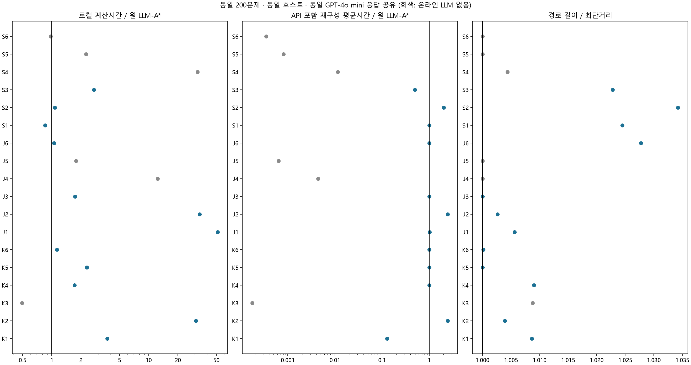

# 동일 조건 18개 방법군 비교 결과

2026-10-28 (Asia/Seoul), jy. 기존 브랜치 결과의 비율을 합치지 않고 모든 행을 같은 PC·200문제에서 새로 측정했다.
온라인 LLM은 gpt-4o-mini-2024-07-18. 같은 수집에서 얻은 응답을 방법 간 공유하고, API 지연을 각 방법의 논리 호출량에 따라 부과했다.
동적 경유점 생성은 보류했다. 팀 제출 알고리즘/기존 Proposed는 변경하지 않았다.

## 속도 판정

- 온라인 LLM을 사용하는 조건 중 전체 평균 지연 최저: **K1_exact**.
- 온라인 LLM+최단성 보장 조건 중 최저: **K1_exact**.
- 모든 문제에서 LLM을 적어도 한 번 호출하는 조건 중 최저: **S1_gate**.
- 모든 문제에서 LLM 호출+최단성 보장 조건 중 최저: **K4_exact**.

위 판정은 성공률 100%인 조건의 **문제별 재구성 총지연 산술평균**이다. 모든 방법이 같은 경로 품질을 보장하는 것은 아니므로 품질 표와 함께 본다. 원 LLM-A*가 이기는 경우도 그대로 표시한다. K6 w=1은 안내 항이 0이므로 유효한 LLM 기여 후보에서 제외했다.

## 결과 해석

K1_exact의 총평균은 원 LLM-A* 대비 87.32% 감소했다. 문제당 호출 0.90회, 출력 9.86토큰으로 원 응답의 608.86토큰보다 짧다. 그러나 규칙 대조와 200/200문제의 순위, 200/200문제의 경로와 200/200문제의 확장 수가 같다. 이번 속도 개선을 LLM 판단의 우수성으로 해석할 수 없다. 규칙 대조는 API 없이 같은 경로를 더 빨리 반환한다.

매 문제 긴 standard 응답을 받는 조건은 API 대기가 지배하여 사실상 비슷한 총시간이다. S1_gate의 수치상 최소값은 원 LLM-A*보다 약 0.006% 빠른 수준이며 실용적인 대기시간 개선으로 주장하지 않는다. 매 문제 호출하는 정확 조건 K4_exact와 J3의 차이도 약 0.05ms여서 일반적인 서비스 속도 순위를 확정할 근거가 아니다.

S3는 호출을 0.47회/문제로 줄여 총평균을 약 절반으로 낮췄지만 최단성 보장은 없다. K2/J2의 3회 호출과 S2의 추가 수정은 이번 조건에서 대기시간을 늘렸다. K2 보정 집합은 152/200문제에서 전체 자유 공간을 포함해 안내 구분력이 사라졌다. 안내를 제거한 대조와 함께 봐야 하며 탐색 확장 수 감소만으로 전체 개선을 주장하지 않는다.

## 18개 primary: 시간·호출 비용

| ID | 방법 | 호출/문제 | 입력/출력 토큰/문제 | 로컬 평균 ms | 재구성 총평균 s | 총평균/원 LLM-A* | 총시간 GM 비율 [95% CI] |
|---|---|---:|---:|---:|---:|---:|---|
| K1 | 통로 ID 선택 | 0.900 | 250.2/9.9 | 8.758 | 0.8323 | 12.70% | 8.36% [4.50, 12.92] |
| K2 | Conformal | 3.000 | 2365.4/1520.2 | 72.013 | 16.1905 | 247.14% | 256.04% [247.26, 265.72] |
| K3 | 벽 하한 g+2h | 0.000 | 0.0/0.0 | 1.153 | 0.0012 | 0.02% | 0.01% [0.01, 0.01] |
| K4 | LLM FOCAL 1.05 | 1.000 | 587.8/608.9 | 4.008 | 6.5529 | 100.03% | 100.03% [100.02, 100.04] |
| K5 | MHA*+DTS 1.05 | 1.000 | 587.8/608.9 | 5.369 | 6.5542 | 100.05% | 100.05% [100.04, 100.06] |
| K6 | 적응 α 1.05 | 1.000 | 587.8/608.9 | 2.650 | 6.5515 | 100.00% | 100.01% [100.00, 100.01] |
| J1 | CHOMP+LLM | 1.000 | 587.8/608.9 | 120.209 | 6.6691 | 101.80% | 101.98% [101.21, 102.96] |
| J2 | FMM+LLM | 3.000 | 2365.4/1520.2 | 78.205 | 16.1967 | 247.23% | 256.14% [247.36, 265.83] |
| J3 | LLM 초기 해+정확 BB | 1.000 | 587.8/608.9 | 4.061 | 6.5529 | 100.03% | 100.03% [100.02, 100.04] |
| J4 | ALT4 | 0.000 | 0.0/0.0 | 28.941 | 0.0289 | 0.44% | 0.47% [0.45, 0.49] |
| J5 | NBS octile | 0.000 | 0.0/0.0 | 4.170 | 0.0042 | 0.06% | 0.05% [0.04, 0.06] |
| J6 | lazy OPEN | 1.000 | 587.8/608.9 | 2.462 | 6.5513 | 100.00% | 100.00% [100.00, 100.01] |
| S1 | 경유점 정제 | 1.000 | 587.8/608.9 | 1.999 | 6.5509 | 99.99% | 99.99% [99.99, 100.00] |
| S2 | 오류 피드백 수정 | 1.935 | 1774.9/1259.9 | 2.510 | 13.3224 | 203.36% | 202.43% [197.48, 207.90] |
| S3 | 정체 시 호출 | 0.470 | 276.4/294.0 | 6.370 | 3.2402 | 49.46% | 1.44% [0.73, 2.67] |
| S4 | 소형 TransPath | 0.000 | 0.0/0.0 | 74.766 | 0.0748 | 1.14% | 0.40% [0.23, 0.73] |
| S5 | 정확 직사각형 압축 | 0.000 | 0.0/0.0 | 5.281 | 0.0053 | 0.08% | 0.04% [0.03, 0.06] |
| S6 | 장애물 단계 반영 | 0.000 | 0.0/0.0 | 2.276 | 0.0023 | 0.03% | 0.02% [0.02, 0.03] |

원 LLM-A*: 로컬 평균 2.339ms, 재구성 총평균 6.5512s, 호출 1회/문제.
조건부 호출은 0회인 문제에서 시간 비율이 매우 작아 기하평균 감소가 크게 보일 수 있다. 기하평균 감소를 평균 대기시간 감소로 바꾸어 말하지 않는다. 위 표는 산술평균과 GM을 모두 제시했다.

## 경로 품질·계산량·메모리

| ID | 유효율 | 최단 일치율 | 길이/최단 GM | 최대 길이/최단 | 비용 보장 | 검색 이웃 확장 평균 | 저장 상태 평균 | RSS peak MiB† |
|---|---:|---:|---:|---:|---|---:|---:|---:|
| K1 | 100.0% | 72.0% | 100.865% | 104.989% | ≤1.05C* | 226.2 | 262.7 | 60.54 |
| K2 | 100.0% | 87.5% | 100.390% | 104.805% | ≤1.05C* | 198.8 | 229.7 | 61.27 |
| K3 | 100.0% | 75.5% | 100.877% | 111.096% | 없음 | 71.7 | 139.3 | 55.11 |
| K4 | 100.0% | 72.0% | 100.901% | 104.995% | ≤1.05C* | 152.2 | 206.3 | 55.00 |
| K5 | 100.0% | 100.0% | 100.000% | 100.000% | ≤1.05C* | 151.5 | 243.9 | 55.50 |
| K6 | 100.0% | 98.5% | 100.017% | 101.789% | ≤1.05C* | 117.8 | 205.4 | 55.43 |
| J1 | 100.0% | 82.0% | 100.563% | 104.753% | ≤1.05C* | 199.0 | 227.6 | 61.13 |
| J2 | 100.0% | 90.0% | 100.262% | 104.684% | ≤1.05C* | 189.6 | 223.4 | 61.23 |
| J3 | 100.0% | 100.0% | 100.000% | 100.000% | 최단 | 375.1 | 431.0 | 55.40 |
| J4 | 100.0% | 100.0% | 100.000% | 100.000% | 최단 | 106.1 | 175.8 | 58.21 |
| J5 | 100.0% | 100.0% | 100.000% | 100.000% | 최단 | 210.8 | 297.3 | 55.42 |
| J6 | 100.0% | 48.0% | 102.775% | 130.985% | 없음 | 129.1 | 205.3 | 55.16 |
| S1 | 100.0% | 58.0% | 102.449% | 133.397% | 없음 | 159.4 | 198.4 | 60.52 |
| S2 | 100.0% | 46.0% | 103.424% | 130.985% | 없음 | 194.4 | 228.2 | 55.43 |
| S3 | 100.0% | 60.5% | 102.276% | 130.985% | 없음 | 183.5 | 218.9 | 60.35 |
| S4 | 100.0% | 84.0% | 100.436% | 104.805% | ≤1.05C* | 243.8 | 299.2 | 228.09 |
| S5 | 100.0% | 100.0% | 100.000% | 100.000% | 최단 | 98.2 | 194.5 | 60.40 |
| S6 | 100.0% | 100.0% | 100.000% | 100.000% | 최단 | 232.9 | 260.8 | 59.98 |

† RSS는 별도 동일 10문제에서 방법마다 새 프로세스를 띄운 1ms 명목 간격 표본 peak다. Python·응답 캐시·라이브러리·모델 상주분 포함이며 순수 알고리즘 할당량/순간 peak가 아니다. 저장 상태 수도 각 엔진의 g 정의이며 그래프/거리표/모델을 포함한 메모리 바이트가 아니다.
검색 확장은 query 이웃 확장이다. 압축 그래프 정점/일반 격자 정점 확장은 동일 연산이 아니다. ALT 거리표·FMM 거리장·K1 통로 추출의 준비 비용은 모두 시간에 포함하고 네이티브 카운터를 raw에 남겼다.

## LLM을 사용하는 최단성 보장 조건

| 조건 | 호출/문제 | 로컬 평균 ms | 재구성 총평균 s | 길이/최단 | 비고 |
|---|---:|---:|---:|---:|---|
| K1_exact | 0.900 | 7.173 | 0.8307 | 100.000% | 조건부 호출 |
| K6_exact | 1.000 | 3.318 | 6.5522 | 100.000% | w=1에서 LLM 안내 항 소거; 기여 후보 제외 |
| K4_exact | 1.000 | 4.012 | 6.5529 | 100.000% | 매 문제 호출 |
| J3 | 1.000 | 4.061 | 6.5529 | 100.000% | 매 문제 호출 |
| K5_exact | 1.000 | 5.314 | 6.5542 | 100.000% | 매 문제 호출 |
| J1_exact | 1.000 | 119.752 | 6.6686 | 100.000% | 매 문제 호출 |
| K2_exact | 3.000 | 71.616 | 16.1901 | 100.000% | 매 문제 호출 |
| J2_exact | 3.000 | 77.804 | 16.1963 | 100.000% | 매 문제 호출 |

이 표의 w=1 변형은 새로 측정한 별도 조건이다. 주 방법을 사후에 바꾸어 원 결과를 덮어쓰지 않는다. S1/S2/S3/J6에 이론적 보장 없이 최단이라는 이름을 붙이지 않았다.

## LLM 기여 분리

| 비교 | 로컬 시간 비율 | 재구성 총시간 비율 | 검색 확장 비율 | 해석 |
|---|---:|---:|---:|---|
| K1/K1_rule | 1.0014 | 99.5458 | 1.0000 | 동일 구조의 직접 대조 |
| K1_exact/K1_rule_exact | 1.0013 | 112.3660 | 1.0000 | 동일 구조의 직접 대조 |
| K2/FOCAL0 | 1.1318 | 905.9443 | 1.0000 | 동일 구조의 직접 대조 |
| K4/K4_noLLM | 1.3628 | 3488.7458 | 1.0747 | 동일 구조의 직접 대조 |
| K4_exact/K4_exact_noLLM | 1.2890 | 3217.9626 | 1.0134 | 동일 구조의 직접 대조 |
| K5/K5_noLLM | 1.4442 | 2418.9033 | 1.0015 | 동일 구조의 직접 대조 |
| K6/K6_noLLM | 1.1989 | 4135.7497 | 1.0400 | 동일 구조의 직접 대조 |
| J1/J1_straight | 0.9924 | 73.9671 | 0.9650 | 동일 구조의 직접 대조 |
| J2/J2_uniform | 1.0667 | 561.3682 | 1.0216 | 동일 구조의 직접 대조 |
| J3/J3_noLLM | 1.2850 | 2936.6774 | 1.2178 | 동일 구조의 직접 대조 |
| J6/J6_full | 0.9925 | 1.0000 | 1.0000 | 동일 구조의 직접 대조 |
| S4/S4_untrained | 0.9934 | 0.9934 | 1.1753 | 동일 구조의 직접 대조 |
| S1/S1_gate | 1.0316 | 1.0000 | 0.9693 | 동일 구조의 직접 대조 |

LLM 제거 시 API 대기도 없어지므로 총시간뿐 아니라 검색과 로컬 계산의 변화도 확인한다. J6/full은 양쪽 모두 LLM을 쓰는 동일 확장 순서의 큐 비교다. S4/untrained는 학습 효과이며 LLM 효과가 아니다.

## 조건·한계

상세 설계와 구현 조정은 PROTOCOL.md 및 IMPLEMENTATION_NOTES.md를 참조한다.

- 신규 API 요청 1,567회, 입력 1,234,969 / 출력 757,532토큰. finish_reason=length 127건도 삭제·재생성 없이 사용했다. 교정·fallback 및 호출 비용은 그대로 반영했다.
- 동일 test 20지도×10쌍=200문제. 호스트·입력·충돌·이동 비용·응답을 공유하고 학습/보정 지도와 분리했다.
- 모든 온라인 LLM은 같은 GPT-4o mini snapshot과 수집 기간을 사용했다. standard/CoT/RePE 및 수정·ID 순위 프롬프트는 방법 특성에 따라 다르다. 필요한 응답 수 차이는 비용에 포함했다.
- CPU/native thread1, 로컬 시간3회 반복. K5 계열3시드는 문제 안에서 평균하며 독립 지도 수를 늘리지 않는다.
- API는 한 번 수집해 공유한다. 총시간은 같은 수집의 API 대기와 현재 로컬 측정의 합이며 각 방법을 온라인으로 반복 운영한 실측이 아니다. 3프롬프트는 순차 운영을 가정했다.
- 기본 응답 수집 뒤 이에 의존하는 수정·순위 응답을 수집했다. 같은 수집 기간에도 서비스 부하와 system fingerprint가 달라질 수 있으며, API 지연의 반복 불확실성은 이번 bootstrap에 포함되지 않는다.
- 모델은 메모리에 상주하고 warm-up 후 측정했다. 로딩·warm-up은 별도다. S4는 기존 seed11 checkpoint를 CPU로 사용했고 재학습하지 않았다.
- 95% 구간은 지도 bootstrap2000회의 탐색적 구간이며 다중 비교 보정이 없다. 공개 자료는 연구 전체에서 미관측인 hidden holdout이 아니다.
- 45조건 모두 같은 실행 블록에서 재측정했지만 네이티브 탐색 엔진은 다르다. 구성요소 기여는 같은 엔진의 제거 대조로 확인한다.
- S2의 추가 수정 효과와 구체적인 피드백 문구 자체의 효과는 다르다. 이번에는 동일 호출수의 일반 재검토 대조를 추가 수집하지 않았으므로 후자의 인과 효과는 미확인이다.
- S2는 공통 경로 검증기의 오류와 첫 충돌 구간을 전달하는 통합 변형이다. 기존 SM의 장애물 식별 피드백 문구를 바이트 단위로 재현한 조건은 아니다.

## 재현 자료

[실행 규약](../../PROTOCOL.md), [구현 조정 기록](../../IMPLEMENTATION_NOTES.md), [전체 수치](summary.json), [문제별 CSV](per_case.csv), [원시 반복](evaluations.jsonl.gz), [요청·응답](generations.jsonl), [독립 검증](audit.json).

사용자 지시에 따라 Codex가 구현 통합·실행·검증·집계 작성을 지원했다. 기존 gm/sm 구현의 출처와 변경은 SM_PROVENANCE.json 및 코드에 남겼다. 사람별 실제 기여를 추정하지 않으며 main/제출용 Proposed는 변경하지 않는다.
