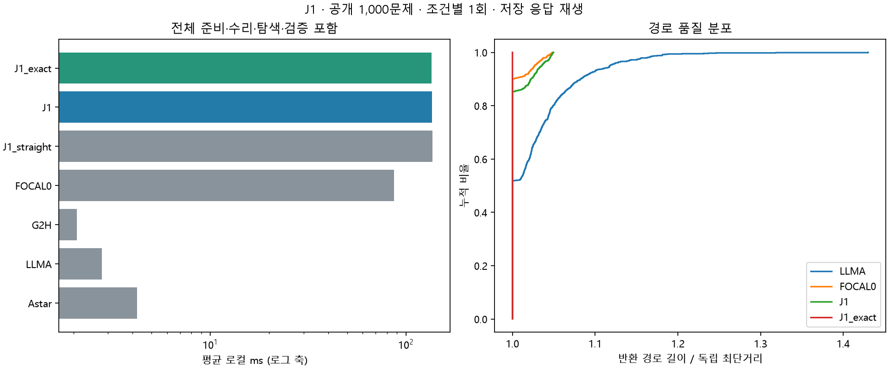

# J1 전체 공개 데이터셋 1회 평가

2026-11-11 · jy · 공개 100지도×10쌍=1,000문제, 7조건×1회=7,000회. 이번 평가 대상은 J1뿐이다.
CHOMP-inspired 경로 수리와 격자 FOCAL을 결합한 기존 COMMON18 구현을 재사용했다. 원 CHOMP 논문 전체의 재현 결과가 아니다.

## 결과 판단

**이번 조건에서 J1의 종합적인 효율 개선은 확인하지 못했다.** 원 LLM-A*보다 경로 품질은 좋아졌으나 준비·수리·탐색을 합친 시간은 증가했다. 로컬 평균은 48.84배, 같은 과거 API 지연을 더한 총평균은 2.45% 증가했다.

같은 5% 보장 FOCAL0는 수리 없이 더 낮은 경로 초과율 GM과 로컬 평균 비용을 보였다. 직선 초기화 대조와 J1의 로컬 시간 GM 구간은 1을 포함해 LLM 초기 경로가 시간을 줄였다는 뚜렷한 근거는 없다. 이번 실행은 단일 반복이므로 작은 시간 차이는 특히 제한적으로 해석한다.

수리 자체의 평균은 48.97ms이고, 전체 로컬 평균은 136.06ms다. 전체 비용을 CHOMP 수리만의 비용으로 돌리지 않는다. NumPy 격자 준비·FOCAL 배열 선택 등의 비용도 포함한다. J1_exact의 최단성은 CHOMP가 아니라 admissible 하한을 사용하는 w=1 탐색·검증 조건에서 나온다.

## 전체 1,000문제

| 조건 | 유효율 | 로컬 평균 ms | 재구성 총평균 s | 길이/최단 GM | 최단 일치율 | 최대 초과율 | 보장 |
|---|---:|---:|---:|---:|---:|---:|---|
| 원 A* | 100.0% | 4.230 | 0.0042 | 100.000% | 100.0% | 0.000% | 최단 |
| 원 LLM-A* | 100.0% | 2.786 | 5.4387 | 102.646% | 51.9% | 43.012% | 없음 |
| 무안내 g+2h | 100.0% | 2.073 | 0.0021 | 102.016% | 63.7% | 43.012% | 없음 |
| 안내 없는 FOCAL 1.05 | 100.0% | 86.723 | 0.0867 | 100.273% | 90.1% | 4.853% | ≤1.05C* |
| 직선 CHOMP+FOCAL 1.05 | 100.0% | 136.542 | 0.1365 | 100.286% | 89.4% | 4.886% | ≤1.05C* |
| LLM CHOMP+FOCAL 1.05 | 100.0% | 136.064 | 5.5720 | 100.429% | 85.3% | 4.973% | ≤1.05C* |
| LLM CHOMP+FOCAL 1.00 | 100.0% | 135.503 | 5.5715 | 100.000% | 100.0% | 0.000% | 최단 |

## J1 직접 대조

| J1 / 대조군 | 로컬 시간 GM 비율 [95% CI] | 확장 GM 비율 | 로컬 개선/동일/악화 문제 |
|---|---|---:|---|
| J1 / LLMA | 52.5376 [44.2594, 62.7299] | 0.5381 | 0/0/1000 |
| J1 / FOCAL0 | 4.1834 [3.5161, 4.8928] | 0.5274 | 0/0/1000 |
| J1 / J1_straight | 0.9868 [0.9712, 1.0011] | 0.7694 | 474/0/526 |

비율은 1 미만일 때 해당 비용이 감소한다. 같은 구조의 직선 초기화 대비가 LLM 초기 경로의 추가 기여를 보는 직접 대조다.
J1의 직접 대조 로컬 시간 GM 비율은 0.9868다. 최단성 보장 변형의 결과는 별도 행이며 주 J1을 대체하지 않는다.
FOCAL0 대비는 CHOMP 준비 전체의 비용·효과를 포함한다. 원 A*/LLM-A*는 탐색 엔진이 달라 구성요소 하나만의 인과 효과로 해석하지 않는다.

## 수리 성공과 계산량

| 조건 | 정규화 초기 경로 유효 | 유효 격자 수리 성공 | 최종 incumbent 직접 반환 | 평균 수리 ms | 평균 반복 수 | 검색 확장 평균 | 저장 상태 평균 |
|---|---:|---:|---:|---:|---:|---:|---:|
| J1 | 56/1000 | 124/1000 | 23/1000 | 48.971 | 152.65 | 227.80 | 261.18 |
| J1_exact | 56/1000 | 124/1000 | 9/1000 | 48.951 | 152.65 | 200.50 | 273.46 |
| J1_straight | 6/1000 | 48/1000 | 13/1000 | 49.675 | 153.65 | 227.49 | 261.84 |

수리 실패여도 최종 FOCAL은 실행된다. 따라서 수리 성공률과 최종 경로 성공률을 구분한다.
J1의 정규화 초기 무효→유효 수리는 70건이며, 초기 유효였으나 수리기가 유효 격자 경로를 보존하지 못한 경우는 2건이다.
수리 실패 시 원래 LLM polyline을 secondary로 계속 쓰는 구현이 아니며, 유효 수리가 없으면 기본 휴리스틱으로 진행한다.
정규화 유효성은 parser 결과에 start/goal 삽입·중복 제거를 적용한 경로의 검사다. 원문 자체의 유효 응답률과 같지 않다.
J1 계열은 배열 기반 FOCAL이므로 heap pop만으로 총 연산량을 나타낼 수 없다. 준비·수리 비용은 로컬 시간에 포함한다.

LLM을 쓰는 LLMA/J1/J1_exact는 모두 문제당 논리 호출1회, 입력 587.08 / 출력 594.67토큰을 동일하게 부과했다. 새 API 호출은0회다.

## COMMON18 test200 부분집합

| 조건 | 로컬 평균 ms | 길이/최단 GM | 최단 일치율 |
|---|---:|---:|---:|
| Astar | 3.896 | 100.000% | 100.0% |
| LLMA | 2.451 | 103.048% | 45.5% |
| G2H | 1.746 | 102.608% | 57.5% |
| FOCAL0 | 70.241 | 100.390% | 87.5% |
| J1_straight | 120.858 | 100.341% | 89.0% |
| J1 | 120.172 | 100.469% | 84.5% |
| J1_exact | 119.696 | 100.000% | 100.0% |

이 200문제는 전체의 부분집합이다. 과거 COMMON18의 새 응답 대신 이번 전체와 같은 2026-10-13 응답을 사용하므로 과거 표와 수치가 달라질 수 있다.

## 실행 범위와 제한

- 각 문제·조건을 정확히1회 실행했다. 추가 반복·시간 중앙값·확률 시드 평균은 없다. CPU/native1스레드, 순서만 고정 seed로 섞었다.
- 기존 GPT-4o mini standard 1,000응답을 요청·입력 SHA와 대조 후 고정했다. 새 API 호출은0회이고 응답 재생 중 네트워크 연결을 차단했다.
- 총시간은 과거 API 대기＋현재 로컬 측정의 재구성 추정이다. 새로운 온라인 서비스 속도나 API 지연 반복 실측이 아니다.
- 파일 읽기·독립 Dijkstra는 타이머 밖이고 지도 준비·파싱·수리·탐색·복원·필수 검증은 타이머 안이다.
- 지도 bootstrap2000회 CI는 문제 구성의 탐색적 불확실성이다. 시간1회와 과거 API 지연의 반복 안정성은 포함하지 않는다.
- 공개 전체는 기존 학습·설정 선택과 평가에 노출된 자료를 포함한다. 전체 결과를 새 hidden test 일반화로 해석하지 않는다.
- 저장 상태·OPEN peak는 논리 개수다. 별도 RSS 측정은 하지 않았으며 실제 메모리 bytes나 총 CPU 연산 수로 표현하지 않는다.
- J1 1.05와 straight 1.05가 직접 대조다. J1_exact와 straight는 w가 달라 직접 기여 대조로 사용하지 않는다.

[사전 규약](../../PROTOCOL.md), [문제별 수치](per_case.csv), [전체 집계](summary.json), [원시 시행](evaluations.jsonl.gz), [저장 응답](responses.jsonl.gz), [실행·소스 기록](protocol.json), [독립 검증](audit.json).

최초 CHOMP-inspired 구현·실험은 승민, 이번 전체 평가·검토는 준연 담당이다. Codex가 실행 통합·검증·문서 작성을 지원했다. 기존 실험은 보존했다.
