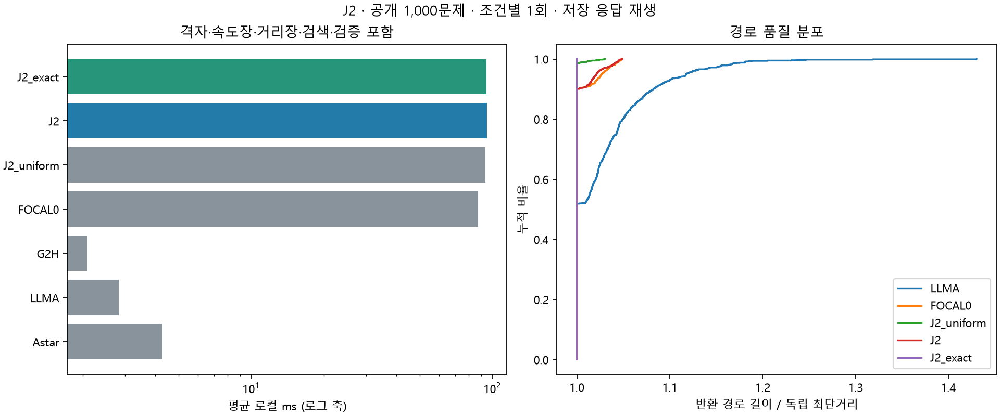

# J2 전체 공개 데이터셋 1회 평가

2026-11-11 · jy · 공개 100지도×10쌍=1,000문제, 7조건×1회=7,000회. 이번 평가 대상은 J2뿐이다.
기존 COMMON18의 Fast Marching 보조 거리장+FOCAL 구현을 변경 없이 재사용했다. J1의 이전 측정값을 이번 대조군으로 쓰지 않았다.

## 결과 판단

**이번 설정에서 J2의 전체 지연 개선은 확인하지 못했다.** 로컬 비용과 논리 호출 비용을 포함한 결과다. 다음 비교는 이번 고정 구현과 저장 응답의 범위로 한정한다.

원 LLM-A* 대비 J2의 로컬 평균 시간 비율은 **33.61배**, 재구성 총평균 시간 비율은 **2.6922배**다. 경로 길이/최단 GM은 102.646%에서 100.238%로 바뀌었다. 경로 품질과 비용을 함께 보고 추가 효용을 판단한다.

같은 FMM의 균일 속도 대조 대비 J2 로컬 시간 GM 비율은 1.0632, 지도 bootstrap95% 구간은 [1.0540, 1.0719]이며 1보다 커 로컬 시간이 증가했다. 이 대조가 LLM에서 유도한 속도장의 추가 기여를 보는 비교다. FOCAL0 대비는 거리장 생성 자체의 비용까지 포함한다.

균일 FMM의 최단 일치율은 98.6%, J2는 90.1%이며, 길이/최단 GM은 각각 100.020%와 100.238%다. LLM 없는 같은 구조의 대조군과 비교해야 일반 FMM 효과와 LLM 안내의 추가 효과를 구분할 수 있다.

J2는 세 프롬프트를 사용해 원 LLMA의1회보다 호출·토큰 비용이 크다. 총시간의 차이를 순수 검색 속도 차이로 해석하지 않는다. J2_exact의 최단성은 FMM 값이 정확하기 때문이 아니라 admissible octile anchor와 w=1 탐색 조건에서 나온다.

## 전체 1,000문제

| 조건 | 유효율 | 로컬 평균 ms | 재구성 총평균 s | 호출/문제 | 길이/최단 GM | 최단 일치율 | 최대 초과율 | 보장 |
|---|---:|---:|---:|---:|---:|---:|---:|---|
| 원 A* | 100.0% | 4.268 | 0.0043 | 0 | 100.000% | 100.0% | 0.000% | 최단 |
| 원 LLM-A* | 100.0% | 2.824 | 5.4388 | 1 | 102.646% | 51.9% | 43.012% | 없음 |
| 무안내 g+2h | 100.0% | 2.091 | 0.0021 | 0 | 102.016% | 63.7% | 43.012% | 없음 |
| 안내 없는 FOCAL 1.05 | 100.0% | 87.516 | 0.0875 | 0 | 100.273% | 90.1% | 4.853% | ≤1.05C* |
| 균일 FMM+FOCAL 1.05 | 100.0% | 93.648 | 0.0936 | 0 | 100.020% | 98.6% | 3.011% | ≤1.05C* |
| LLM FMM+FOCAL 1.05 | 100.0% | 94.926 | 14.6424 | 3 | 100.238% | 90.1% | 4.909% | ≤1.05C* |
| LLM FMM+FOCAL 1.00 | 100.0% | 94.488 | 14.6420 | 3 | 100.000% | 100.0% | 0.000% | 최단 |

## J2 대응 비교

| J2 / 대조군 | 로컬 시간 GM 비율 [95% CI] | 검색 확장 GM 비율 | 로컬 개선/동일/악화 문제 |
|---|---|---:|---|
| J2 / LLMA | 20.3695 [15.7733, 26.8341] | 0.9387 | 3/0/997 |
| J2 / FOCAL0 | 1.6391 [1.5334, 1.7406] | 0.9201 | 14/0/986 |
| J2 / J2_uniform | 1.0632 [1.0540, 1.0719] | 1.0329 | 116/0/884 |

비율은 1 미만일 때 해당 비용이 감소한다. 확장 감소는 전체 CPU 시간 감소와 다르다.
J2와 균일 FMM은 경로가 587/1000문제, 검색 확장 수가 448/1000문제에서 같다.

## 거리장 준비와 비용

| 조건 | FMM 평균 ms | 거리장 heap pop 평균 | update 평균 | accepted 평균 | 검색 확장 평균 | 저장 상태 평균 | 입력/출력 토큰/문제 |
|---|---:|---:|---:|---:|---:|---:|---:|
| J2_uniform | 6.182 | 2570.18 | 2581.05 | 1360.21 | 225.21 | 254.43 | 0.00/0.00 |
| J2 | 6.178 | 2552.64 | 2581.05 | 1360.21 | 225.07 | 256.49 | 2363.24/1561.61 |
| J2_exact | 6.177 | 2552.64 | 2581.05 | 1360.21 | 198.63 | 272.33 | 2363.24/1561.61 |

FMM 시간은 전체 준비 비용의 일부다. 격자 생성·세 응답 파싱·polyline 거리장·속도장 준비도 로컬 전체 시간에 포함했다.
J2의 FMM 평균 6.18ms와 전체 로컬 평균 94.93ms를 구분한다. 전체 로컬 비용을 FMM 계산 하나의 비용으로 돌리지 않는다.
거리장은 cardinal 방향의 1차 Eikonal 해다. 정확한 8방향 최단거리나 admissible heuristic으로 주장하지 않고 FOCAL 보조 순위로만 쓴다.
목표에서 cardinal로 도달하지 못한 거리장 값은 원 구현의 큰 보조 비용으로 정규화하며, anchor의 OPEN 후보는 제거하지 않는다.
거리장 heap 연산·검색 확장·배열 기반 FOCAL 선택은 서로 다른 작업이므로 합산한 하나의 operation 순위를 만들지 않는다.

## COMMON18 test200 부분집합

| 조건 | 로컬 평균 ms | 길이/최단 GM | 최단 일치율 |
|---|---:|---:|---:|
| Astar | 3.949 | 100.000% | 100.0% |
| LLMA | 2.477 | 103.048% | 45.5% |
| G2H | 1.771 | 102.608% | 57.5% |
| FOCAL0 | 71.065 | 100.390% | 87.5% |
| J2_uniform | 77.057 | 100.038% | 98.0% |
| J2 | 78.472 | 100.318% | 88.0% |
| J2_exact | 78.129 | 100.000% | 100.0% |

이200문제는 전체의 부분집합이다. 과거 COMMON18의 새 응답 대신 이번 전체와 같은 2026-10-13 응답을 사용하므로 과거 표와 수치가 달라질 수 있다.

## 실행 범위와 제한

- 문제·조건마다 정확히1회, 추가 반복·중앙값·시드 평균은 없다. CPU/native1스레드, 순서만 고정 seed로 섞었다.
- 기존 GPT-4o mini standard/CoT/RePE 3,000응답을 요청·입력 SHA와 확인 후 고정했다. 새 API 호출0회, 실행 중 네트워크/API 연결을 차단했다.
- 원 LLMA는standard1회, J2/J2_exact는세 응답을 모두 사용한다. 같은 응답의 지연·토큰은 동일하게 부과한다.
- 총시간은 과거 API 지연과 현재 로컬 시간의 합이며, 세 프롬프트의 순차 호출 가정이다. 현재 서비스 실측이나 수집 당시 병렬 벽시계가 아니다.
- 파일 읽기·독립 Oracle·Dijkstra는 타이머 밖이고, 지도 준비·파싱·제안/속도/거리장·검색·복원·필수 검증은 안이다.
- 시간1회와 과거 API 지연의 반복 안정성은 평가하지 않는다. 지도 bootstrap2000회 구간은 문제 구성의 탐색적 불확실성만 나타낸다.
- 공개 전체는 연구에 이미 노출된 자료다. 전체 결과를 새로운 hidden test 일반화로 주장하지 않는다.
- 저장 상태·OPEN peak는 논리 개수다. 이번에는 별도 RSS 측정이 없으며 메모리 bytes나 총CPU 연산으로 표현하지 않는다.
- J2/J2_uniform은같은 w1.05의 직접 대조다. J2_exact와uniform은 w가 달라 직접 성분 대조로 사용하지 않는다.

[사전 규약](../../PROTOCOL.md), [문제별 수치](per_case.csv), [전체 집계](summary.json), [원시 시행](evaluations.jsonl.gz), [저장 응답](responses.jsonl.gz), [실행 기록](protocol.json), [독립 검증](audit.json).

최초 J2 구현·실험은 승민, 이번 전체 평가·검토는 준연 담당이다. Codex가 실행 통합·검증·문서 작성을 지원했다. 이전 결과는 보존했다.
