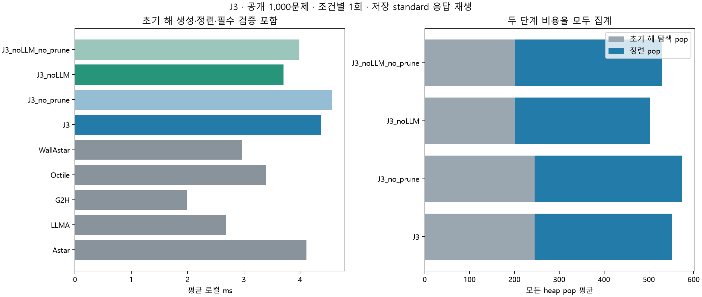

# J3 전체 공개 데이터셋 1회 평가

2026-11-11 · jy · 공개100지도×10쌍=1,000문제, 9조건×1회=9,000회. J3 초기 해 상한 가지치기를 평가했다.
기존 experiments/JY/search.py를 변경 없이 사용했다. 주 J3는 COMMON18과 같은 LLM seed 변형이고 비LLM seed도 별도 비교한다.

## 결과 판단

원 LLM-A* 대비 주 J3의 로컬 평균은 **1.630배**, 재구성 총평균은 **1.000310배**다. 최단 일치율은 51.9%에서 100.0%로 바뀌었다. 최단성 확보와 전체 비용 절감은 별개이므로 단일 정확 탐색과 같은2단계 대조를 함께 본다.

원 LLMA에 추가된 로컬 평균은 1.689ms이며, 같은 API 지연을 포함한 총평균 변화는 +0.0310%다. 이번 고정 응답에서는 지연을 거의 유지하면서 최단성을 추가하는 용도로 해석할 수 있다. 이는 서비스 속도를 새로 반복 측정한 결과나 LLM 자체의 판단 능력 개선을 뜻하지 않는다.

가지치기 구성요소의 이득은 아래 대응 대조에서 확인하되, 단일 정확 탐색보다 빠른 방식으로 확대하지 않는다. LLM 없는 초기 해 대조와의 차이도 있어 좋은 상한을 확보하는 방법의 비용·품질이 중요하다.

LLM이 출력한 좌표를 바로 유효 상한으로 쓰는 방식이 아니다. 원 LLM-A*가 실제 격자 탐색으로 만든 유효 경로를 seed로 얻고, 그 길이를 상한으로 다시 정확 탐색한다. seed 탐색과 파싱·검증도 모두 비용에 포함했다.

## 전체 1,000문제

| 조건 | 유효율 | 로컬 평균 ms | 재구성 총평균 s | 호출/문제 | 길이/최단 GM | 최단 일치율 | 보장 |
|---|---:|---:|---:|---:|---:|---:|---|
| 원 A* | 100.0% | 4.111 | 0.00411 | 0 | 100.000% | 100.0% | 최단 |
| 원 LLM-A* | 100.0% | 2.681 | 5.43864 | 1 | 102.646% | 51.9% | 없음 |
| g+2h | 100.0% | 1.998 | 0.00200 | 0 | 102.016% | 63.7% | 없음 |
| 단일 clean octile A* | 100.0% | 3.398 | 0.00340 | 0 | 100.000% | 100.0% | 최단 |
| 단일 정확 벽 하한 A* | 100.0% | 2.973 | 0.00297 | 0 | 100.000% | 100.0% | 최단 |
| LLM seed+가지치기 | 100.0% | 4.369 | 5.44033 | 1 | 100.000% | 100.0% | 최단 |
| LLM seed+무가지치기 | 100.0% | 4.569 | 5.44053 | 1 | 100.000% | 100.0% | 최단 |
| g+2h seed+가지치기 | 100.0% | 3.707 | 0.00371 | 0 | 100.000% | 100.0% | 최단 |
| g+2h seed+무가지치기 | 100.0% | 3.985 | 0.00399 | 0 | 100.000% | 100.0% | 최단 |

## 구성요소와 단일 탐색 대조

| 개입 / 대조 | 로컬 GM 비율 [95% CI] | 모든 pop GM 비율 | 확장 GM 비율 | 로컬 개선/동일/악화 |
|---|---|---:|---:|---|
| J3 / J3_no_prune | 0.8895 [0.8719, 0.9068] | 0.8408 | 0.8373 | 642/1/357 |
| J3_noLLM / J3_noLLM_no_prune | 0.8226 [0.8007, 0.8438] | 0.7742 | 0.7676 | 711/0/289 |
| J3 / J3_noLLM | 1.2933 [1.2560, 1.3333] | 1.2182 | 1.2378 | 166/0/834 |
| J3 / Octile | 1.2743 [1.2410, 1.3091] | 1.4302 | 1.5568 | 148/0/852 |
| J3 / WallAstar | 1.4203 [1.3695, 1.4725] | 2.0018 | 2.0306 | 155/0/845 |
| J3_noLLM / Octile | 0.9853 [0.9573, 1.0123] | 1.1741 | 1.2577 | 325/0/675 |
| J3_noLLM / WallAstar | 1.0982 [1.0538, 1.1418] | 1.6433 | 1.6405 | 349/0/651 |

비율은1미만이면 해당 비용이 감소한다. 무가지치기2단계 대조와의 차이는 가지치기 성분 효과다. 처음부터 seed를 만들지 않는 단일 A*보다 유리하다는 뜻으로 확대하지 않는다.
J3/J3_noLLM은같은 정확 refinement와 가지치기를 유지하고 초기 해 생성기를 교체한 대조다. LLM의 API 대기를 빼더라도 로컬 비용과 초기 해 품질의 차이를 함께 확인해야 한다.

## 초기 해와 정련 비용

| 조건 | 초기 해가 이미 최단 | fallback | seed 평균 ms | seed 외 로컬 평균 ms | seed pop 평균 | 정련 pop 평균 | 가지치기 이벤트 평균 | 검색 확장 평균 | 저장 상태 합 평균 |
|---|---:|---:|---:|---:|---:|---:|---:|---:|---:|
| J3 | 519/1000 | 0 | 2.568 | 1.801 | 245.17 | 307.06 | 71.59 | 455.50 | 495.65 |
| J3_no_prune | 519/1000 | 0 | 2.574 | 1.995 | 245.17 | 328.55 | 0.00 | 475.92 | 563.40 |
| J3_noLLM | 637/1000 | 0 | 1.881 | 1.826 | 201.35 | 301.31 | 70.77 | 406.00 | 448.74 |
| J3_noLLM_no_prune | 637/1000 | 0 | 1.889 | 2.096 | 201.35 | 328.55 | 0.00 | 432.11 | 527.11 |

seed 외 로컬 시간에는 정확 refinement뿐 아니라 지도·추가 검증·wrapper 비용이 포함된다. 순수 refinement 시간이라고 부르지 않는다.
모든 pop은 seed와 refinement 합계다. 가지치기 이벤트는 후보 거부·상한 종료 기록이며 고유 삭제 노드 수가 아니다. 저장 상태는 두 단계g 항목 합으로 실제 동시 peak bytes가 아니고, 원 코드의 heap peak는 refinement에 한정된다.

## COMMON18 test200 부분집합

| 조건 | 로컬 평균 ms | 길이/최단 GM | 최단 일치율 |
|---|---:|---:|---:|
| Astar | 3.760 | 100.000% | 100.0% |
| LLMA | 2.353 | 103.048% | 45.5% |
| G2H | 1.681 | 102.608% | 57.5% |
| Octile | 3.036 | 100.000% | 100.0% |
| WallAstar | 2.641 | 100.000% | 100.0% |
| J3 | 4.023 | 100.000% | 100.0% |
| J3_no_prune | 4.180 | 100.000% | 100.0% |
| J3_noLLM | 3.263 | 100.000% | 100.0% |
| J3_noLLM_no_prune | 3.560 | 100.000% | 100.0% |

이200문제는 전체의 부분집합이다. 이번에는 전체와 같은 2026-10-13 standard 응답을 사용해 과거 COMMON18의 새 응답과 섞지 않았다.

## 실행 범위와 제한

- 문제·조건별1회, CPU/native1스레드, seed20261111로 순서만 섞었다. 시간 반복·중앙값·확률 시드 평균은 없다.
- 저장 standard1,000응답을 요청·입력·SHA와 확인해 고정했다. 새 API 호출0회이며 실행 중 네트워크/API 연결을 차단했다.
- LLMA/J3/J3_no_prune은논리1회, 다른 조건은0회다. 사용하는 같은 응답에 같은 과거 지연·토큰을 부과했다.
- 총시간은 과거 API 지연+현재 로컬의 재구성 추정이다. 현재 온라인 서비스 반복 실측이 아니다.
- 파싱·준비·seed·refinement·복원·필수 검증은 타이머 안, 파일 읽기·독립 Oracle/Dijkstra는 밖이다.
- 질의/방법 사이 이웃 캐시는 공유하지 않는다. 같은 질의의 seed/refinement 안에서는 기존 코드처럼 재사용하며 seed 비용도 포함한다.
- 공개 전체는 기존 연구에 노출된 자료다. 지도 bootstrap2000회는 구성의 탐색적 불확실성이며 시간/API 반복 변동을 포함하지 않는다.
- 단순 상한 가지치기와 정확 refinement이며 ARA* 전체 구현이나 탐색 상태 전체의 증분 재사용 알고리즘이 아니다.
- 이전 J1/J2/JY 결과를 이번 대조로 합치지 않는다. 별도 RSS 측정은 없으며 논리 상태를 실제 메모리 bytes로 표현하지 않는다.

[사전 규약](../../PROTOCOL.md), [문제별 수치](per_case.csv), [전체 집계](summary.json), [원시 시행](evaluations.jsonl.gz), [응답](responses.jsonl.gz), [실행 기록](protocol.json), [독립 검증](audit.json).

준연 담당 J3의 기존 JY 구현을 재평가했다. Codex가 실행 통합·검증·문서 작성을 지원했고 기존 결과는 보존했다.
