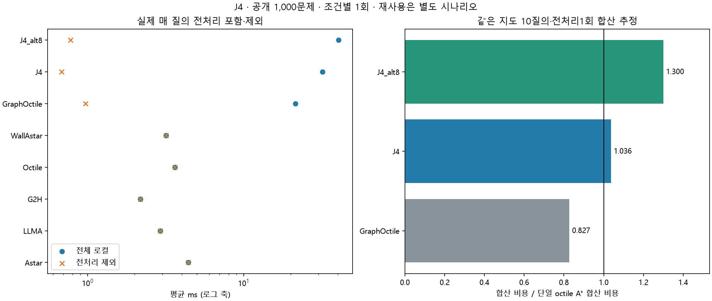

# J4 전체 공개 데이터셋 1회 평가

2026-11-11 · jy · 공개100지도×10쌍=1,000문제, 8조건×1회=8,000회. J4 ALT를 평가했다.
기존 JY LandmarkIndex와 정확 검색을 변경 없이 사용했다. GraphOctile/ALT4/ALT8 전처리를 각 질의에서 실제로 새로 만들었다.

## 결과 판단

**이번 조건에서 전처리 포함 단일 질의의 속도 개선은 확인하지 못했다.** 아래 재사용 시나리오까지 구분해 해석한다.

ALT4의 단일 질의 전체 로컬 평균은 31.877ms이며 단일 octile A*의 **8.789배**다. 전처리를 제외한 나머지 질의 평균은 0.680ms지만 전처리 평균 31.196ms도 실제 비용이다. 검색 절감과 전처리 회수 여부를 구분한다.

같은 지도 첫10질의에 전처리를1회만 합산하는 시나리오에서 ALT4/단일 octile A* 비용합 비율은 **1.0364**다. 이는 아래 정의로 재구성한 비용이며 한 index를 상주시켜 연속 운영한 실측은 아니다.

J4는 온라인 LLM을 쓰지 않는 정확 하한 강화다. 원 LLMA 대비 API 대기가 사라지는 효과를 LLM 안내의 개선으로 해석하지 않는다. 그와 별도로 같은 품질·같은 검색 엔진의 단일 정확 탐색 및 GraphOctile와 비교한다.

## 전체 1,000문제 — 실제 새 전처리

| 조건 | 유효율 | 전처리 평균 ms | 준비 후 평균 ms | 전체 로컬 평균 ms | 재구성 총평균 s | 최단 일치율 | 보장 |
|---|---:|---:|---:|---:|---:|---:|---|
| 원 A* | 100.0% | 0.000 | 4.422 | 4.422 | 0.00442 | 100.0% | 최단 |
| 원 LLM-A* | 100.0% | 0.000 | 2.914 | 2.914 | 5.43888 | 51.9% | 없음 |
| g+2h | 100.0% | 0.000 | 2.179 | 2.179 | 0.00218 | 63.7% | 없음 |
| 단일 clean octile A* | 100.0% | 0.000 | 3.627 | 3.627 | 0.00363 | 100.0% | 최단 |
| 단일 정확 벽 하한 A* | 100.0% | 0.000 | 3.173 | 3.173 | 0.00317 | 100.0% | 최단 |
| 전체 그래프+octile(랜드마크0) | 100.0% | 20.491 | 0.969 | 21.460 | 0.02146 | 100.0% | 최단 |
| ALT4 | 100.0% | 31.196 | 0.680 | 31.877 | 0.03188 | 100.0% | 최단 |
| ALT8 | 100.0% | 39.733 | 0.778 | 40.511 | 0.04051 | 100.0% | 최단 |

준비 후 시간은 전체 로컬에서 실제 전처리만 뺀 값으로, 검색·복원·wrapper 필수 검증도 포함한다. 전처리 없는 방법은 전체 로컬과 같다. 정확 조건의 길이/최단 GM과 최대 초과율은 summary.json에 따로 남겼다.

## 대응 비교

| 개입 / 대조 | 전체 로컬 GM 비율 [95% CI] | 준비 후 GM 비율 | 총 heap pop GM 비율 | query 확장 GM 비율 |
|---|---|---:|---:|---:|
| J4 / Octile | 13.2034 [12.1746, 14.3625] | 0.2506 | 30.1832 | 0.5383 |
| J4_alt8 / Octile | 16.7885 [15.4840, 18.2762] | 0.2910 | 60.1796 | 0.4586 |
| J4 / WallAstar | 14.6982 [13.6584, 15.8536] | 0.2790 | 42.2453 | 0.7021 |
| J4 / GraphOctile | 1.4907 [1.4749, 1.5076] | 0.8071 | 30.1832 | 0.5383 |
| J4_alt8 / GraphOctile | 1.8955 [1.8698, 1.9234] | 0.9371 | 60.1796 | 0.4586 |

비율은 1 미만이면 해당 비용이 감소한다. GraphOctile는 같은 전체 그래프를 만들고 거리표만 제외한다. GraphOctile와 on-demand Octile는같은 확장 순서/경로를 검산하지만 graph 준비·이웃 접근 비용은 다르다.

## 전처리와 검색 작업

| 조건 | 준비 heap pop 평균 | query pop 평균 | 준비 확장 평균 | query 확장 평균 | 거리표 항목 평균 | graph 정점/간선 평균 | query 저장 상태 평균 |
|---|---:|---:|---:|---:|---:|---:|---:|
| GraphOctile | 0.00 | 328.55 | 0.00 | 231.76 | 0.00 | 1360.63/10070.62 | 297.93 |
| J4 | 5612.84 | 128.42 | 5401.49 | 110.92 | 5401.49 | 1360.63/10070.62 | 183.99 |
| J4_alt8 | 11334.00 | 101.31 | 10842.33 | 93.02 | 10842.33 | 1360.63/10070.62 | 167.84 |

총 operation은 준비 heap pop+query pop이다. 준비 heap pop이 0인 GraphOctile도 전체 graph 생성 비용이 있다. 거리표 조회·휴리스틱 계산·graph 생성 비용을 heap pop이 모두 설명하지 않으며, 위 항목 개수는 실제 메모리 bytes가 아니다.

## 전처리1회 재사용 합산 시나리오

| 같은 지도 첫 Q쌍 | GraphOctile / Octile 비용합 | ALT4 / Octile 비용합 | ALT8 / Octile 비용합 |
|---|---:|---:|---:|
| 1 | 5.6077 | 8.2818 | 10.5591 |
| 5 | 1.3947 | 1.8973 | 2.3988 |
| 10 | 0.8273 | 1.0364 | 1.2996 |

공식은 지도별 첫 질의 전처리1회+고정된 첫Q쌍의 준비 후 비용 합이다. 표는100지도의 비용 합끼리 나눈 산술 합산 비율이다. 지도별 대응 기하평균과 bootstrap 구간은 summary.json에 함께 보존했다.
물리적으로는 모든 질의에서 새 index를 생성했다. 같은 지도에서 index 내용이 deterministic하다는 전제와 랜드마크·크기·작업 카운터 일치를 확인해 재사용 비용을 재구성했다. 상주 index의 연속 운영·캐시·파일 로딩 비용을 별도로 실측한 결과가 아니다. 10쌍을 초과하는 손익분기는 추정하지 않는다.

## COMMON18 test200 부분집합

| 조건 | 전체 로컬 평균 ms | 준비 후 평균 ms | 최단 일치율 |
|---|---:|---:|---:|
| Astar | 4.034 | 4.034 | 100.0% |
| LLMA | 2.570 | 2.570 | 45.5% |
| G2H | 1.854 | 1.854 | 57.5% |
| Octile | 3.287 | 3.287 | 100.0% |
| WallAstar | 2.819 | 2.819 | 100.0% |
| GraphOctile | 21.629 | 0.865 | 100.0% |
| J4 | 32.216 | 0.650 | 100.0% |
| J4_alt8 | 41.023 | 0.750 | 100.0% |

이200문제는 전체의 부분집합이며 고유 문제 수에 더하지 않는다.

## 실행 범위와 제한

- 문제·조건별1회, CPU/native1스레드, seed20261111로 순서만 섞었다. 시간 반복 안정성은 평가하지 않는다.
- 실제 새 전처리3,000회, dataset 검색8,000회다. 독립 Oracle/Dijkstra와 휴리스틱 검산은 타이머 밖이다.
- 파싱·전처리·검색·복원·필수 경로 검증은 전체 로컬 안이다. 파일 읽기는 밖이다.
- J4/ALT8/GraphOctile는온라인LLM0회, 원 LLMA 대조만 저장 standard 응답1회다. 새 API 호출0회, 실행 중 네트워크/API 연결을 차단했다.
- 원 LLMA의 총시간은 과거 API 지연+현재 로컬의 재구성 추정이며 현재 온라인 서비스 반복 실측이 아니다.
- 지도 bootstrap2000회는 구성의 탐색적 구간이다. 공개 전체는 기존 연구 노출 자료이고 시간/API 반복 변동은 구간에 포함되지 않는다.
- 논리 저장 상태·거리표 항목을 전체 peak bytes로 표현하지 않는다. 별도 RSS 측정은 없다.
- 기존 J1/J2/J3/JY/COMMON18 측정과 합쳐 순위를 만들지 않았다.

[사전 규약](../../PROTOCOL.md), [문제별 수치](per_case.csv), [전체 집계·재사용](summary.json), [원시 시행](evaluations.jsonl.gz), [실행 기록](protocol.json), [독립 검증](audit.json).

준연 담당 J4를 기존 JY 코드로 재평가했다. Codex가 실행 통합·검증·문서 작성을 지원했고 기존 결과는 보존했다.
