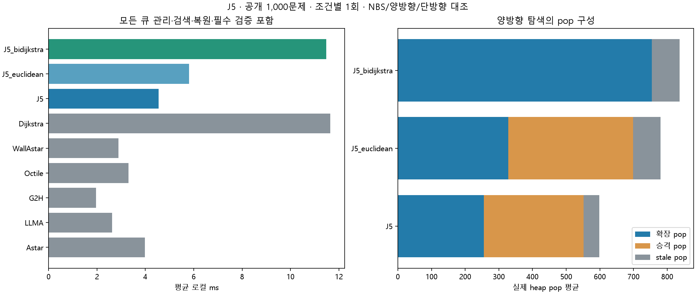

# J5 전체 공개 데이터셋 1회 평가

2026-11-11 · jy · 공개100지도×10쌍=1,000문제, 9조건×1회=9,000회. 기존 JY NBS/양방향 탐색을 변경 없이 평가했다.

## 결과 판단

**이번 조건에서 NBS의 단일 정확 A* 대비 평균 시간 개선은 확인하지 못했다.** 주 J5의 전체 로컬 평균은 4.546ms로 같은 실행의 단일 octile A* 대비 1.379배다. 양방향 검색의 확장과 큐 관리 비용을 모두 포함했다.

평균 검색 확장은 NBS 255.38, 단일 octile A* 231.76이며, NBS의 모든 heap pop은 598.47회다. 전방/후방을 합친 비용과 단방향 비용을 같은 기준으로 본다.

양방향 Dijkstra와 단방향 Dijkstra 비교는 휴리스틱 없는 상태에서 양방향 탐색의 효과를 보는 대조다. 그 이득을 강한 하한을 쓰는 단일 A*와의 우위로 확대하지 않는다. NBS의 확장 관련 이론도 총 heap pop/실행시간의 일정 배수 보장으로 해석하지 않는다.

J5와 그 변형은 온라인 LLM을 쓰지 않는다. 원 LLMA 대조보다 API 대기가 사라지는 효과를 LLM 안내 자체의 개선으로 표현하지 않는다.

## 전체 1,000문제

| 조건 | 유효율 | 로컬 평균 ms | 재구성 총평균 s | 길이/최단 GM | 최단 일치율 | 모든 heap pop 평균 | 검색 확장 평균 | 보장 |
|---|---:|---:|---:|---:|---:|---:|---:|---|
| 원 A* | 100.0% | 3.981 | 0.00398 | 100.000% | 100.0% | 372.00 | 371.00 | 최단 |
| 원 LLM-A* | 100.0% | 2.619 | 5.43858 | 102.646% | 51.9% | 245.17 | 244.17 | 없음 |
| g+2h | 100.0% | 1.962 | 0.00196 | 102.016% | 63.7% | 201.35 | 200.35 | 없음 |
| 단일 clean octile A* | 100.0% | 3.297 | 0.00330 | 100.000% | 100.0% | 328.55 | 231.76 | 최단 |
| 단일 정확 벽 하한 A* | 100.0% | 2.885 | 0.00288 | 100.000% | 100.0% | 224.36 | 175.38 | 최단 |
| 단방향 Dijkstra | 100.0% | 11.652 | 0.01165 | 100.000% | 100.0% | 971.48 | 903.80 | 최단 |
| NBS octile | 100.0% | 4.546 | 0.00455 | 100.000% | 100.0% | 598.47 | 255.38 | 최단 |
| NBS Euclidean | 100.0% | 5.802 | 0.00580 | 100.000% | 100.0% | 780.04 | 327.68 | 최단 |
| 양방향 Dijkstra | 100.0% | 11.485 | 0.01149 | 100.000% | 100.0% | 836.99 | 754.42 | 최단 |

## 대응 비교

| 개입 / 대조 | 로컬 GM 비율 [95% CI] | 모든 pop GM 비율 | 검색 확장 GM 비율 | 로컬 개선/동일/악화 |
|---|---|---:|---:|---|
| J5 / Octile | 1.4640 [1.4111, 1.5133] | 2.1704 | 1.1751 | 217/0/783 |
| J5 / WallAstar | 1.6287 [1.5671, 1.6909] | 3.0377 | 1.5327 | 139/1/860 |
| J5 / J5_euclidean | 0.7517 [0.7387, 0.7645] | 0.7315 | 0.7416 | 965/0/35 |
| J5 / J5_bidijkstra | 0.3214 [0.3020, 0.3421] | 0.5658 | 0.2672 | 994/0/6 |
| J5_bidijkstra / Dijkstra | 0.9534 [0.9309, 0.9769] | 0.8201 | 0.8037 | 541/0/459 |
| J5_euclidean / Octile | 1.9476 [1.8776, 2.0150] | 2.9672 | 1.5845 | 99/0/901 |

비율은 1 미만일 때 해당 비용이 감소한다. 전체 평균 시간 비율과 문제별 대응 비율의 기하평균은 구분한다.

## 큐 관리와 양방향 상태

| 조건 | 선택 쌍 평균 | 확장 pop 평균 | 승격 pop 평균 | stale pop 평균 | push 평균 | 재개방 평균 | 전방/후방 g 항목 평균 |
|---|---:|---:|---:|---:|---:|---:|---:|
| J5 | 127.69 | 255.38 | 296.44 | 46.65 | 700.66 | 0.46 | 171.28/172.24 |
| J5_euclidean | 163.84 | 327.68 | 371.20 | 81.16 | 913.72 | 0.01 | 212.65/213.35 |
| J5_bidijkstra | — | 754.42 | 0.00 | 82.56 | 929.41 | 0.00 | 422.22/417.87 |

양방향 Dijkstra는 NBS 쌍 선택을 하지 않으므로 쌍 수는 해당 없음이다. NBS의 operation=expansions+promotions+stale_pops, expansions=2*pairs를 원시 시행별로 검산했다.
storage는 전방/후방g 항목 합이다. 같은 정점이 양쪽에 있으면 두 번 세며 고유 정점수나 실제 peak bytes가 아니다. 원 코드 heap peak는 반복 경계에서 관측한 논리 큐 항목 수다.

## COMMON18 test200 부분집합

| 조건 | 로컬 평균 ms | 모든 pop 평균 | 검색 확장 평균 | 최단 일치율 |
|---|---:|---:|---:|---:|---:|
| Astar | 3.653 | 326.26 | 325.26 | 100.0% |
| LLMA | 2.308 | 203.20 | 202.20 | 45.5% |
| G2H | 1.649 | 161.14 | 160.14 | 57.5% |
| Octile | 2.992 | 271.45 | 202.38 | 100.0% |
| WallAstar | 2.581 | 188.80 | 150.73 | 100.0% |
| Dijkstra | 11.452 | 942.22 | 874.50 | 100.0% |
| J5 | 3.826 | 491.43 | 210.81 | 100.0% |
| J5_euclidean | 5.156 | 676.99 | 285.06 | 100.0% |
| J5_bidijkstra | 11.138 | 795.67 | 718.99 | 100.0% |

이200문제는 전체의 부분집합이다. 과거 결과와 합산하거나 고유 문제 수에 더하지 않는다.

## 실행 범위와 제한

- 문제·조건별1회, CPU/native1스레드, seed20261111로 순서만 섞었다. 시간 반복·중앙값·확률 시드 평균은 없다.
- 기존 JY NBS/양방향 코드를 그대로 사용하고 단방향 Dijkstra는 같은 clean astar 엔진의 h=0 대조로 실행했다.
- 작은 fixture에서 쌍 전수 대조를 수행하고 기존35개 무작위 소형 지도×3조건의 reference/최단성 검사를 통과했다.
- 본 시간 측정에서는 audit=False다. Cartesian frontier 검산의 추가 비용을 본 알고리즘 시간에 포함하지 않았다.
- 파싱·지도 준비·모든 큐 관리·쌍 선택·승격·검색·복원·필수 경로 검증은 로컬 안이고 파일 읽기·독립 Oracle/Dijkstra는 밖이다.
- 원 LLMA만 저장 standard1,000응답을 재생해 논리1회/문제다. 다른 조건은 온라인LLM0회이며 새 API 호출은0회다. 실행 중 네트워크/API 연결을 차단했다.
- LLMA 총시간은 과거 API 지연+현재 로컬의 재구성 추정이며 현재 서비스 반복 실측이 아니다.
- 공개 전체는 기존 연구 노출 자료다. 지도 bootstrap2000회는 구성의 탐색적 구간이며 시간/API 반복 변동을 포함하지 않는다.
- 논리 상태를 실제 메모리 bytes로 표현하지 않으며 별도 RSS 측정은 없다. 이전 J1~J4/JY의 시간과 합산하지 않는다.

[사전 규약](../../PROTOCOL.md), [문제별 수치](per_case.csv), [전체 집계](summary.json), [원시 시행](evaluations.jsonl.gz), [실행 기록](protocol.json), [소형 검증](preflight.json), [무작위 검사](unit_tests.json), [독립 검산](audit.json).

준연 담당 J5의 기존 JY 구현을 재평가했다. Codex가 실행 통합·검증·문서 작성을 지원했고 기존 결과는 보존했다.
