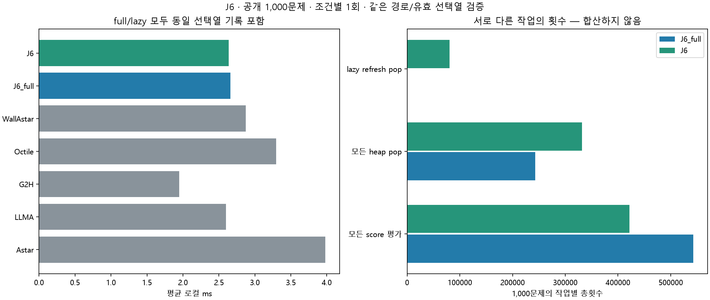

# J6 전체 공개 데이터셋 1회 평가

2026-11-11 · jy · 공개100지도×10쌍=1,000문제, 7조건×1회=7,000회. 기존 JY full/lazy 구현을 변경 없이 평가했다.

## 결과 판단

**이번1회 측정에서 로컬 시간 감소가 관측됐다.** 지연 갱신/full의 문제별 로컬 시간 GM 비율은 0.99008, 지도 bootstrap95% 구간은 [0.98615, 0.99403]다. 전체 재계산과 지연 갱신의 유효 선택열·경로·확장은1,000쌍 모두 같았다.

총 score 평가 횟수는 543,034→422,010로 22.29% 감소했지만, lazy refresh pop이 80,601회 추가됐다. 우선순위 계산 감소와 큐 관리 증가를 실제 시간과 함께 판단한다.

두 방식 모두 같은 저장 경유점·parser·1e-9 정수 키·동률·closed 규칙을 쓴다. 원 LLMA와는 stale-g 처리와 우선순위 표현도 달라 원 LLMA 대비 전체 차이를 J6 갱신 최적화 하나의 효과로 돌릴 수 없다.
full/lazy 둘 다 동일 trace append를 타이머 안에서 수행했다. 같은 선택열의 계측 비용도 포함한 실행이며 미계측 production 성능이 아니다.

## 전체 1,000문제

| 조건 | 유효율 | 로컬 평균 ms | 재구성 총평균 s | 길이/최단 GM | 최단 일치율 | 모든 heap pop 평균 | 확장 평균 | 보장 |
|---|---:|---:|---:|---:|---:|---:|---:|---|
| 원 A* | 100.0% | 3.979 | 0.003979 | 100.000% | 100.0% | 372.00 | 371.00 | 최단 |
| 원 LLM-A* | 100.0% | 2.599 | 5.438563 | 102.646% | 51.9% | 245.17 | 244.17 | 없음 |
| g+2h | 100.0% | 1.950 | 0.001950 | 102.016% | 63.7% | 201.35 | 200.35 | 없음 |
| 단일 clean octile A* | 100.0% | 3.296 | 0.003296 | 100.000% | 100.0% | 328.55 | 231.76 | 최단 |
| 단일 정확 벽 하한 A* | 100.0% | 2.872 | 0.002872 | 100.000% | 100.0% | 224.36 | 175.38 | 최단 |
| 동일 엔진 전체 재계산 | 100.0% | 2.661 | 5.438625 | 102.646% | 51.9% | 242.94 | 158.59 | 없음 |
| 동일 엔진 지연 갱신 | 100.0% | 2.637 | 5.438602 | 102.646% | 51.9% | 331.64 | 158.59 | 없음 |

J6 계열은 최단성 보장이 없다. 같은 경로를 반환하는 것은 full/lazy 동등성이고 최단 경로 보장과는 다르다.

## 갱신 작업과 큐 비용

| 조건 | score 평가 합 | target 변경 합 | stale pop 합 | lazy refresh 합 | 모든 heap pop 합 | heappush 합 | 논리 저장 상태 평균 |
|---|---:|---:|---:|---:|---:|---:|---:|
| J6_full | 543,034 | 5,071 | 83,342 | 0 | 242,936 | 341,409 | 236.90 |
| J6 | 422,010 | 5,071 | 91,443 | 80,601 | 331,638 | 422,010 | 236.90 |

score 평가는 초기 삽입·재삽입까지 포함한다. heappush는실제 해당 함수 호출만 세며 full list 재구성/heapify 항목 전체를 삽입으로 세지 않는다. full의 rebuild 비용은 시간과 score 평가에 반영한다. 서로 다른 카운터를 더해 총 CPU 연산이라고 표현하지 않는다.
trace는 stale/refresh를 제외한 유효 상태 선택열이다. lazy에 추가 pop이 있어도 이 선택열과 경로는 full과 일치한다.

## target 변경 여부에 따른 기술적 부분집합

| 부분집합 | 문제 수 | full 평균 ms | lazy 평균 ms | lazy/full 로컬 GM [95% CI] |
|---|---:|---:|---:|---|
| target_changed | 812 | 2.655 | 2.624 | 0.98746 [0.98330, 0.99172] |
| target_unchanged | 188 | 2.687 | 2.694 | 1.00144 [0.99211, 1.01187] |

변경 여부는 고정 응답·탐색 동작에 따른 기술적 분류다. 전체 결과와 두 부분집합을 함께 제시하며 고유 문제 수를 늘리지 않는다. 변경0인 문제에서는두 방식의 작업 카운터가 같은지도 검산했다. 지도마다 부분집합 크기가 다르므로 bootstrap은 지도별 합·사례 수를 같이 재표집해 사례 가중을 유지했다.

## COMMON18 test200 부분집합

| 조건 | 로컬 평균 ms | 모든 pop 평균 | 최단 일치율 |
|---|---:|---:|---:|
| Astar | 3.666 | 326.26 | 100.0% |
| LLMA | 2.281 | 203.20 | 45.5% |
| G2H | 1.664 | 161.14 | 57.5% |
| Octile | 2.990 | 271.45 | 100.0% |
| WallAstar | 2.564 | 188.80 | 100.0% |
| J6_full | 2.344 | 201.72 | 45.5% |
| J6 | 2.344 | 289.10 | 45.5% |

이200문제는 전체의 부분집합이다. 이전 측정과 합산하지 않았다.

## 실행 범위와 제한

- 문제·조건별1회, CPU/native1스레드, seed20261111로 순서만 섞었다. 시간 반복 안정성을 확인한 결과가 아니다.
- 저장 standard1,000응답을 요청·입력·SHA와 확인 후 고정했다. 잘린 응답도 제외하지 않았다. 새 API 호출0회, 실행 중 네트워크/API 연결을 차단했다.
- LLMA/full/lazy는각각 같은 응답을 논리1회씩 사용한다. 과거 지연·토큰도 같은 값으로 부과한다.
- 총시간은 과거 API 지연+현재 로컬의 재구성 추정이며 현재 온라인 서비스 반복 실측이 아니다.
- 파싱·준비·모든 갱신/큐 관리·검색·선택열 기록·복원·필수 검증은 로컬 안이다. 파일 읽기·독립 Oracle/Dijkstra·trace 해시/대조는 밖이다.
- 새 경유점을 생성하지 않고 정적 목록 안에서 현재 target를 바꾸는 기존 규칙이다. 동적 생성이나 재호출 실험을 재개하지 않았다.
- 공개 자료는 기존 연구에 노출됐다. 지도 bootstrap2000회 구간은 구성의 탐색적 불확실성이며 시간/API 반복 변동을 포함하지 않는다.
- 논리 storage와 heap peak를 실제 bytes로 표현하지 않으며 별도 RSS 측정은 없다. 기존 J1~J5/JY 결과의 절대 시간과 합산 순위를 만들지 않는다.

[사전 규약](../../PROTOCOL.md), [문제별 수치](per_case.csv), [전체 집계](summary.json), [유효 선택열 포함 원시 시행](evaluations.jsonl.gz), [실행 기록](protocol.json), [강제 target 검사](unit_tests.json), [독립 검산](audit.json).

준연 담당 J6의 기존 JY 구현을 재평가했다. Codex가 실행 통합·검증·문서 작성을 지원했고 기존 결과는 보존했다.
