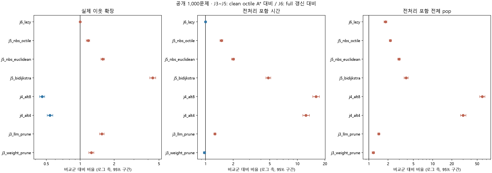
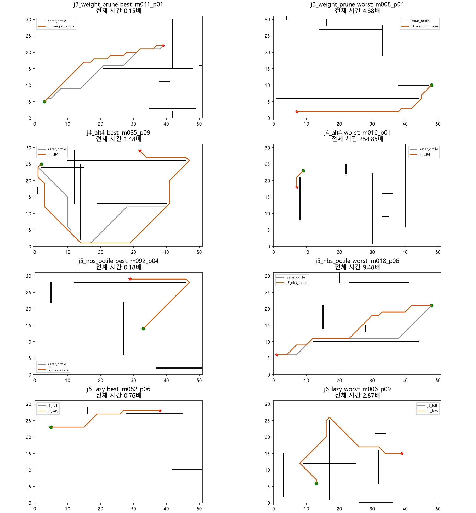

# J3~J6 구현·비교 결과 보고서

2026-10-27 (Asia/Seoul), `jy` 브랜치. 동적 경유점 생성은 보류했다. 기존 gm/sm 문서 형식을 참고해 비교 결과가 확인되지 않았던 네 방법군을 새로 구현했다. 기존 gm c56eb83와 원 로컬 폴더의 코드·동적 결과를 보존했다.

## 결과와 판단

**J3는 조건부 후속 후보이며, J4·J5·J6의 일반적인 효율 개선은 확인하지 못했다.** J3의 가지치기는 동일한 초기 경로를 만드는 무가지치기 2단계 대조군보다 유리했지만, 단일 A*와의 비교는 데이터에 따라 달랐다. 공개 자료의 강한 정확 탐색 대조군인 벽 하한 A*보다도 느렸다. 이번 결과로 팀 최종 제출 알고리즘을 바꾸지는 않는다.

| 방법 | 공개 1,000문제 시간/A* [95% CI] | 기존 별도 30문제 | 새 합성 120문제 | 해석 |
|---|---|---|---|---|
| 정확 벽 하한 A* | 0.8957 [0.8760, 0.9160] | 1.0279 [0.9663, 1.0868] | 1.0693 [1.0249, 1.1154] | 공개 자료의 더 강한 정확 대조군 |
| J3 비LLM 초기 해+가지치기 | 0.9727 [0.9456, 1.0004] | 0.7235 [0.5624, 0.9100] | 0.8460 [0.7642, 0.9288] | 공개 CI에 1 포함; 별도/합성에서 감소 |
| J3 저장 LLM 초기 해+가지치기 | 1.2631 [1.2303, 1.2968] | 1.0644 [0.8540, 1.2833] | 미실행 | 공개에서 증가; 새 합성은 미실행 |
| J4 ALT 4개 | 12.4068 [11.4585, 13.5453] | 14.9041 [8.9369, 24.9413] | 26.9037 [20.3285, 35.8560] | 전처리 포함 단일 질의에서 불리 |
| J4 ALT 8개 | 15.9459 [14.6894, 17.4236] | 17.8718 [10.7457, 29.9855] | 31.4360 [23.6343, 42.1597] | 더 강한 하한이나 준비 비용 증가 |
| J5 NBS octile | 1.4901 [1.4355, 1.5432] | 1.3869 [1.2064, 1.5803] | 1.3259 [1.2140, 1.4485] | 전체 시간·확장 증가 |
| J6 lazy 갱신 | 0.9961 [0.9928, 1.0001] | 0.9888 [0.9697, 1.0076] | 미실행 | J6 full 대비; 시간 이득 불명확 |

시간 비율은 1 미만이면 감소다. J3~J5와 정확 벽 하한 A*는 clean octile A* 대비, J6만 동일 clean engine의 full 갱신 대비다. 서로 다른 분모를 한 순위로 정렬하지 않는다. ALT 시간에는 실제 측정한 지도 전처리를 더했다. 과거 API 지연은 이 표에 포함하지 않았다.

## 실행 범위와 통제

- 공개 100지도×10쌍=1,000문제, 기존 seed=20261013 별도 10지도×3쌍=30문제, 새 seed=20261027 합성 30지도×4쌍=120문제.
- 공개/기존 별도는 18조건×3회, 새 합성은 저장 응답이 없는 5개 LLM 조건을 제외한 13조건×3회. **총 60,300회 실행**, 고유 문제-방법 조건은 20,100개다.
- 새 모델/API 호출 0회. 기존 GPT-4o mini standard 1,030개 응답을 입력·요청 SHA와 확인한 후 재사용했다. 재생을 온라인 추론시간으로 측정하지 않았다.
- 한 Windows 프로세스에서 고정 시드로 방법 순서를 섞어 순차 측정. 문제별 3회 시간 중앙값, 지도 단위 2,000회 bootstrap 탐색적 95% 구간. 다중 비교 보정 없음.
- 공개/기존 별도 자료는 이전 연구에 노출됐으며 hidden holdout이 아니다. 새 합성은 동일 생성기 계열의 제한된 추가 평가다. 설정 선택에 사용하지 않았다.
- 기존 fixture·무작위 쌍 선택 검사와 smoke 7문제를 먼저 통과했다. 공개 pilot 30문제는 고정된 본실험 부분집합이며 별도 독립 표본으로 더하지 않는다.

## J3: 초기 경로 상한 가지치기

초기 유효 격자 경로의 길이를 U로 두고, octile 하한 h₀에 대해 g(n)+h₀(n)≥U인 후보를 제외한다. 초기 경로와 refinement의 계산을 모두 포함한다. 더 작은 g로 도달하면 다시 후보가 될 수 있다. 초기 해는 원 g+2h 또는 원 LLM-A*로 구하며, 정답 경로를 상한으로 주입하지 않는다. ARA* 전체 구현이나 탐색 상태 재사용 알고리즘이라고 부르지 않는다.

공개 자료에서 가지치기/무가지치기 시간은 비LLM 0.8110 [0.7875, 0.8339], LLM 0.8836 [0.8651, 0.9008]였다. 따라서 상한 가지치기 구성요소의 효과는 보였지만 초기 해를 생성하는 2단계 전체의 가치와는 구분해야 한다.

비LLM J3의 단일 A* 대비 공개 pop은 1.1741배, 이웃 확장은 1.2577배로 증가했다. 시간의 작은 감소만으로 확장 절감을 주장할 수 없다. 같은 공개 자료에서 정확 벽 하한 A* 대비 J3 시간은 1.0859배다.

공개 초기 해가 이미 최단인 문제는 비LLM 637/1,000, LLM 519/1,000이다. LLM 초기 경로로 대체한 구성은 공개 자료에서 오히려 느렸다. 과거 API 대기까지 추가되는 배포에서는 이 수치보다 유리해지는 근거가 없다.

## J4: ALT 랜드마크 하한

시작/목표와 무관하게 graph-farthest로 랜드마크를 고르고 각 랜드마크의 실제 격자 최단거리를 계산했다. h=max(octile, max_l |d(l,n)−d(l,G)|). 연결되지 않은 거리표 항은 생략하고 유한한 octile을 유지했다. 전체 합법 그래프 생성, 모든 Dijkstra, 거리표 저장을 준비 비용으로 기록했다.

공개 ALT4의 준비 후 query pop은 A*의 0.4694배이나 준비 pop까지 합치면 30.1832배다. query 절감을 전체 계산 절감으로 해석할 수 없다. Cold 시간은 준비를 질의마다 실제 반복 실행한 값이 아니라 지도·반복별 실제 준비 측정과 각 query 측정의 합이다.

| 동일 지도 첫 Q개 질의 | ALT4 전체 시간/A* 누적 시간 | ALT8 |
|---|---:|---:|
| 공개 Q=1 | 11.8830 | 15.2747 |
| 공개 Q=5 | 2.0539 | 2.6056 |
| 공개 Q=10 | 1.1090 | 1.3906 |

준비를 한 번만 하는 공개 Q=10에서도 종합 시간 이득은 확인하지 못했다. 일부 지도에서 유리한 것과 전체 평균의 유리함은 다르다. 측정하지 않은 더 큰 Q의 손익분기나 임의 신규 지도에서의 우위를 이 표로 보장하지 않는다.

## J5: NBS·양방향 탐색

최초 만남으로 끝내지 않고 양방향 쌍 하한 max(fF,fB,gF+gB)과 현재 유효 연결 경로 비용을 비교한다. NBS는 waiting(f)/ready(g) 네 큐를 사용하며, 최소 하한 쌍에서 최소 g 동률 선택을 구현했다. 추가 대조군은 NBS Euclidean 및 양방향 Dijkstra다. 원래 그래프가 무방향이므로 동일 이웃 함수를 역방향에도 사용한다.

공개 NBS octile은 A* 대비 이웃 확장 1.1751배, 모든 heap pop 2.1704배, 전체 시간 1.4901배다. 기본 A* 하한이 강한 작은 격자에서 쌍 선택과 네 큐의 관리 비용을 회수하지 못했다. 이번 결과는 NBS의 원 논문 도메인 전체를 부정하는 것이 아니다. 2VC 정리도 총 pop/시간의 2배 제한이 아니다.

## J6: metric 하한을 이용한 lazy OPEN 갱신

정적 LLM 경유점 t가 t′로 바뀌면 |d(n,t′)−d(n,t)|≤d(t,t′)이다. 따라서 오래된 우선순위에서 그 변화량을 빼면 새 우선순위의 하한이 된다. 전역 offset으로 하한을 O(1)에 이동하고, 큐 최상단이 현재 epoch가 아니면 정확한 키로 다시 넣는다. g 감소는 버전으로 무효화한다. 단순히 오래된 키로 노드를 확장하는 방식과 다르다.

full과 lazy 모두 stale-g를 건너뛰는 같은 clean engine과 1e-9 정수 키를 사용한다. 원 재현의 중복 확장 엔진과는 다르므로 원 LLM-A* 대비 변화 전체를 J6 효과로 돌리지 않는다. 기존 neighbor 관측 시 경유점 변경 규칙을 유지하며 동적 생성이나 재호출은 없다.

공개 자료에서 경유점 변경이 실제 있었던 문제는 812/1,000이다. 우선순위 평가 합계는 full 543,034회, lazy 422,010회로 22.29% 감소했다. 하지만 lazy refresh pop이 80,601회 추가됐고, pop 비율은 1.8163배다. 시간은 0.9961 [0.9928, 1.0001]로 뚜렷한 이득을 확인하지 못했다. 우선순위 평가 수는 삽입 때의 평가도 포함하며 실제 전체 연산량/시간과 같지 않다.

## 검증·사례·해석 한계

- 60,300개 저장 성공 경로를 독립 정수 선분 교차 그래프로 재검사했고, 정확 조건 40,680회가 Dijkstra 최단거리와 일치했다.
- J6 full/lazy는 공개+기존 별도 1,030문제×3회=3,090쌍에서 상태 pop 열 해시·경로·이웃 확장·storage·target 변경이 일치했다.
- 원 A*/LLM-A*/g+2h는 같은 입력과 저장 결과의 path/length/pop/storage를 대조했다. 초기 fixture의 도달 불가도 구조화된 실패로 처리했다.
- operation은 각 엔진의 실제 모든 heap pop이며 CPU FLOP 수가 아니다. NBS promotion·stale, J6 refresh를 포함한다. legacy duplicate는 실제 이웃 확장을 반복하므로 stale skip과 다르다.
- storage는 검색 g 항목 수다. J3 두 단계 합은 누적 작업량 지표이고 동시 peak 메모리가 아니다. J5는 양방향 합. ALT graph/거리표와 heap peak는 별도 기록이다.
- 전체 성공률 100%는 이 자료에서의 관측이다. 정확 조건 이외에는 최단 보장이 없으며 legacy g+2h와 K3의 짧은 시간은 일부 경로 비용 증가와 함께 읽어야 한다.
- 지도별 최선/최악 시간 비율 사례는 자동 선택한 기술 통계다. 한 문제의 그림으로 평균 효과를 대신하지 않는다. OS 부하를 완전히 격리한 시간 측정은 아니며 수 ms 차이는 제한적으로 해석한다.

대표 사례를 카운터로 보면 J3의 m041_p01은 초기 해 37 pop으로 최단 길이를 얻고 refinement 1 pop에서 하한과 상한이 일치해 종료했다(A* 333 pop). 반대로 m008_p04는 초기 해 생성에만 1,085 pop을 쓴 뒤 refinement 166 pop이 더 필요했다(A* 전체 166 pop). 초기 해 생성이 쉬운지, 비용 하한이 충분히 강한지가 결과를 좌우한다.

ALT4 m016_p01은 query 6 pop으로 A*와 같았는데도 지도 준비가 추가됐다. NBS octile은 m092_p04에서 이웃 확장이 592→86으로 줄었지만 m018_p06에서는 47→394로 늘었다. J6 m082_p06에서는 키 평가가 1,568→389로 줄었으나 m006_p09는 키 평가가 양쪽 1,072회로 같고 lazy에 refresh 92회가 추가됐다. 시간 최선/최악 사례는 반복 중앙값 기준으로 선택했으며 수치 카운터는 결정론적이어서 세 반복에서 동일하다.

## 다음 판단과 직접 설명할 부분

우선 J3의 조건부 이득이 어느 지도 구조와 초기 해 품질에서 나오는지 검토할 수 있다. 이미 공개 결과를 본 뒤 결합법이나 임계값을 바꾸면 별도의 새 프로토콜·새 출력 폴더가 필요하다. J4를 채택하려면 실제 더 많은 반복 질의 조건에서 준비 비용을 회수하는지 확인해야 한다. J5/J6는 이번 설정의 기본 효율 개선안으로 선정할 근거가 부족하다.

설명할 핵심은 J3의 상한/하한과 종료 조건, ALT의 삼각부등식과 준비 비용, NBS의 첫 만남 종료가 안전하지 않은 이유, J6의 오래된 키가 안전한 하한이 되는 이유다. 복잡도·경계 조건·실행 명령은 각 방법 README와 공통 PROTOCOL에 연결했다.

## 출처·재현·기여

- [실행 전 규약](PROTOCOL.md), [구현/검증 이력](DEVELOPMENT.md), [실행 명령](README.md).
- [전체 표](results/run_20261027/analysis/TABLES.md), [환경/소스/입력 해시](results/run_20261027/manifest.json), [독립 audit](results/run_20261027/final_audit.json), [진단 집계](results/run_20261027/analysis/diagnostics.json).
- 원 탐색·Geometry와 K3 하한 및 독립 oracle은 기존 gm 구현과 MIT 원본 코드에서 재사용했다. 그 재사용을 신규 방법 자체의 기여로 세지 않는다.
- [ALT 원 연구](https://www.microsoft.com/en-us/research/publication/computing-the-shortest-path-a-search-meets-graph-theory/), [NBS 원 연구](https://arxiv.org/abs/1703.03868). J3는 표준 branch-and-bound 적용, J6는 metric 하한을 사용한 이 실험의 적용 설계다.
- 사용자 요청에 따라 Codex가 구현·실험 실행·검증·분석·문서 작성을 지원했다. 팀원별 사람의 실제 기여를 추정하거나 개인 기여 보고서를 대신 작성하지 않았다.
- 제출용 adapter/Proposed 연결, 기존 ACL 보고서·PDF·ZIP 변경, main 브랜치 통합은 수행하지 않았다.
