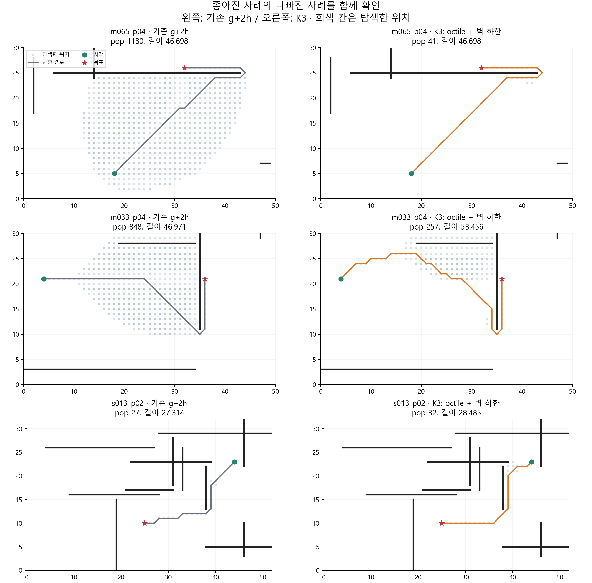

# K3 구현·검증·결과와 선정 메모

2026-10-25 · 규민 담당 · 작업 브랜치 `gm` · 실행 ID `run_20261025`

**공개 1,000문제에서는 K3가 기존 g+2h보다 탐색량을 48.74%, 경로 길이를 0.79%, 실행시간을 22.19% 줄였다. 새 지도 120문제에서는 탐색량은 17.70% 줄었지만 길이는 거의 같고 시간은 14.37% 늘었다.** 따라서 벽 하한은 유망한 구성요소지만 모든 환경에서 더 빠르다고 결론 내릴 수 없다. 아래 감소율은 모두 문제별 비율의 기하평균 기준이다.

비교용으로 둔 **직선거리＋벽 하한**은 사전 지정 주 방법인 **octile＋벽 하한**보다 두 데이터셋의 집계 결과가 더 좋았다. 주 방법을 사후 교체하지 않고 두 결과를 모두 보존했다. 나중에 개선안을 선정할 때 K3 안의 두 구성을 구분해서 판단하면 된다.

## 1. 무엇을 구현하고 어떻게 비교했나

기존 g+2h는 목표까지 직선으로 얼마나 남았는지를 주로 보고 다음 탐색 위치를 고른다. K3는 직선이 벽을 통과하면 벽 끝을 돌아가는 거리도 계산한다. 이를 통해 가까워 보이지만 벽 때문에 접근할 수 없는 곳의 우선순위를 낮출 수 있다. 경유점을 만들거나 특정 끝점을 반드시 통과시키는 방법은 아니다.

직선이 막힌 벽 j의 두 끝점 a, b에 대해 다음 값을 사용한다.

```text
벽 하나의 하한 = min(현재→a→목표의 직선거리 합, 현재→b→목표의 직선거리 합)
K3 거리 h     = max(장애물 없는 8방향 거리, 각 벽의 하한)
탐색 우선순위 = g + 2h
```

벽별 값을 합하면 같은 우회를 중복 계산할 수 있어서 최댓값을 사용한다. 계산할 때만 다른 벽과 격자 제약을 제거하며, 반환 경로에서는 원래의 8방향 이동·이동 비용 1/√2·벽 접촉 금지를 모두 지킨다. [구체적인 예와 하한 설명](README.md#하한이-되는-이유와-보장의-범위)을 참고하면 된다.

공통 탐색 엔진에서 h만 교체했다. 가중치 2, 큐 동률 처리, 중복 pop, CLOSED의 재개방 금지, 종료 조건과 경로 검증은 그대로다. 아래 5가지를 실행 전에 고정했다.

| 조건 | 바꾼 내용 | 알아보려는 점 |
| --- | --- | --- |
| 기존 A* | g+h, 직선거리 | 최단경로와 원 재현의 기준 |
| 기존 g+2h | g+2h, 직선거리 | 이번 개선의 핵심 비교 대상 |
| octile만 적용 | h를 장애물 없는 8방향 거리로 교체 | 벽 정보 없이 거리 공식만 바꿔도 좋아지는가 |
| 직선거리＋벽 하한 | 기존 직선거리와 벽별 하한의 최댓값 | 벽 정보의 효과만 추가하면 어떤가 |
| K3: octile＋벽 하한 | octile과 벽별 하한의 최댓값 | 사전에 정한 주 방법 |

LLM/API 호출, 모델 변경, 학습, 파라미터 성능 튜닝은 없었다. 비가중 `g+h_K3`는 하한과 탐색의 정확성 검사용으로 별도 실행했고, 주 방법의 성능으로 섞지 않았다.

## 2. 단계별 과정과 결과

| 단계 | 과정 | 확인된 결과 |
| --- | --- | --- |
| 경계 사례 | 빈 지도, 긴 벽, 역방향 벽, 교차 벽, 경계에 붙은 벽, 길이 0 벽, 시작=목표, 도달 불가, 끝점 접촉, 벽과 같은 직선 위의 우회 검사 | 10종 ×6방법 통과. 도달 불가는 실패로, 동일 시작·목표는 길이 0으로 처리 |
| 독립 기하 검증 | 탐색 코드와 별도로 정수 외적 기반 선분 교차 판정으로 격자 그래프 생성 | 전체 130지도에서 1,548,240개 이동 충돌 판정이 기존 Geometry와 일치 |
| 하한·일관성 검증 | 독립 Dijkstra 거리와 모든 유효 노드의 h 비교, 합법적 간선의 삼각부등식 검사 | 하한성 4,628,643건, 일관성 34,312,932건 통과. 허용 오차 1e-8, 최대 수치 초과는 약 1e-13 |
| 비가중 K3 검증 | g+h_K3 반환 경로와 독립 Dijkstra 비교 | 공개 1,000개＋합성 120개 모두 최단거리 일치 |
| 파일럿 | 공개 지도 0,10,…,90에서 각 3쌍, 5방법×3회 | 30개 모두 성공. 주 K3의 pop 55.53% 감소. 설정을 수정하지 않고 본실험 진행 |
| 공개 본실험 | 원 재현의 공개 100지도×10쌍, 5방법×3회 | 15,000회 모두 유효. 기존 A*·g+2h의 2,000개 고유 결과는 3회 반복 모두 저장 경로·연산 수·저장량·길이와 일치 |
| 새 지도 평가 | seed=20261025, 30지도×4쌍, 5방법×3회 | 1,800회 모두 유효. 탐색량 개선은 유지되지만 시간 성능은 악화 |

파일럿 450회를 포함해 총 **17,250회 성능 측정**을 보존했다. 파일럿은 본실험의 일부이므로 서로 다른 문제 수는 **1,120개**다. 그림은 6개 조건의 trace를 재생해 만들며, 문서 편집 중 그림을 다시 생성할 때도 원 결과와 경로·지표가 같은지 확인한다. 이런 설명용 재생은 성능 집계에 넣지 않는다.

새 지도는 크기 (32,22), (52,32), (72,42)와 축별 벽 수 4·6·8을 고정 규칙으로 순환했다. 무효 끝점·동일 좌표·연결되지 않은 쌍 등은 제외 건수를 기록했다. 이 평가는 새로운 선분 장애물 지도에서의 확인이며 모든 종류의 미로나 로봇 환경을 대표하지 않는다.

## 3. 공개 1,000문제 결과

아래는 **기존 g+2h=100**으로 정규화한 문제별 비율의 기하평균이다. 낮을수록 좋다. 모든 방법은 1,000/1,000문제에서 유효 경로를 반환했다.

| 방법 | 탐색량(pop) | 저장량(g 사전) | 경로 길이 | 총시간 |
| --- | ---: | ---: | ---: | ---: |
| 기존 A* | 291.41% | 177.83% | 98.02% | 264.55% |
| 기존 g+2h | 100.00% | 100.00% | 100.00% | 100.00% |
| octile만 적용 | 96.65% | 99.48% | 100.30% | 104.32% |
| 직선거리＋벽 하한 | **48.19%** | **73.72%** | **98.83%** | **71.94%** |
| K3: octile＋벽 하한 | **51.26%** | **75.68%** | **99.21%** | **77.81%** |

주 방법 K3는 pop을 약 절반으로 줄였고 길이도 조금 짧아졌다. 벽을 넣지 않고 octile만 바꾼 행의 pop 감소는 3.35%에 그쳤다. 이 비교는 큰 감소가 단순히 8방향 거리 공식을 사용해서만 생긴 결과는 아니라는 근거다.

그렇다고 각 문제에서 둘 다 좋아진 것은 아니다.

| K3 대 기존 g+2h | 개선 | 동일 | 악화 |
| --- | ---: | ---: | ---: |
| 탐색량 | 748 | 201 | 51 |
| 경로 길이 | 236 | 629 | 135 |
| 실행시간 | 519 | 0 | 481 |

탐색량을 줄이면서 경로를 더 길게 만들지 않은 문제는 **643/1,000**개, 둘 다 엄격히 줄인 문제는 **227/1,000**개다. 최단경로를 반환한 문제는 기존 g+2h 637개, 주 K3 742개, 직선거리＋벽 하한 787개다. 모든 문제의 최단경로를 보장한 것은 아니다.

지도 단위 bootstrap 95% 구간은 K3의 pop 비율 **47.91–54.71%**, 길이 비율 **99.00–99.43%**, 시간 비율 **73.87–81.84%**다. 이 구간은 평가한 지도 집합의 변동을 반영하며 별도 하드웨어나 임의의 새 환경에 대한 보장은 아니다.

## 4. 새 지도 120문제 결과

동일하게 기존 g+2h=100이며 전 방법 120/120문제 성공했다.

| 방법 | 탐색량(pop) | 저장량(g 사전) | 경로 길이 | 총시간 |
| --- | ---: | ---: | ---: | ---: |
| 기존 g+2h | 100.00% | 100.00% | 100.00% | 100.00% |
| octile만 적용 | 99.20% | 100.60% | 100.42% | 104.29% |
| 직선거리＋벽 하한 | **79.94%** | **91.12%** | **99.55%** | 107.36% |
| K3: octile＋벽 하한 | **82.30%** | **92.48%** | 100.07% | 114.37% |

K3의 pop은 **52개 개선·60개 동일·8개 악화**, 길이는 **15개 개선·91개 동일·14개 악화**였다. 탐색량이 감소하고 길이가 늘지 않은 문제는 **44/120**개였다.

길이 비율 100.07%의 95% 구간은 **99.53–100.62%**로 100%를 포함한다. 길이가 개선됐다고 결론 내리기 어렵다. pop 비율 구간은 **76.80–87.55%**, 시간은 **108.12–120.10%**였다. 탐색량 감소와 시간 증가를 함께 보고해야 한다.

### 탐색량이 줄었는데 시간이 늘어난 이유

`operation`은 큐에서 후보를 꺼낸 횟수다. 한 후보의 h를 계산하려고 여러 벽을 검사하는 작업은 pop에 더해지지 않는다. K3는 적게 탐색해도 각 후보를 평가하는 비용이 더 크다.

이번 공개 지도는 평균 4.76개 벽, 새 지도는 평균 11.60개 벽이었다. K3의 문제당 벽 검사는 공개 약 **708회**, 새 지도 약 **1,244회**다. 새 지도에서는 탐색량 감소폭도 작아져 벽 검사 비용이 이득을 상쇄할 수 있다.

보조 분석에서 반환 경로·pop·g 사전 크기가 모두 기존과 같은 새 지도 25문제의 K3 시간은 기존의 **138.24%**였다. 이는 탐색 절감이 없는 상황의 추가 비용과 부합한다. 사후에 선택한 하위 집합이고 각 내부 연산을 분리 측정한 것은 아니므로 정확한 비용 원인의 비중까지 단정하지 않는다.

전체 시간의 산술평균과 위 비율을 혼동하면 안 된다. 새 지도에서 문제당 시간 산술평균은 기존 **1.4353ms**, K3 **1.3929ms**로 오히려 작다. 오래 걸리는 일부 문제에서 절약한 시간이 합계에 크게 영향을 주기 때문이다. 반면 각 문제의 상대 변화를 동일하게 반영한 기하평균은 **14.37% 증가**, 개별 문제로는 **94/120개가 느려졌다**. 실행 전에 고정한 대표 지표는 기하평균이며 두 사실을 함께 남긴다.

## 5. 왜 직선거리＋벽 하한이 더 좋았나

octile은 장애물이 없는 8방향 격자에서 직선거리보다 강한 하한이다. 하지만 이번 주 실험은 `g+2h`이고 탐색을 다시 여는 규칙도 원 코드 그대로다. h를 키우면 후보의 우선순위, 먼저 확정되는 경로, 종료 시점이 바뀐다. **더 강한 하한이라는 성질이 가중 탐색의 pop·길이·시간을 모두 개선한다는 뜻은 아니다.**

직선거리＋벽 하한은 공개 지도에서 pop **51.81% 감소**, 길이 **1.17% 감소**, 시간 **28.06% 감소**를 보였다. 새 지도에서는 pop **20.06% 감소**, 길이 **0.45% 감소**, 시간 **7.36% 증가**였다. 공개 지도에서 탐색량·길이가 동시에 나빠지지 않으며 적어도 하나가 좋아진 사례는 이 변형 701개, 주 K3 645개다.

따라서 K3 계열을 후속 후보로 가져간다면 직선거리 기반 변형을 유력하게 볼 이유가 있다. 다만 이것은 결과를 보고 얻은 선택 근거다. 이 변형을 처음부터 유일한 주 가설로 정했다고 서술하거나 새 자료에서의 우월성을 확정하지 않는다.

## 6. 실제 사례로 이해하기

그림은 왼쪽이 기존 g+2h, 오른쪽이 주 K3다. 회색 칸은 탐색한 위치이고 색 선은 최종 경로다. 같은 위치의 중복 pop은 그림에서 겹치므로 숫자가 칸 개수와 다를 수 있다.



- **m065_p04: 큰 이득.** 목표 앞의 긴 가로 벽 주변을 기존 방법이 넓게 탐색했다. K3는 벽의 오른쪽 끝으로 돌아가는 비용을 반영해 pop **1,180→41**, 길이 **46.698→46.698**이었다. 중복을 뺀 서로 다른 위치도 **617→41**로 줄었다. 단순히 중복 집계만 줄인 효과는 아니다.
- **m033_p04: 탐색량과 경로 품질의 절충.** pop은 **848→257**로 줄었지만 길이는 **46.971→53.456**, 약 **13.81% 증가**했다. K3 경로는 초반에 위쪽으로 갔다가 결국 아래쪽으로 우회한다. 벽 하나씩의 하한은 여러 벽을 연속해서 통과하는 전체 우회 구조를 충분히 설명하지 못하고, 가중 탐색은 이 차이를 최적 경로로 바로잡기 전에 끝날 수 있다.
- **s013_p02: 둘 다 악화.** 새 지도에서 pop **27→32**, 길이 **27.314→28.485**였다. 이 사례는 기존 방법이 이미 적게 탐색할 때 K3가 이득을 보장하지 않음을 보여준다.

첫 사례는 공개 pop 비율이 가장 많이 개선된 문제, 둘째는 공개 길이 비율이 가장 많이 악화된 문제, 셋째는 새 지도 pop 비율이 가장 많이 악화된 문제다. 사후 설명용 예시이며 대표 평균으로 제시하지 않는다. 전체 통계는 선택 없이 모든 문제를 포함한다. 공개 지도 pop의 최대 악화는 별도 사례 m093_p09의 **35→49(+40%)**였고 길이는 같았다. 새 지도 길이의 최대 악화는 s015_p01의 **4.414→5.243(+18.77%)**였다.

## 7. 기존 논문 재현 결과와의 관계

아래 표는 공개 1,000문제에서 **A*=100**으로 환산해 기존 재현 기록과 위치를 비교한 것이다. LLM-A*와 V-Gate는 [기존 결과](../../최신/재현_실험_결과.md)의 저장 수치이고 이번에 모델을 다시 호출하지 않았다. 시간은 서로 다른 실행 기록을 섞어 비교하지 않는다.

| 방법 | A* 대비 pop | A* 대비 길이 | 자료 |
| --- | ---: | ---: | --- |
| 기존 g+2h | 34.32% | 102.02% | 이번 실행에서 기존 결과와 동등성 확인 |
| 기존 LLM-A*, GPT-4o mini Few-shot | 44.85% | 102.65% | 원 재현 저장 결과 |
| 기존 V-Gate | 34.63% | 102.13% | 원 개선 실험 저장 결과 |
| K3: octile＋벽 하한 | **17.59%** | **101.21%** | 이번 신규 실험 |
| 직선거리＋벽 하한 | **16.54%** | **100.83%** | 이번 신규 비교 조건 |

이 결과는 **기하 정보로 탐색을 개선할 수 있다는 근거**다. LLM이 좋아졌다는 근거는 아니다. K3를 LLM 안내와 결합해 최종 개선안으로 쓸 경우에는 K3 단독·기존 LLM-A*·결합 조건을 비교해야 한다. 이번 단계에서 그 결합 실험까지 완료했다고 주장하지 않는다.

## 8. 나중에 방법 하나를 선정할 때의 메모

| 판단 항목 | 현재 판단 |
| --- | --- |
| 후보 유지 여부 | **유지.** 공개 데이터의 탐색량 절감이 크고 별도 지도에서도 pop 감소를 확인 |
| 우선 검토할 변형 | 직선거리＋벽 하한. 결과상 주 K3보다 유리했음을 사후 발견으로 명시 |
| 경로 품질 | 평균은 유지 또는 개선되지만 개별 문제 악화 존재. 길이 제한이 중요하면 후속 K4에서 다룰 가치가 있음 |
| 시간 성능 | 공개에서는 개선, 새 지도에서는 문제별 상대 시간이 악화. 벽이 많거나 원래 쉬운 문제에서 비용 주의 |
| 구현 비용 | 학습·API·모델 설치 없음. 평가한 선분 장애물·정수 8방향 격자에서 간결하게 적용 가능 |
| 정확성 근거 | 독립 그래프·Dijkstra와 전체 하한·간선 조건 검사 통과. 원본 비교군 결과 보존 |
| 추가 메모리 | 기존 storage는 전체 RAM이 아님. 벽 끝점·목표 거리 O(벽 수)를 추가 저장 |
| 미확인 범위 | LLM 결합 효과, 다른 장애물 표현·큰 지도, 다른 장비에서의 시간, 최종 TA 조건 성능 |
| 과제에 쓸 수 있는 결론 | 문제 완화 기반 하한은 이 공개 데이터에서 탐색을 줄였다. 더 강한 하한과 더 좋은 가중 탐색 결과는 동일하지 않았다 |

원 논문 재현 지표와 새 개선 실험을 분리하고, 이 결과만으로 과제 점수나 최종 제출 개선안을 확정하지 않는다. 이후 K4·K5·K6도 동일한 경로 유효성·pop·길이·시간·악화 사례 형식으로 남기면 비교하기 쉽다.

## 9. 측정과 추적 자료

각 문제·방법을 3회 실행해 시간은 중앙값으로 집계했다. 순서는 고정 시드로 섞었다. 총시간에는 Geometry 생성, 끝점 거리 준비, 탐색, 반환 경로 검증을 포함한다. 정답 Dijkstra·파일 입출력·통계는 제외하고 모든 방법은 새 캐시를 사용한다. 벽 검사 카운터의 작은 비용도 포함된 Python 구현 측정이다.

`operation`은 중복 포함 pop, `storage`는 무한 g 항목 포함 사전 크기다. K3 주 방법의 서로 다른 탐색 위치 수 비율도 공개 **58.93%**, 새 지도 **85.72%**로 줄었다. 큐 중복을 그대로 유지한 실험이므로 이를 제거하는 다른 탐색 엔진에서 절감폭이 같다고 가정하지 않는다.

Windows 11, Intel64 Family 6 Model 151, 논리 CPU 12개, Python 3.14.5, NumPy 2.4.6, Matplotlib 3.10.9에서 실행했다. 3회 짧은 측정과 한 장비의 결과이므로 밀리초 시간의 작은 차이는 과도하게 해석하지 않는다. 지도 bootstrap 2,000회는 지도 간 상관을 고려하지만 시간 반복·하드웨어 변동 전체를 추정한 구간은 아니다. 성능·검증 실행기는 약 89초 걸렸으며 문서·그림 작성 시간은 포함하지 않는다.

- [실행 전 규약](PROTOCOL.md), [실행·구현 안내](README.md)
- [모든 조건의 자동 수치표와 절대 평균](results/run_20261025/analysis/TABLES.md)
- [통계 비교 그림](results/run_20261025/analysis/comparison.png)
- [공개 원시 결과](results/run_20261025/public/evaluations.jsonl), [새 지도 원시 결과](results/run_20261025/synthetic/evaluations.jsonl)
- [공개 문제별 CSV](results/run_20261025/public/per_case.csv), [새 지도 문제별 CSV](results/run_20261025/synthetic/per_case.csv)
- [하한·최단거리 검증](results/run_20261025/verify_public/summary.json), [새 지도 검증](results/run_20261025/verify_synthetic/summary.json)
- [실행 환경·코드·데이터 SHA-256](results/run_20261025/manifest.json), [그림·보조 분석 출처](results/run_20261025/analysis/manifest.json)

기존 `results/main`, 원본 `source_code`, 기존 최종 보고서는 변경하지 않았다. K3 신규 코드·분석은 Codex 지원으로 작성했으며 실행 로그와 악화 사례를 함께 보존했다. 작성 내용을 이해하고 최종 보고서의 실제 기여 기록과 일치시키는 것은 별도의 제출 전 확인 사항이다.
