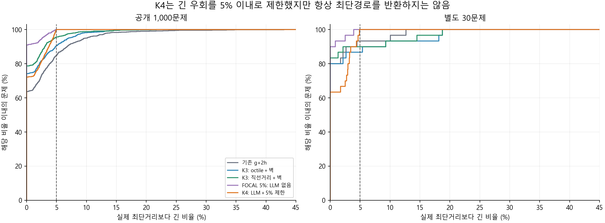
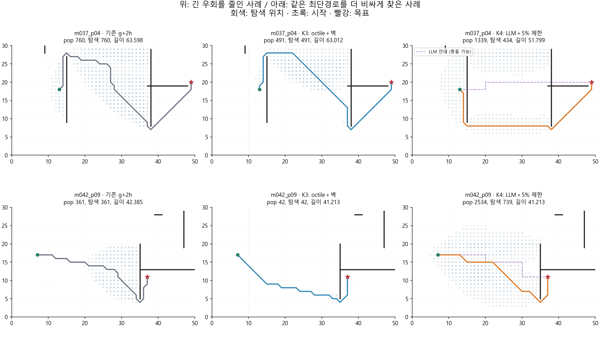

# K4 구현·검증·결과와 선정 메모

2026-10-25 · 규민 담당 · gm · 실행 ID `run_20261025`

**K4는 개별 경로를 최단거리의 105% 이내로 제한하는 데 성공했지만, 이번 LLM 안내 구성은 기존 g+2h와 K3보다 계산 비용이 컸다.** 공개 1,000문제에서 K3 주 방법 대비 경로 길이는 0.35% 짧아졌으나 전체 heap pop은 4.20배, 계획기 시간은 3.33배였다. 비교용 K3 직선거리 변형보다 길이도 약간 길었다. 현재의 성능 우선 후보는 K3로 유지한다.

LLM을 제거한 FOCAL이 LLM을 사용한 주 K4보다 공개 데이터의 pop·길이·시간 집계에서 모두 좋았다. 따라서 이번 결과로 **LLM 안내의 추가 효과를 주장할 수 없다.** 품질 제한을 구현한 성과와 LLM 안내가 탐색을 개선했는지를 별도로 판단한다.

## 1. 구현한 방법을 쉽게 설명하면

K3는 벽을 돌아가는 거리를 고려해서 `g+2h` 값이 가장 작은 위치를 탐색한다. K4는 후보를 두 단계로 고른다.

1. K3 하한으로 `f=g+h0`를 계산하고, OPEN 최솟값 fmin의 1.05배 안에 드는 후보를 모은다.
2. 그 후보들 안에서 LLM이 제시한 꺾은 선을 따라 목표 쪽으로 진행하기 좋은 위치를 고른다.

이를 FOCAL 탐색이라고 한다. 최단경로의 길이가 100이라면 주 설정의 반환 길이는 105 이내여야 한다. LLM이 후보를 추천해도 비용 조건을 통과하지 못하면 선택하지 않는다. 더 짧은 g로 도달하는 경로를 찾으면 이미 탐색한 위치도 다시 연다.

LLM의 좌표 목록은 **실제 이동 명령이나 반드시 지날 경유점**이 아니다. 후보에서 안내 선의 가장 가까운 지점까지 거리와 그 지점부터 안내 선을 따라 목표까지 남은 길이를 더해 FOCAL 내부 순위로 사용한다. 안내 선이 벽을 통과해도 그 선을 따라 실제로 이동시키지 않는다. 최종 경로는 원래의 8방향 이동과 벽 접촉 금지 규칙을 지킨다.

품질 제한은 LLM이 맞는지와 독립적이다. 올바른 하한·OPEN·재개방을 유지할 때 `fmin≤최단거리`이고, 목표를 FOCAL에서 선택하면 `반환 길이≤g(goal)≤1.05·fmin≤1.05·최단거리`이기 때문이다. [구현 설명](README.md)에 점수식과 전제를 자세히 적었다.

## 2. 비교를 어떻게 준비했나

공개 지도는 K3와 같은 **100개 지도×10쌍=1,000문제**다. 추가로 실제 GPT 응답이 이미 있는 **10개 별도 지도×3쌍=30문제**를 사용했다. 이 30문제는 seed=20261013의 기존 generalization 자료이며, **K3 실험의 seed=20261025 새 지도 120문제와 다르다.** 이번 30문제에서도 g+2h와 K3 두 변형을 같은 입력에서 다시 실행했다.

GPT-4o mini `gpt-4o-mini-2024-07-18`, Few-shot/standard의 기존 실제 응답 1,030개를 고정 재생했다. 프롬프트와 요청 SHA-256을 재구성해 입력과 일치하는지 확인했다. 응답을 새로 뽑거나 좋은 것만 골라 쓰지 않았다. 신규 API 호출은 0회다.

다음 12조건을 [실행 전 규약](PROTOCOL.md)에 고정했다.

| 조건 | 실험에서 확인하려는 내용 |
| --- | --- |
| 기존 A* | 최단경로와 기존 재현 기준 |
| 기존 g+2h | 핵심 대조군 |
| K3 octile＋벽 | 이전에 지정한 K3 주 방법과 직접 비교 |
| K3 직선거리＋벽 | K3에서 더 좋은 결과를 보인 변형과 비교 |
| 새 엔진 g+2h0 | stale 제거와 CLOSED 재개방의 효과를 FOCAL 효과와 구분 |
| FOCAL 5%, LLM 없음 | 같은 품질 제한에서 LLM 기여 확인 |
| FOCAL 5%, 시작–목표 직선 안내 | 안내 점수의 기하 계산과 LLM 좌표의 기여 구분 |
| **K4 LLM＋5% 제한** | **사전 지정 주 방법** |
| K4 LLM＋0% 제한 | 최단경로를 요구할 때의 비용 |
| K4 LLM＋10% 제한 | 허용 범위를 넓혔을 때의 변화 |
| K4 LLM＋100% 제한 | 최단거리 2배까지 허용한 민감도 조건 |
| K4 LLM＋5%, 벽 하한 제거 | K3 하한을 함께 쓰는 효과 |

결과를 본 후 주 조건·안내 수식·허용 계수를 바꾸지 않았다. 좋은 대조군을 사후에 주 K4라고 부르지도 않는다.

## 3. 검증과 실행 과정

| 단계 | 과정 | 결과 |
| --- | --- | --- |
| 구현 원리 확인 | FOCAL 비용 제한과 OPEN/재개방 조건을 문헌과 대조 | 일반 FOCAL 틀과 우리 투영 안내를 구분해 구현 |
| 경계 사례 | K3의 빈 지도·긴 벽·역방향 벽·교차 벽·경계 벽·퇴화 벽·시작=목표·도달 불가·끝점·같은 직선 사례 | 10종×안내 4종×비용 제한 4종=160회 통과 |
| 작은 무작위 지도 | seed=20261026, 지도 40개, 안내 3종·제한 3종 | 360회 통과. 독립 기하·Dijkstra로 경로와 제한 확인 |
| 큐와 선택 검증 | 모든 후보를 매번 스캔하는 별도 FOCAL 참조 구현과 경로·선택 순서 비교 | 위 520회에서 일치. 전체 OPEN 선택 감사 6,686회, 작은 지도 하한·간선 검사 74,046회 통과 |
| 특수 동작 | CLOSED 재개방 강제 그래프, admissible하지만 inconsistent한 하한에 의한 fmin 감소 | 재개방·재확장·자격 재구성 확인. 잘못된 계수·끝점·비유한 안내 처리도 통과 |
| 파일럿 | 공개 지도 0,10,…,90의 각 3쌍, 12조건×3회 | 1,080회 성공. 본실험의 일부이며 독립 표본 수에 더하지 않음 |
| 공개 본실험 | 1,000문제×12조건×3회 | **36,000회 유효**, 비용 제한 위반 0회 |
| 별도 지도 평가 | 30문제×12조건×3회 | **1,080회 유효**, 비용 제한 위반 0회 |

총 **38,160회 성능 측정**을 저장했다. 고유 문제 수는 1,030개다. 공개 본실험의 기존 A*·g+2h·K3 두 변형은 3회 반복 모두 이전 K3 저장 결과의 경로·operation·storage·length와 일치했다(12,000건 비교). 별도 30문제의 A*·g+2h도 기존 저장 결과와 일치했다(180건).

FOCAL 계열 7조건의 제한을 각 문제의 독립 최단거리와 비교했다. 파일럿 포함 **22,260건에서 지정한 제한 위반은 0**이었다. 주 K4의 w=1.05도 공개·별도 모든 문제에서 통과했고, w=1.00 조건은 전 문제에서 최단경로를 반환했다.

## 4. 공개 1,000문제의 핵심 비교

**기존 g+2h=100**으로 정규화한 문제별 비율의 기하평균이다. 작을수록 좋다. 시간은 응답이 이미 있는 계획기 시간이고, 모든 행의 유효 경로는 1,000/1,000이다.

| 방법 | 전체 heap pop | 실제 탐색 횟수 | 경로 길이 | 계획기 시간 |
| --- | ---: | ---: | ---: | ---: |
| 기존 g+2h | 100.00% | 100.00% | 100.00% | 100.00% |
| K3 octile＋벽 | **51.26%** | **51.26%** | 99.21% | **77.96%** |
| K3 직선거리＋벽 | **48.19%** | **48.19%** | **98.83%** | **71.99%** |
| FOCAL 5%, LLM 없음 | 202.81% | 103.48% | **98.27%** | 194.10% |
| K4 LLM＋5% 제한 | 215.34% | 110.39% | 98.87% | 259.73% |

K3 주 방법과 비교하면 K4는 전체 pop **4.20배**, 실제 탐색 **2.15배**, 시간 **3.33배**, 길이 **0.35% 감소**다. K3 직선거리 변형과 비교하면 전체 pop **4.47배**, 시간 **3.61배**, 길이 **0.036% 증가**였다.

따라서 평균 길이를 조금 줄이기 위해 지불한 탐색 비용이 컸다. 특히 K3의 더 좋은 변형을 기준으로 보면 길이 집계도 더 좋아지지 않았다.

### 전체 pop과 실제 탐색 횟수를 왜 나눴나

기존 g+2h·K3는 단일 큐에서 꺼낸 횟수를 operation으로 센다. K4에는 OPEN 최소값 확인용 정리, 자격 대기 후보의 승격, FOCAL 선택과 stale 항목 제거가 있다. 이를 빠뜨리지 않도록 **세 heap의 모든 pop을 합산**했다.

공개 K4의 문제당 산술평균은 실제 선택·확장 **183.99회**, 전체 heap pop **516.81회**다. 전체 pop의 구성은 OPEN 172.91회, 대기 후보 149.05회, FOCAL 194.85회다. 이외에도 heap push 850.38회, 재개방 42.36회, 안내 선분 검사 1,312.05회가 있었다. 이런 비용은 시간에도 포함된다.

기존 엔진을 그대로 사용하는 K3의 중복 pop도 실제 이웃 순회를 하므로 실제 탐색 횟수에 포함했다. 새 단일 큐 엔진 g+2h0 대조군은 pop 54.00%, 실제 탐색 50.17%, 길이 99.10%, 시간 92.44%였다. 새 엔진을 썼다는 사실만으로 큰 성능 향상이 생기지는 않았다. FOCAL과 안내 계산의 비용을 별도로 판단해야 한다.

### 개별 문제의 개선·악화

| 주 K4 대 K3 octile＋벽 | 개선 | 동일 | 악화 |
| --- | ---: | ---: | ---: |
| 전체 heap pop | 8 | 12 | 980 |
| 실제 탐색 횟수 | 100 | 94 | 806 |
| 경로 길이 | 214 | 603 | 183 |
| 계획기 시간 | 5 | 0 | 995 |

K3 대비 전체 pop 비율의 95% 구간은 **390.65–452.42%**, 길이 **99.47–99.84%**, 계획기 시간 **320.13–347.18%**다. 지도 단위 bootstrap 구간이며 하드웨어 변동 전체나 다른 지도 분포에 대한 보장은 아니다.

## 5. K4가 얻은 장점: 개별 경로의 긴 우회 제한

평균 길이와 최악의 길이는 다른 기준이다. K4 주 설정의 목적 중 하나는 몇몇 문제에서 크게 돌아가는 경로를 제한하는 것이었다.

| 방법 | 최단거리보다 5% 초과한 문제 | 가장 긴 경로의 최단거리 대비 초과율 |
| --- | ---: | ---: |
| 기존 g+2h | 153/1,000 | 43.01% |
| K3 octile＋벽 | 96/1,000 | 21.65% |
| K3 직선거리＋벽 | 44/1,000 | 21.65% |
| FOCAL 5%, LLM 없음 | **0/1,000** | 4.85% |
| K4 LLM＋5% 제한 | **0/1,000** | 4.99% |

이 부분은 구현 의도대로 작동했다. 그러나 LLM을 뺀 FOCAL도 같은 제한을 지켰다. **이 장점은 FOCAL의 비용 조건과 올바른 탐색 유지에서 생기는 것이며 LLM의 정확성 덕분이라고 해석하지 않는다.**

K4가 K3보다 항상 짧은 경로를 주는 것도 아니다. K3가 이미 최단경로를 찾은 문제에서 K4는 5% 안의 약간 더 긴 경로를 선택할 수 있다. 실제로 K3보다 길어진 공개 문제가 183개 있었다. 최단경로를 반환한 수는 K3 주 방법 742개, K3 직선거리 변형 787개, LLM 없는 FOCAL 910개, 주 K4 722개였다.

## 6. LLM은 도움이 되었나

같은 h0·w=1.05·큐 엔진에서 LLM 안내만 제거한 조건과 비교하면 공개 데이터의 주 K4는 다음과 같다.

- 전체 heap pop **6.18% 증가**, 실제 탐색 **6.68% 증가**.
- 경로 길이 **0.61% 증가**, 계획기 시간 **33.82% 증가**.
- LLM 안내 대신 시작–목표 직선을 같은 투영 점수로 사용한 조건보다도 전체 pop·길이·시간 집계가 나빴다.

좌표 파싱 오류 때문에 LLM을 사용하지 못한 문제는 공개 **116/1,000**개(좌표 schema 29개, 목록 없음 87개), 별도 지도 **3/30**개다. 이 문제들은 LLM 없는 FOCAL과 경로·pop·길이가 정확히 같음을 확인했다. 입력 실패를 성공한 LLM 안내로 세지 않는다.

파싱에 성공한 공개 884개만 따로 확인한 사후 진단에서도 LLM은 LLM 없는 FOCAL 대비 pop **7.02%**, 길이 **0.69%**, 시간 **38.74%**를 더 사용했다. 즉 파싱 실패만 없애면 효과가 생긴다고 주장할 근거도 없다.

이번 안내는 LLM 좌표를 잇는 선의 가까운 부분으로 유도한다. 그 선이 장애물을 관통하거나 잘못된 우회 방향을 담고 있으면 좋은 후보 순위를 보장하지 않는다. 품질 제한은 이런 안내가 최종 길이를 과도하게 늘리는 것을 막지만, 잘못된 방향을 확인하는 데 쓰는 시간까지 없애 주지는 않는다. 다른 LLM 표현·통로 안내까지 실패했다고 일반화할 수는 없다.

## 7. 허용 범위를 바꾸면 좋아지나

동일한 LLM·K3 하한을 유지하고 실행 전에 정한 네 가지 제한을 비교했다. 아래도 기존 g+2h=100 기준이다.

| 허용 초과율 | 전체 heap pop | 실제 탐색 | 길이 | 계획기 시간 | 관측 최대 초과율 |
| --- | ---: | ---: | ---: | ---: | ---: |
| 0% | 257.97% | 104.96% | 98.02% | 267.20% | 0% |
| **5%: 주 설정** | **215.34%** | **110.39%** | **98.87%** | **259.73%** | **4.99%** |
| 10% | 157.88% | 103.59% | 100.11% | 241.13% | 9.99% |
| 100% | 107.40% | 82.69% | 108.25% | 218.44% | 99.36% |

허용 범위를 크게 늘리면 FOCAL 관리 pop이 줄어드는 경향은 있었지만 경로가 길어졌다. 100% 허용 조건은 실제 탐색을 줄여도 전체 pop과 시간이 여전히 g+2h보다 컸다. 이 조건을 사후에 주 K4로 바꿀 이유는 얻지 못했다. 허용 범위가 넓어질 때 실제 탐색 횟수가 모든 구간에서 단조 감소하는 것도 아니었다.

K3 하한을 빼고 직선거리 하한을 쓴 5% 조건은 pop **657.58%**, 시간 **455.33%**였다. 강한 하한이 없으면 낮은 f 후보를 더 많이 확인해야 했다. 이번 K4에서 K3 하한은 비용을 줄이는 데 도움이 됐지만, 그 조합이 K3 단독보다 빠르다는 뜻은 아니다.

## 8. 별도 지도 30문제

실제 GPT 응답이 저장된 별도 10지도에서 평가했다. 아래는 그 **같은 30문제의 g+2h=100** 기준이고 전 방법 30/30 성공했다.

| 방법 | 전체 heap pop | 실제 탐색 | 길이 | 계획기 시간 |
| --- | ---: | ---: | ---: | ---: |
| 기존 g+2h | 100.00% | 100.00% | 100.00% | 100.00% |
| K3 octile＋벽 | 75.23% | 75.23% | 100.68% | 112.24% |
| K3 직선거리＋벽 | 73.88% | 73.88% | 100.36% | 97.97% |
| FOCAL 5%, LLM 없음 | 176.00% | 103.78% | 99.17% | 197.76% |
| K4 LLM＋5% 제한 | 180.66% | 108.19% | 100.12% | 269.66% |

K3 주 방법 대비 주 K4의 전체 pop은 **2.40배**, 시간 **2.40배**, 길이는 **0.56% 감소**였다. 길이 비율의 95% 구간은 **97.65–101.19%**로 개선을 뚜렷하게 확인하기 어렵다. 비용 제한 위반은 없었고 최대 초과율은 **4.90%**였다.

별도 지도에서도 LLM 없는 FOCAL보다 유리한 평균 결과를 얻지 못했다. 다만 지도 10개뿐이고 기존 추가 평가에서 쓰던 자료이므로 새로운 대규모 일반화 검증으로 표현하지 않는다. K3 보고서의 새 지도 120문제 수치와 직접 대조하면 안 된다.

## 9. 실제 경로에서 확인한 장점과 손해

**m037_p04 — 긴 우회 제한의 장점.** K3의 길이/최단거리 비율이 가장 큰 공개 사례다. K3 경로는 길이 **63.012**, 실제 최단거리는 **51.799**로 약 21.65% 길었다. K4는 길이 **51.799**의 최단경로를 찾았다. 대신 전체 pop은 **491→1,339**였다. K4의 유효 탐색은 434회였으므로 선택 횟수만 보고 전체 계산이 줄었다고 해석하면 안 된다. 이 예시는 비용 제한이 유용한 상황이며 LLM만의 효과를 입증하는 비교는 아니다.

**m042_p09 — 같은 경로 길이를 훨씬 비싸게 찾음.** K4/K3 전체 pop 비율이 가장 큰 공개 사례다. K3와 K4가 둘 다 길이 **41.213**인 최단경로를 찾았지만 pop은 **42→2,534**, 실제 탐색도 **42→739**였다. 그림의 보라색 LLM 안내는 벽을 통과하는 방향을 제시한다. 그 안내 근처를 확인하는 동안 탐색이 넓어진 모습과 부합한다. 단일 사례만으로 모든 비용의 원인을 정량적으로 나누지는 않는다.

**m027_p02 — 제한을 지켜도 K3보다 길 수 있음.** K3가 길이 **35.314**인 최단경로를 찾았지만 K4는 **37.071**, 약 4.98% 긴 경로를 선택했다. 5% 제한을 통과한다고 기존 방법보다 항상 짧아지는 것은 아니다.

사례는 결과 확인 후 설명 목적으로 고른 것이다. 전체 통계는 모든 문제를 포함하고, 경로 그림 재생은 성능 측정에 더하지 않는다.

## 10. 시간·비용·한계

주 시간표는 **LLM 응답을 이미 가진 상태의 계획기 시간**이다. 지도·하한 준비, 응답 파싱·투영 안내 준비, 큐 관리, 탐색, 반환 경로 검증을 포함한다. 파일 입출력·정답 Dijkstra·통계는 제외한다. 모든 방법을 같은 시점에 3회씩, 고정 시드로 순서를 섞어 측정했으며 문제별 중앙값을 사용했다.

기존 공개 응답의 생성 지연은 평균 **5.436초**, 중앙값 **4.768초**였고 총 **1,181,748토큰**이었다. 별도 30개의 평균 지연은 **5.772초**, 토큰은 **37,498**개였다. 이미 발생한 과거 기록이며 이번에 다시 사용료를 낸 것은 아니다. 새로운 문제의 LLM 생성 시간과 비용이 0이라고 해석하면 안 된다.

공개 K4의 계획기 시간 산술평균은 약 **4.894ms**다. 이를 과거 평균 응답 지연과 더하면 약 **5.441초**이지만 서로 다른 실행 시점의 합성 추정치다. 신규 전체 시스템 시간을 실측한 값으로 보고하지 않는다.

Python의 세 heap·계측 카운터·안내 선분 반복 계산으로 구현했다. 전체 pop 외에 비교·push·거리 계산·메모리 비용도 있으므로 이 숫자를 CPU 명령 수라고 부르지 않는다. 공개 K4는 최대 heap 항목 수의 문제별 평균이 약 384개였으며, storage는 이 추가 메모리를 포함하지 않는다. 더 최적화된 다른 FOCAL 구현이 같은 시간 결과를 낸다는 주장도 하지 않는다.

Windows 11, Intel64 Family 6 Model 151, 논리 CPU 12개, Python 3.14.5, NumPy 2.4.6에서 측정했다. 그림은 Matplotlib 3.10.9다. 짧은 시간 3회와 한 장비의 결과이며 bootstrap은 지도별 변동을 반영한다. 전체 검증·성능 실행기는 약 178초 걸렸고 문서·그림 생성은 별도다.

## 11. 방법 선정 메모

| 판단 기준 | 이번 K4에 대한 판단 |
| --- | --- |
| 경로 유효성과 지정 비용 제한 | 통과. 모든 평가 문제에서 지정한 w 제한 유지 |
| pop·길이·시간의 종합 성능 | K3를 대체할 근거 부족. K3 직선거리 변형이 이번 공개 지표에서 더 유리 |
| LLM의 추가 기여 | 확인하지 못함. 같은 FOCAL에서 LLM 제거 조건이 더 좋음 |
| 남길 가치 | 평균만 보지 않고 개별 경로의 큰 우회를 제한하는 구조와 검증 근거 |
| 속도가 주목표인 최종 후보 | 현재는 K3 계열 우선 유지 |
| 5% 품질 제한이 필수인 경우 | FOCAL 구조는 검토 가능. 이번 자료에서는 LLM 없는 조건이 더 합리적 |
| 후속 가설 | 통로 등 다른 안내 표현, 안내 계산·큐 유지 비용 절감. **이번에 추가 구현·검증한 결과는 아님** |

이 실험은 일반 FOCAL이나 모든 LLM 안내의 가능성을 부정하지 않는다. 기존 좌표 응답을 정적 투영 점수로 사용한 **이번 구성**의 판단이다. K5·K6과 비교할 때도 주 설정·대조군·실패·시간 범위를 같은 방식으로 보존한다.

## 12. 추적 자료

- [12조건 전체 자동 수치표](results/run_20261025/analysis/TABLES.md), [비교 그림](results/run_20261025/analysis/comparison.png)
- [검증 상세](results/run_20261025/verification.json), [공개 검사 집계](results/run_20261025/public/checks.json), [별도 지도 검사](results/run_20261025/transfer/checks.json)
- [공개 원시 기록](results/run_20261025/public/evaluations.jsonl), [별도 지도 원시 기록](results/run_20261025/transfer/evaluations.jsonl)
- [공개 CSV](results/run_20261025/public/per_case.csv), [별도 지도 CSV](results/run_20261025/transfer/per_case.csv)
- [사용한 응답·요청 연결](results/run_20261025/responses.jsonl), [파싱·지연 진단](results/run_20261025/analysis/diagnostics.json)
- [실행·환경·코드·데이터 해시](results/run_20261025/manifest.json), [그림·보조 분석 출처](results/run_20261025/analysis/manifest.json)
- [실행법과 이론 근거](README.md), [실행 전 규약](PROTOCOL.md), [방법별 실험 장부](../README.md)

FOCAL 틀의 근거는 [Cohen et al. (IJCAI 2018)](https://ijcai.org/proceedings/2018/199)와 [Fickert et al. (AAAI 2022)의 Focal Search 설명](https://www.cs.unh.edu/~ruml/papers/rrd-aaai-2022.pdf)이다. 이번 K4는 일반 FOCAL에 자체 LLM 투영 안내를 결합했으며 AFS/EES 전체 재현은 아니다. 규민 담당 작업에서 Codex가 신규 코드·실험·분석·문서 작성을 지원했다. 기존 논문 재현과 K3 결과를 수정하지 않고 gm의 별도 폴더에 보존한다.
