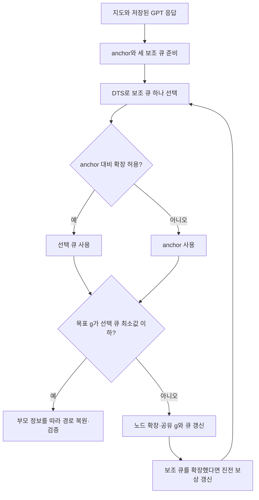

# K5: 여러 안내를 사용하는 MHA*＋Thompson Sampling

규민 담당, `gm`의 독립 개선 실험이다. [결과·선정 메모](REPORT.md), [실행 전 설정](PROTOCOL.md), [자동 수치표](results/run_20261025/analysis/TABLES.md)를 함께 본다.

## 무엇이 달라졌나

K3는 벽을 반영한 거리 하나로 후보를 고른다. K4는 허용 비용 범위 안에서 LLM 안내에 가까운 후보를 고른다. K5는 여러 후보 큐를 동시에 유지하며 다음 한 번의 확장을 어느 큐에 맡길지 고른다. 모든 큐는 지금까지 찾은 경로 비용 g와 부모 정보를 공유한다. 최종 goal은 하나이고 LLM 경유점을 반드시 방문하지 않는다.

- **anchor**: K3 octile＋벽 하한. 확장·종료의 비용 제한을 검사한다.
- **벽 안내 큐**: g＋2×벽 하한. K3와 유사한 빠른 목표 접근을 시도한다.
- **목표 안내 큐**: g＋2×직선거리. 기하 벽 점수와 다른 순서를 제공한다.
- **LLM 안내 큐**: g＋2×polyline 점수. 기존 GPT 경유점 방향을 시도한다.

DTS는 안내별로 최근 진전 여부를 관찰한다. 진전이 많은 안내가 선택될 가능성을 높이지만 탐색을 계속할 기회도 남긴다. 여기서 진전은 “그 큐 OPEN의 최소 안내 값이 과거 최저보다 낮아짐”이다. 최종 경로 길이가 좋아졌다는 뜻은 아니다. GPT가 확률이나 보상을 평가하지 않는다.



주 설정의 비용 상한은 최단거리의 **2배**다. K4 주 설정과 같은 **1.05배** 조건도 별도 시험한다. DTS가 좋아야 비용 제한이 지켜지는 것이 아니라 anchor와 MHA*의 검사 조건이 제한의 근거다. 코드의 전제는 유한 그래프, 양의 이동 비용, 일관된 anchor, 고정된 유한 보조 안내다.

## 코드와 재실행

| 파일 | 역할 |
| --- | --- |
| [search.py](search.py) | SMHA* 큐·CLOSED·종료 검사, Scheduler, 기존 비교군 연결 |
| [verify.py](verify.py) | heap 없는 참조, 독립 기하·Dijkstra, 경계 사례·DTS 검증 |
| [run.py](run.py) | 입력·응답 검사, 13조건·5시드·3회 측정, 압축 원시 결과·통계 |
| [report.py](report.py) | 표·비교 그림·선택 큐 진단·사례 그림 |
| [audit.py](audit.py) | 저장 결과·입력 해시·집계와 반복 확인 |

저장소 최상위에서 실행한다. 기존 K3/K4 환경의 numpy·matplotlib을 사용하며 API 키는 필요 없다.

```powershell
python -m experiments.K5.verify
python -m experiments.K5.run --output experiments/K5/results/my_new_run
python -m experiments.K5.report --input experiments/K5/results/my_new_run
python -m experiments.K5.audit --input experiments/K5/results/my_new_run
```

run은 이미 존재하는 출력 폴더를 거부한다. 성능 측정 중 다른 벤치마크를 동시에 실행하지 않는다. 시드 5개와 시간 반복 3개는 다르다. 같은 시드를 3번 실행하면 시간만 달라지고 경로·큐 선택은 같아야 한다. 결과를 읽는 예:

```python
from pathlib import Path
from experiments.K5.run import read_rows
for row in read_rows(Path('experiments/K5/results/run_20261025/public/evaluations.jsonl.gz')):
    if row['method'] == 'mha_dts_w200' and row['repeat'] == 0:
        print(row['case_id'], row['seed_index'], row['operation'], row['length'])
```

## 기록과 비교 시 주의

- raw `.jsonl.gz`: 매 시행의 입력 식별자·시드·경로·성능·보상·큐 지표. 무손실 압축이다.
- `per_seed.json`: 시드별 시간 중앙값과 지표. `per_case.csv`: 문제별 시드 평균. `summary.json`: 전체 비교·지도 bootstrap·시드별 편차.
- `operation`은 탐색과 보상 heap의 pop 합계다. `successor_expansions`는 목표를 제외하고 이웃을 검토한 횟수다. 두 수치는 다르다.
- MHA*는 목표를 pop하기 전에 성공할 수 있다. 비교군은 목표 pop을 실제 확장에서 제외해 맞췄다. 기존 원시 operation 값은 변경하지 않았다.
- `storage`는 g 사전 크기이며 큐·안내 캐시·전체 RAM을 뜻하지 않는다. `peak_heap_entries`도 따로 본다.
- 시간에는 파싱·준비·탐색·bandit·검증을 포함한다. 응답 파일 읽기와 독립 정답 산출은 제외한다. 새 요청에서 발생하는 모델 생성 시간은 별도다.
- 공개 1,000문제와 별도 30문제는 K4와 같다. K3의 추가 120문제와 혼동하지 않는다.

## 출처·작업 지원

SMHA*는 [Aine et al., RSS 2014](https://publications.ri.cmu.edu/storage/publications/pub_files/2014/7/rss14.pdf), DTS는 [Phillips et al., IJCAI 2015](https://www.cs.cmu.edu/~venkatrn/papers/ijcai15.pdf)의 방법이다. 큐 안내 수식은 기존 K3와 K4를 연결한 이번 과제의 적용이다. 새로 발명한 알고리즘이라고 주장하지 않는다.

Codex가 관련 문헌 확인, 구현, 검증·실험 스크립트 작성/실행, 수치 분석과 문서 초안을 도왔다. 최종 제출 전 팀원이 흐름과 한계를 이해하고 설명을 검토해야 한다. 기존 보고서·ZIP을 제출판으로 자동 갱신하지 않았고 K5는 별도 방법 후보 기록으로 보관한다.
