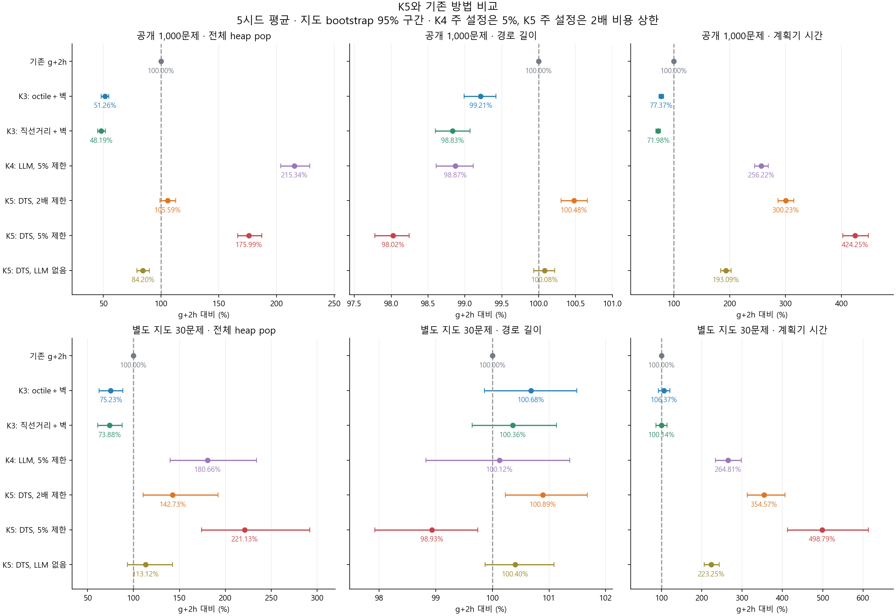
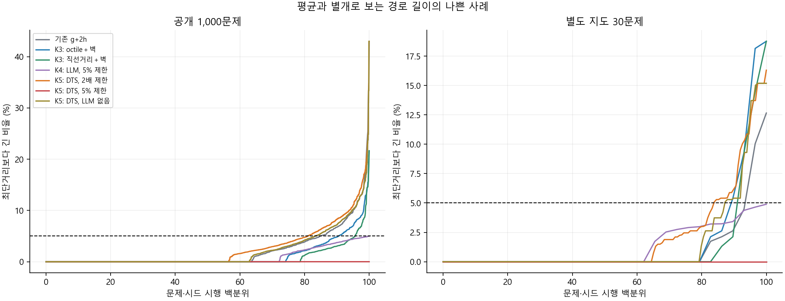
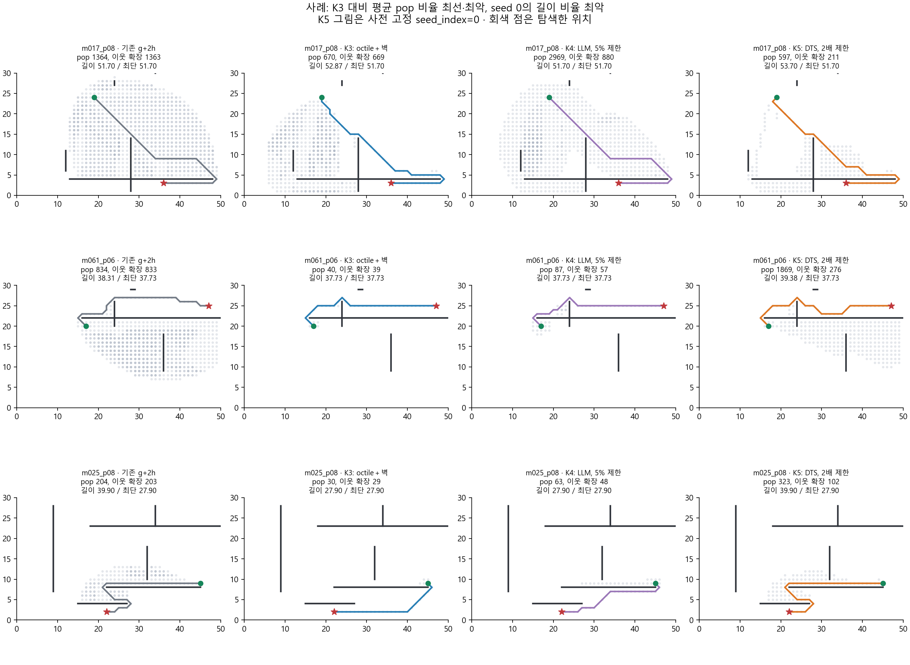

# K5 구현·비교 결과와 선정 메모

2026-10-25 · 규민 담당 · gm · 실행 `run_20261025`

**이번 K5는 구현·검증을 통과했지만, 연산량과 경로 길이를 함께 개선할 후보로는 K3보다 불리하다.** 공개 1,000문제에서 주 K5는 K3 octile＋벽 대비 전체 pop 2.06배, 계획기 시간 3.88배, 경로 길이 1.28% 증가였다. DTS가 고정 순환보다 실제 이웃 확장을 줄인 효과는 있었지만, 관리 비용을 상쇄하지 못했다. 현재 속도·연산량 중심 후보는 K3를 유지한다.

이 결론은 이번 안내 함수와 작은 2차원 지도에서의 결과다. MHA*나 Thompson Sampling이 모든 문제에서 쓸모없다는 뜻은 아니다. 또한 K3만으로 과제의 LLM 결합 개선 요구를 충족한다는 판정도 아니다.

## 1. K5는 무엇을 구현했나

K3는 벽을 고려한 거리 하나를 사용한다. K5는 그 거리, 단순 목표 직선거리, GPT 경유점 안내를 **서로 다른 탐색 큐**로 유지한다. 각 큐가 따로 만든 완성 경로 중 하나를 나중에 고르는 구조는 아니다. 지금까지 발견한 더 좋은 경로 비용 g와 부모 정보를 공유하면서, 다음 한 번의 노드 확장을 맡을 큐를 선택한다.

**MHA*는 탐색과 비용 제한을 담당한다.** anchor는 K3의 octile＋벽 하한이고, 보조 큐는 `g+2h0`, `g+2×직선거리`, `g+2×LLM polyline 점수`로 정렬한다. 보조 큐가 anchor 대비 허용 범위를 벗어나면 anchor를 진행한다. 목표는 처음부터 끝까지 하나이며 경유점 방문은 의무가 아니다.

**DTS는 보조 큐의 선택을 담당한다.** 프로그램이 안내별 진전을 관찰해 Beta 분포를 갱신하고, 매번 표본을 뽑아 사용할 큐를 선택한다. 진전은 해당 큐에 남은 후보들의 최소 안내 값이 이전 최저보다 낮아지는 것이다. 경로를 줄였는지, 최적 경로 쪽으로 갔는지를 정답으로 평가하는 것은 아니다. 이력이 너무 쌓여 전환이 느려지지 않도록 α＋β를 C=10 수준으로 제한한다.

주 K5의 상한은 최적비용의 2배다. 기존 g+2h의 가중 탐색 수준과 비교하려는 설정이다. K4 주 설정은 1.05배이므로, **K5도 1.05배인 별도 조건**을 함께 평가했다. 모든 안내식과 비교 조건은 [실행 전 규약](PROTOCOL.md)에 고정했다.

기반은 [SMHA*, Aine et al., RSS 2014](https://publications.ri.cmu.edu/storage/publications/pub_files/2014/7/rss14.pdf)와 [DTS, Phillips et al., IJCAI 2015](https://www.cs.cmu.edu/~venkatrn/papers/ijcai15.pdf)다. 이번 작업은 이 틀에 기존 K3/K4 안내를 연결한 적용 실험이다. 해당 연구의 로봇·퍼즐 실험 전체를 재현했다는 뜻은 아니다.

## 2. 어떤 순서로 확인했나

1. **비교 규칙 고정:** 주 방법 DTS, 일반 TS, 고정 순환, LLM 제거, 벽 안내 하나, 5% 상한을 사전에 정했다. 기존 g+2h·K3 두 변형·K4와 엔진 대조군까지 총 13조건이다.
2. **구현 정확성 확인:** heap 없는 SMHA 참조와 작은 지도·경계 사례에서 경로, 큐 선택 순서, 보상 갱신을 비교했다. 2,160조건, 전체 스캔 검사 30,860회, 독립 충돌 검사 34,624회, 하한 검사 75,714회를 통과했다.
3. **검증 중 수정:** 목표를 여러 번 지나는 비정상 polyline에서 투영 오차 때문에 목표 안내가 0이 아닐 수 있었다. K5 보조 안내는 목표에서 명시적으로 0으로 보정했다. 성능 측정 전에 수정했고 기존 K4 코드는 그대로 유지했다.
4. **파일럿 30문제:** 본실험에 포함되는 일부 문제로 실행·기록·기존 결과 동등성을 확인했다. 결과를 보고 설정을 바꾸지 않았다.
5. **공개 1,000문제 및 별도 30문제:** 확률 조건은 각각 5시드, 각 시드 시간 측정 3회. 결정적 조건은 3회. 순서를 섞고 매번 새 캐시로 실행했다.
6. **사후 감사:** 입력·코드 해시, 동일 시드 재현, 과거 비교군과의 동일성, 집계값을 다시 확인했다. 원시 결과를 압축해 보존했다.

파일럿 포함 **92,220회 실행 모두 유효 경로**였다. 실제 서로 다른 평가는 **1,030문제**이고, 파일럿을 별도 30개 문제로 더하지 않는다. 독립 Dijkstra와 경로 검사를 매 실행에 적용했고 비용 상한 검사 79,500회에서 위반은 없었다. 기존 비교군 22,260회는 이전 K4 기록과 경로·길이·pop·storage가 일치했다. [검증 결과](results/run_20261025/verification.json), [최종 감사](results/run_20261025/final_audit.json).

공개 데이터는 원본 100지도×10쌍이다. 별도 30문제는 K4와 같은 기존 seed=20261013 자료이며 **K3의 새 지도 120문제와 다르다**. 이미 사용했던 평가 집합이므로 완전히 새로운 holdout이라고 부르지 않는다.

모델은 K4와 같은 `gpt-4o-mini-2024-07-18`, Few-shot/standard의 실제 저장 응답이다. 1,030개 요청의 지도·프롬프트·해시를 검증했다. **새 API 호출은 0회**다. LLM 모델·프롬프트를 새로 개선한 실험은 아니다.

## 3. 공개 1,000문제 결과

기존 g+2h를 100으로 놓은 비율이다. 작을수록 작다. 문제마다 확률 조건의 5시드를 산술평균한 뒤, 문제별 상대 비율의 기하평균을 냈다. 시간은 시드별 3회 중앙값을 먼저 사용했다. **시간에는 LLM 생성 지연을 포함하지 않는다.**

| 방법 | 전체 heap pop | 실제 이웃 확장 | 경로 길이 | 계획기 시간 |
| --- | ---: | ---: | ---: | ---: |
| 기존 g+2h | 100.00% | 100.00% | 100.00% | 100.00% |
| K3 주 방법: octile＋벽 | 51.26% | 50.70% | 99.21% | 77.37% |
| K3 비교 변형: 직선거리＋벽 | 48.19% | 47.56% | 98.83% | 71.98% |
| K4 주 방법: LLM, 5% 상한 | 215.34% | 110.69% | 98.87% | 256.22% |
| **K5 주 방법: DTS, 2배 상한** | **105.59%** | **59.01%** | **100.48%** | **300.23%** |
| K5: DTS, 5% 상한 | 175.99% | 138.05% | 98.02% | 424.25% |

K5 주 방법과 g+2h를 비교하면 이웃 확장은 40.99% 감소하지만, 전체 pop의 관측 집계는 5.59% 증가하고 시간은 3.00배다. pop 비율의 지도 bootstrap 95% 구간은 **98.98–112.54%**여서 pop 차이 자체는 방향이 확실하다고 단정하지 않는다. 반면 시간 비율 구간은 **286.27–314.92%**다. 경로 길이도 0.48% 길었다.

K3 주 방법과 비교하면 전체 pop **2.06배**(95% 구간 1.94–2.18), 이웃 확장 16.40% 증가, 길이 1.28% 증가, 시간 **3.88배**다. 문제별로 pop 개선/동일/악화는 34/7/959이고, pop이 줄면서 길이가 더 길어지지 않은 문제는 25개다. K3 비교 변형과 비교해도 전체 pop 2.19배, 시간 4.17배여서 결론이 바뀌지 않는다.

## 4. 왜 덜 확장했는데 느린가

노드의 이웃을 검사하는 작업 외에 여러 큐를 갱신하고, 이전 항목을 제거하고, 보상을 계산하고, 확률 표본을 뽑는 일이 추가되기 때문이다. 주 K5의 공개 데이터 **시행별 산술평균**은 다음과 같다. 위 표의 문제별 비율 기하평균과는 다른 집계다.

| 항목 | 평균 |
| --- | ---: |
| 실제 이웃 확장 | 87.46회 |
| 탐색 heap pop | 259.06회 |
| 보상용 heap pop | 123.20회 |
| 전체 pop | 382.26회 |
| 위 pop 중 stale 제거 | 294.80회 |
| 모든 heap push | 1,358.37회 |
| 최대 전체 heap 항목 수 | 981.68개 |
| Beta 표본 추출 | 265.38회 |
| LLM 안내 선분 검사 | 1,247.38회 |
| 계획기 시간 | 4.657ms |

`operation`에 보상용 pop도 포함한 이유가 이것이다. 안내 선택에서 절약한 확장만 세면 K5를 과대평가하게 된다. 반대로 pop만으로 모든 CPU 작업을 설명할 수도 없어 시간을 함께 측정했다. 큐의 동시 항목 수는 메모리 부담의 한 지표이며 실제 RAM 바이트 측정은 아니다.

## 5. DTS와 LLM 각각 도움이 됐나

같은 2배 상한에서 비교했다.

| 조건 | 전체 pop | 이웃 확장 | 길이 | 시간 |
| --- | ---: | ---: | ---: | ---: |
| 고정 순환, 세 안내 | 103.88% | 64.55% | 100.69% | 249.22% |
| 일반 TS, 세 안내 | 106.52% | 59.42% | 100.51% | 298.59% |
| **DTS, 세 안내** | **105.59%** | **59.01%** | **100.48%** | **300.23%** |
| DTS, LLM 큐 제거 | 84.20% | 55.05% | 100.08% | 193.09% |
| 벽 안내 하나 | 59.51% | 47.58% | 99.12% | 114.80% |
| 단일 weighted A* 엔진 대조 | 54.00% | 49.60% | 99.10% | 92.77% |

표의 기준은 모두 g+2h=100이다.

**DTS는 고정 순환보다 이웃 확장을 8.58% 줄였지만 시간은 20.47% 늘었다.** 전체 pop은 1.65% 증가했으며 구간은 98.70–104.60%로 100을 포함한다. DTS가 실제 큐 사용을 조절하기는 했다. 전체 이웃 확장에서 LLM 큐 비중은 고정 순환 26.05%에서 DTS 20.18%로 줄고, 벽 안내 쪽 비중은 늘었다. 이것이 최종 실행 시간의 개선까지 이어지지는 않았다.

일반 TS 대비 DTS의 pop 감소는 0.87% 정도이고 시간은 0.55% 늘었다. 이력 축소만으로 큰 개선을 얻지는 못했다. 고차원·다수 큐에 관한 참고 연구의 개선 폭이 이번 작은 지도에서도 나온다고 기대할 수는 없다.

**LLM을 추가한 순효과도 불리했다.** LLM 큐를 뺀 DTS보다 주 K5는 pop 25.40%, 이웃 확장 7.19%, 길이 0.40%, 시간 55.49% 증가했다. 이 대조는 큐 수와 표본 추출 비용도 바뀌므로 GPT 문장/좌표의 품질만을 따로 분리한 비교는 아니다. 그러나 실제 시스템에 LLM 큐를 더할 가치가 있는지를 보는 비교로는 부정적이다.

공개 116문제는 파싱 실패로 LLM 큐를 벽 안내로 대체했다. 잘 파싱된 **884문제만 별도로 본 사후 분석**에서도 LLM 추가 시 pop 27.63%, 시간 62.15%, 길이 0.49% 증가였다. 파싱 실패만이 전체 악화의 원인이라고 보기는 어렵다. 사후 부분집합 분석은 주 결과를 대체하지 않는다.

## 6. K4와 동일한 비용 상한에서는

5% 상한의 K5는 공개 1,000문제×5시드 및 별도 30문제×5시드에서 **모두 최단경로**를 찾았다. 이것은 이번 데이터의 관측 결과이며 항상 최단경로를 보장하는 알고리즘으로 바뀌었다는 뜻은 아니다. 설정상의 보장은 여전히 1.05배다.

공개 데이터에서 K4 주 방법보다 K5 5% 조건은 pop 18.27%, 길이 0.85% 감소했지만, 이웃 확장은 24.72%, 시간은 **65.58% 증가**했다. 이 조건의 확장 중 **95.45%가 anchor**였다. 보조 안내를 2배로 둔 상태에서 상한을 좁혀 대부분의 선택이 anchor로 돌아간 것이다. 좋은 경로 품질을 DTS나 LLM의 성공으로 귀속하기 어렵다. 같은 상한의 LLM 없는 K4 대조군까지 [전체 수치표](results/run_20261025/analysis/TABLES.md)에 남겼다.

2배 상한의 K4와 주 K5를 비교하면 K5의 길이는 7.18% 짧지만 시간은 39.27% 더 들었다. pop 차이는 −1.69%이고 95% 구간이 100을 포함한다. 따라서 K4와 K5 중 하나가 모든 지표에서 낫다고 할 수 없다.

주 K5의 공개 5,000시드 시행에서는 최적 경로 2,830개, 최단거리보다 5% 넘게 긴 경로 956개, 최악은 최단거리의 1.4301배였다. **2배 상한을 지켰다는 사실만으로 경로 품질이 충분히 좋다고 평가해서는 안 된다.**

## 7. 별도 지도 30문제

동일한 30문제에서 모든 비교군을 재실행한 결과다. 표본은 지도 10개라 불확실성이 크다.

| 방법 | 전체 pop | 이웃 확장 | 길이 | 시간 |
| --- | ---: | ---: | ---: | ---: |
| g+2h | 100.00% | 100.00% | 100.00% | 100.00% |
| K3 octile＋벽 | 75.23% | 74.75% | 100.68% | 106.37% |
| K3 직선거리＋벽 | 73.88% | 73.33% | 100.36% | 100.14% |
| K4 LLM, 5% 상한 | 180.66% | 108.11% | 100.13% | 264.81% |
| K5 DTS, 2배 상한 | 142.73% | 80.68% | 100.89% | 354.57% |
| K5 DTS, 5% 상한 | 221.13% | 189.19% | 98.93% | 498.79% |

별도 지도에서도 주 K5의 실행 시간 이득은 없었다. 주 K5는 150시드 시행 모두 성공했지만, 그중 25개가 최단거리보다 5% 넘게 길었고 최악은 1.1630배였다. 기존 응답 3개는 파싱 실패 대체였다.

## 8. 개별 사례와 시드 변화

아래 그림의 K5는 항상 **seed_index=0**이다. 좋은 시드만 골라 그리지 않았다. 사례는 공개 데이터에서 K3 대비 5시드 평균 pop 비율의 최선/최악, seed 0의 경로 길이 비율 최악으로 뽑았다.

- **m017_p08 — 확장을 줄일 가능성이 드러난 사례:** K3 pop 670에 비해 K5의 5시드 pop은 597, 94, 89, 145, 93이었다. 평균 203.6으로 줄었지만 시드별 차이가 크다. 그림의 seed 0은 길이 53.70으로 K3 52.87보다 길다. 가장 좋은 시드 89만 대표 성능으로 제시하면 과장된다.
- **m061_p06 — 이미 좋은 벽 안내를 분산시켜 악화:** K3는 pop 40으로 길이 37.73의 최단경로를 찾았다. K5의 평균 pop은 1,855로 46.38배이고, seed 0은 pop 1,869·길이 39.38이었다. 추가 안내가 불필요한 영역 탐색과 많은 stale 항목을 만든 사례다.
- **m025_p08 — 저렴한 확장과 좋은 경로는 별개:** K3는 pop 30·길이 27.90, K4는 pop 63·길이 27.90이었다. 주 K5는 5시드 모두 길이 39.90으로 긴 우회를 선택했다. seed 0의 pop은 323이다. 충분히 넓은 상한 안에서는 잘못된 우회도 그대로 종료될 수 있다.

시드별 공개 전체 pop 비율은 g+2h 대비 102.81–104.42%, 시간 비율은 297.56–300.95%였다. **문제별 시드 평균을 먼저 내는 주 집계와, 시드별 전체 기하평균은 계산 순서가 다르다.** 그래서 주 집계 pop 105.59%가 이 범위 밖에 있어도 모순이 아니다. 주 결론은 최선 시드를 선택한 결과가 아니다.

## 9. 한계와 다음 후보 선정에 쓸 판단

- 이번 보조 안내는 세 개이고 두 개는 기존의 거리 안내다. 서로 다른 난점을 해결하는 강한 안내를 많이 가진 고차원 문제와 다르다. 이번 결과를 모든 MHA* 구성으로 일반화하지 않는다.
- 보상은 안내 값 감소라는 대리 지표다. 특히 공유 OPEN에서는 다른 큐가 만든 진전이 현재 큐의 보상에 섞일 수 있다. 큐 선택 학습이 최종 경로·시간을 직접 최적화하지 않는다.
- 5시드 평균을 고정한 지도 bootstrap 구간이다. 시드의 모든 불확실성까지 포함한 구간이나 여러 비교에 보정한 통계 검정은 아니다. 30문제 전이 점검은 특히 작다.
- K5 5% 조건에서 anchor 단독 최적 탐색과의 별도 성능 대조는 추가하지 않았다. 이 조건의 최적 경로 관측을 LLM 개선 성과라고 주장하지 않는다.
- Python 구현, lazy heap 삭제, 작은 그래프의 실제 관리 비용이 결과에 영향을 준다. 다른 큐 구현이나 더 큰 지도에서의 성능을 측정한 것은 아니다.
- 공개 응답 생성 지연은 과거 기록 평균 **5.436초**, 별도 지도는 **5.772초**였다. 현재 계획기는 밀리초 수준이다. 새 문제에서는 모델 생성 지연이 추가되므로 캐시 실험의 시간을 전체 온라인 지연으로 제시하지 않는다. 과거 응답 총 1,219,246토큰을 재사용했으며 이번 신규 API 비용은 없다.

**선정 의견:** K5는 탐색 배분의 일부 효과를 확인한 비교·분석 항목으로 보관한다. 현재 과제의 연산량·경로 길이 목표에서는 K3를 대체할 근거가 부족하다. K4는 비용 제한의 효과를 설명하는 후보이고, K5의 실험적 장점은 “DTS가 고정 순환보다 확장을 줄였지만 전체 비용은 늘었다”는 구분이다. 아직 K6 등 다른 담당 방법까지 모두 평가한 상태는 아니므로 최종 제출 개선안을 확정하지 않는다.

## 10. 보존 자료

- [구현과 실행법](README.md), [사전 규약](PROTOCOL.md), [탐색 코드](search.py), [검증 코드](verify.py).
- [환경·입력·코드 해시](results/run_20261025/manifest.json), [최종 감사](results/run_20261025/final_audit.json), [결과 파일 해시](results/run_20261025/artifacts_sha256.json).
- [공개 원시 시행](results/run_20261025/public/evaluations.jsonl.gz), [공개 시드별 지표](results/run_20261025/public/per_seed.json), [공개 문제별 평균](results/run_20261025/public/per_case.csv), [공개 통계](results/run_20261025/public/summary.json).
- [별도 지도 원시 시행](results/run_20261025/transfer/evaluations.jsonl.gz), [별도 지도 통계](results/run_20261025/transfer/summary.json), [큐·사례 진단](results/run_20261025/analysis/diagnostics.json), [13조건 전체 표](results/run_20261025/analysis/TABLES.md).

Codex가 문헌 확인·구현·검증/실험 실행·분석과 문서 초안 작성을 지원했다. 최종 제출 전 팀원의 설명 검토가 필요하다. 기존 논문 재현 보고서나 제출 ZIP은 이번 후보 기록으로 자동 교체하지 않았다.
