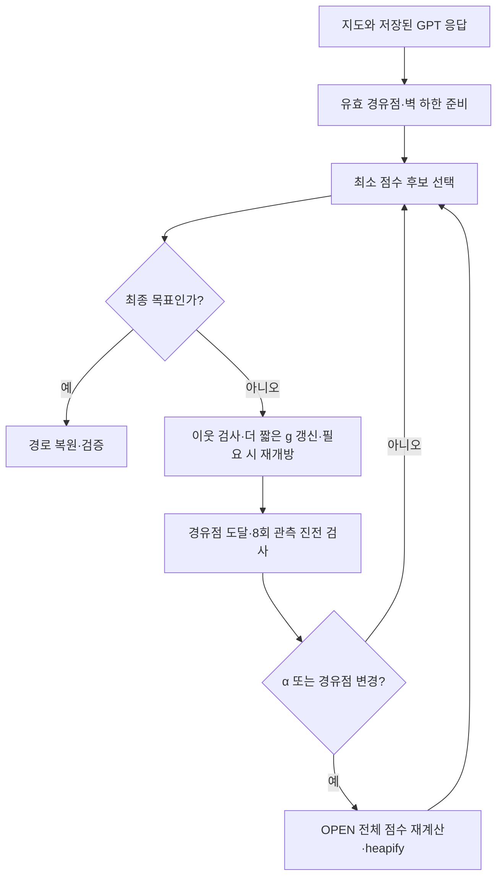

# K6: 탐색 진전에 따라 경유점의 영향력을 조절하기

규민 담당, `gm`의 독립 개선 실험이다. [결과·선정 메모](REPORT.md), [측정 전에 고정한 규약](PROTOCOL.md), [자동 비교표](results/run_20261025/analysis/TABLES.md)를 함께 본다.

## 이해를 위한 흐름

K3는 벽을 반영한 거리 하한으로 후보를 고르고, K4는 허용 범위의 후보 중 LLM 안내를 따르며, K5는 여러 안내 큐를 번갈아 쓴다. K6는 **큐 하나에서 LLM 경유점에 주는 영향력 α를 바꾼다.** 최종 목표는 처음부터 끝까지 하나다. 경유점은 후보 선택을 유도하며 반환 경로가 반드시 방문해야 하는 지점은 아니다.

1. 기존 GPT 응답을 읽어 정수 격자의 유효한 중간 경유점만 남긴다. 새 GPT 호출이나 경로 수리는 없다.
2. 첫 경유점에 대한 α를 0.5로 시작한다. 목표까지의 기본 거리에는 K3의 octile＋벽 하한을 쓴다.
3. 탐색기가 고른 위치를 8번 관찰한다. 경유점까지의 최저 거리가 이전 최저 기록보다 1 이상 줄면 α에 0.25를 더하고, 그렇지 않으면 절반으로 줄인다.
4. α가 1/16 이하가 되면 그 경유점의 안내를 끈다. 경유점을 실제로 확장하면 다음 경유점으로 넘어가 α를 초기화한다. 마지막 목표 단계에서는 안내를 끈다.
5. α나 현재 경유점이 달라질 때 OPEN 전체의 순위를 다시 계산한다. 목표가 최소 점수로 선택되면 경로를 복원하고 충돌과 이동 규칙을 검증한다.

**진전 판단은 프로그램이 한다.** GPT가 자신의 안내를 평가하지 않는다. 탐색 위치가 경유점에 가까워졌다는 신호일 뿐, 최종 경로가 짧아졌다는 보상도 아니다. 정체 중인 경유점을 강제로 건너뛰지는 않는다.



## 초안식과 실제 주 방법

원래 K6 제안은 `f=g+h+α·d(node,target)`였다. 이 식은 α를 0으로 하면 g+h가 되어, g+2h와 비교할 때 안내 효과와 탐욕성 변화가 섞인다. 따라서 초안식도 대조 실험으로 보존하고, 주 방법은 다음과 같이 정했다.

```text
f = g + H
H = w·h0 + α·(w−1)·(min(d(node,target), h0)−h0)
h0 = K3 octile＋벽 하한, 0≤α≤1
주 설정 w=2, 품질 제한 비교 w=1.05
```

α=0이면 g+w·h0로 돌아간다. α가 클수록 경유점에 가까운 후보의 점수를 낮춘다. 경유점이 목표보다 훨씬 멀다는 이유로 후보 점수를 계속 키우지는 않는다. `h0≤H≤w·h0`를 유지하며 목표 H=0, 더 좋은 g의 재개방, 정확한 OPEN 재정렬과 함께 비용 상한의 근거가 된다. **w=2는 최단거리의 2배 이하라는 제한이지 최단경로 보장이 아니다.**

초안식 조건은 중간 경유점이 끝나면 g+h0가 되며 일반적인 2배 상한을 주장하지 않는다. 새로운 제어법·필터·전환 규칙이 들어가므로 원본 LLM-A*와 동일한 구현이라고 부르지 않는다. 수식 변경과 대조군은 성능을 보기 전에 [규약](PROTOCOL.md)에 고정했다.

## 코드와 재실행

| 파일 | 역할 |
| --- | --- |
| [search.py](search.py) | 좌표 필터, Controller, 재개방·전체 재정렬을 지원하는 단일 큐, 기존 비교군 연결 |
| [verify.py](verify.py) | 독립 기하·Dijkstra, heap 없는 전체 스캔 참조, 제어·재개방·경계 검사 |
| [run.py](run.py) | 19조건·K5 5시드·시간 3회 반복, 과거 결과 동등성, 원시 기록·통계 |
| [report.py](report.py) | 비교표·그림·α 기록·개선/악화 사례 |
| [audit.py](audit.py) | 저장 바이트·해시·반복·횟수·집계를 별도로 재검사 |

저장소 최상위에서 실행한다. 기존 환경의 numpy·matplotlib을 사용하며 API 키는 필요 없다.

```powershell
python -m experiments.K6.verify
python -m experiments.K6.run --output experiments/K6/results/my_new_run
python -m experiments.K6.report --input experiments/K6/results/my_new_run
python -m experiments.K6.audit --input experiments/K6/results/my_new_run
```

run은 이미 존재하는 출력 폴더를 거부한다. 측정 중 다른 벤치마크를 함께 실행하지 않는다. 공개 1,000문제·기존 별도 30문제와 실제 GPT 응답을 다시 쓴다. K5만 기존과 같은 5개 난수 시드를 쓰며 K6는 결정적이다. 3회 반복은 시간 측정용으로, 독립 문제 수를 늘리지 않는다.

저장 응답으로 한 문제를 실행하는 인터페이스:

```python
from experiments.K6.search import run_once
result = run_once(query, 'adaptive_wall_w200', saved_response_text, trace=True)
print(result['operation'], result['rekey_scans'], result['length'])
```

이것은 개선안 비교용 실행 인터페이스다. 최종 과제용 `Proposed`를 이 방법으로 자동 교체하지 않는다.

## 결과를 읽는 기준

- `evaluations.jsonl.gz`: 매 시행의 경로·시드·반복·시간·제어·큐 관리 지표. 무손실 압축.
- `per_seed.jsonl.gz`: 시간 3회 중앙값. `per_case.csv`: K5의 시드 평균. `summary.json`: 문제별 상대 비율의 기하평균과 지도 bootstrap.
- `operation`: 실제 heap pop만 센다. **heapify에 필요한 OPEN 전체 재계산은 포함하지 않는다.** `rekey_scans`, `heap_rebuilds`, `rekey_discarded`, 실제 시간을 반드시 같이 본다.
- `successor_expansions`: 목표를 제외하고 이웃을 검토한 횟수. `storage`: g 사전 크기이며 전체 RAM이 아니다.
- 계획기 시간에는 파싱·필터·하한 준비·탐색·α 조절·재정렬·경로 검증을 포함한다. 파일 읽기·독립 정답 계산·LLM 생성 지연은 제외한다.
- 별도 30문제는 seed=20261013의 기존 자료다. K3의 추가 120문제와 다르며 미지 holdout이라고 주장하지 않는다.
- 주 방법은 `adaptive_wall_w200`으로 고정했다. 고정 α, 안내 제거, 초안식, 벽 하한 제거, w=1.05, window=16은 해석용 대조군이다. 사후 가장 좋은 값을 주 결과로 바꾸지 않는다.

## 출처와 AI 지원

Weighted A*와 재개방은 [Hansen & Zhou, Anytime Heuristic Search, §2.1–2.2](https://arxiv.org/pdf/1110.2737)를 참고했다. 동적 순위 변경에 따른 OPEN 관리 비용은 [Dynamic Potential Search](https://ojs.aaai.org/index.php/SOCS/article/view/18392)의 관련 문제의식이다. 이 실험은 두 알고리즘 전체의 재현이 아니며 α 제어·혼합식은 이번 과제용 설계다.

Codex가 문헌 확인, 구현·검증·실험 실행, 집계와 문서 초안을 지원했다. 최종 제출 전 팀원이 실제 코드 흐름과 결과를 이해하고 설명을 검토해야 한다. 이번 결과는 gm의 후보별 기록이며 기존 논문 재현 결과·최종 보고서 PDF·제출 ZIP은 별도로 유지한다.
