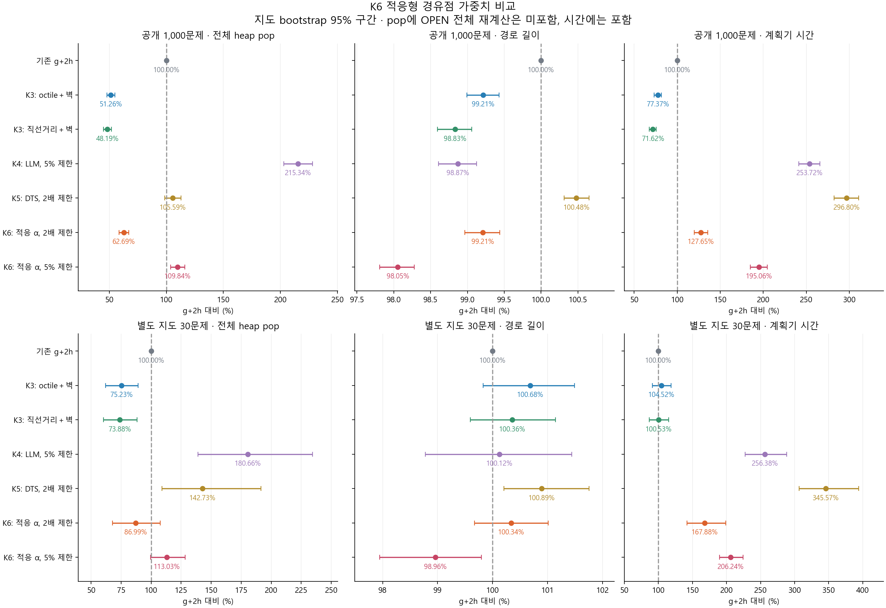
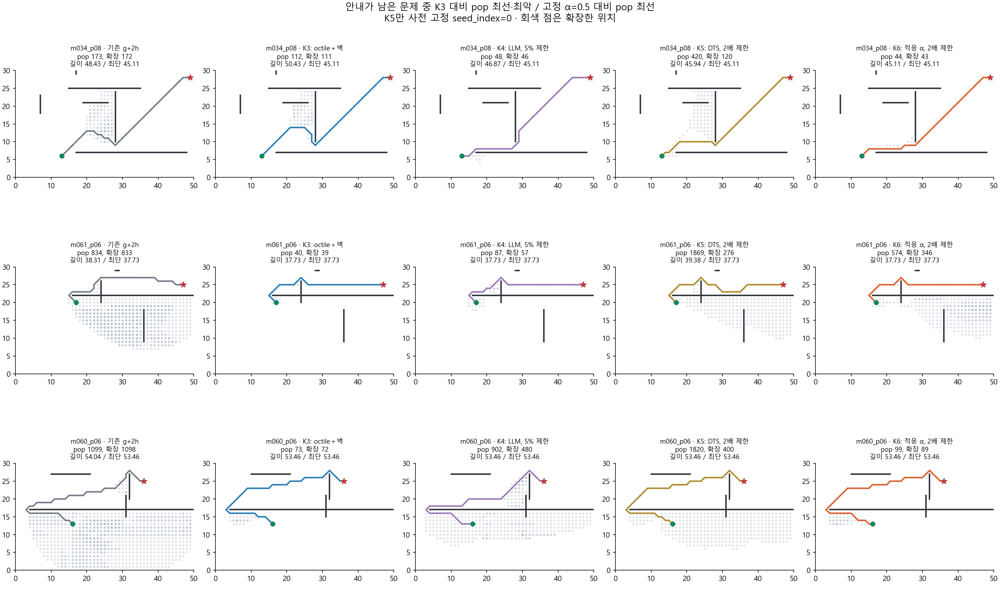
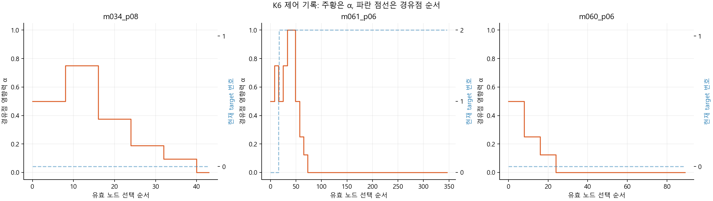
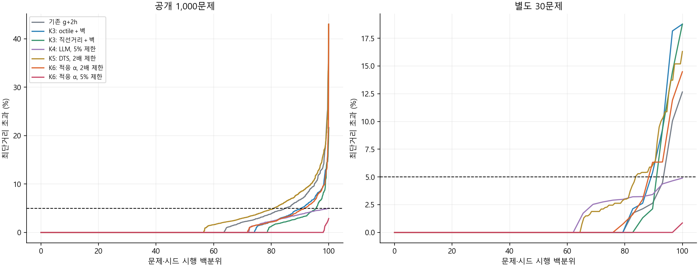

# K6 구현·실험 결과와 선정 메모

2026-10-25 · 규민 · `gm` · 주 방법 `adaptive_wall_w200`

**후속 결과:** 아래 기록에서 미확인이라고 남긴 5% 조건의 LLM 제거·고정 α 비교는 [별도 실험](../K6_w105/REPORT.md)으로 완료했다. 적응/no-guide는 공개 pop 5.05% 감소·이웃 확장 2.97% 증가·시간 20.37% 증가·길이 사실상 동일이었다. 작은 고정 α 품질 이득과 비용까지 새 문서에 기록했다. 아래의 원래 실험·수치는 당시 결과로 보존한다.

**K6는 g+2h보다 heap pop을 줄였지만 K3를 넘지 못했다.** 공개 1,000문제에서 g+2h 대비 pop은 37.31% 감소, 길이는 0.79% 감소했으나 계획기 시간은 27.65% 늘었다. K3 주 방법 대비 pop은 22.28%, 시간은 64.98% 늘고 길이는 사실상 같았다. 속도 중심 후보는 K3를 유지한다. 별도의 5% 비용 제한 K6는 같은 제한의 K4·K5보다 유리한 결과를 보였으므로 품질 제한 후보로 기록하되, 이를 LLM의 추가 효과로 단정하지 않는다.

수치는 별도 표시가 없으면 문제별 비율의 기하평균이다. `pop`에는 OPEN 전체 재계산을 세지 않으므로 총 연산량으로 읽으면 안 된다. 전체 19조건과 신뢰구간은 [자동 비교표](results/run_20261025/analysis/TABLES.md)에 있다.

## 1. 어떤 방법을 구현했나

K6는 **경유점 쪽으로 진전이 있으면 안내 영향력 α를 높이고, 정체하면 낮추는 단일 큐 탐색**이다. GPT가 좌표를 한 번 주면 나머지는 프로그램이 처리한다. 이번에는 이미 수집한 실제 응답을 재생했다.

- 유효한 중간 경유점을 남기고 α=0.5로 시작한다. 벽 위·범위 밖·비정수 좌표는 제거하고, 시작/목표와 연속 중복은 중간 목록에서 제외한다. 경유점 사이의 선분을 수리하지는 않는다.
- 실제로 선택해 이웃을 확장한 위치를 8회씩 관찰한다. 현재 경유점까지의 최저 거리가 이전 기록보다 1 이상 줄면 α에 0.25를 더하고, 아니면 절반으로 줄인다. 1/16 이하이면 해당 경유점의 안내를 끈다.
- 경유점을 실제 확장하면 다음 경유점으로 넘어가 초기화한다. 마지막 목표 단계에서는 α=0이다. 반환 경로가 모든 경유점을 통과할 필요는 없다.
- α나 경유점이 달라지면 OPEN의 모든 점수를 갱신하고 heapify한다. 이미 확장한 점에 더 짧은 g가 발견되면 재개방한다.

원래 제안의 `f=g+h+α·d`는 안내를 끄면 g+h가 된다. 이번 주 방법은 안내를 끄면 g+2h0로 돌아오도록 다음 혼합식으로 구체화했다. **초안식과 달라진 부분이며, 결과를 보기 전에 고정했다.** 초안식도 적응/고정 조건으로 별도 시험했다.

```text
f = g + H
H = w·h0 + α·(w−1)·(min(d(node,target), h0)−h0)
h0 = K3 octile＋벽 하한
주 설정 w=2; 품질 제한 비교 w=1.05
```

이 식은 경유점에 가까운 후보 점수를 낮추며 `h0≤H≤w·h0`를 유지한다. admissible h0, 목표 H=0, 개선 g의 재개방, 변경 시 정확한 OPEN 재정렬을 함께 사용하면 목표 선택 시 비용이 w·최단거리 이하가 된다. 이것은 성능 향상의 보장이 아니라 경로 비용의 제한이다. 초안식 대조군에는 이 제한을 주장하지 않는다. 상세 전제·근거는 [실행 규약](PROTOCOL.md), 코드 흐름은 [README](README.md)에 있다.

## 2. 구현·검증·실험 순서

1. K3–K5의 실제 코드·조건·결과와 과제 지침 대응 문서를 확인했다. 기존 파일과 측정 결과는 변경하지 않았다.
2. 주 혼합식, α 조절법, 19개 비교 조건, 반복·집계를 규약에 고정했다. 공개 데이터에서 좋은 값으로 주 설정을 다시 고르지 않았다.
3. 단일 heap 엔진과 제어기를 구현하고, heap 없는 전체 OPEN 스캔 참조·독립 기하·Dijkstra·재개방 예제로 검사했다. 참조 구현의 부동소수점 덧셈 순서를 실제 점수 정의와 맞추는 검증 단계 수정을 거친 뒤 모든 검사를 통과했다. 성능 결과를 본 뒤 탐색 구현을 수정하지 않았다.
4. 파일럿 30문제와 공개 전체 1,000문제, 기존 별도 30문제를 실행했다. 파일럿은 공개 데이터의 부분집합이며 독립 표본 수에 더하지 않는다.
5. 저장 기록에서 통계·사례·그림을 만들고 해시, 반복 일치, 과거 결과 동등성, 집계 비율을 재검사했다. 성능 측정 이후 수정은 설명 문서와 그림 표시 부분이다.

| 항목 | 조건·검증 결과 |
| --- | --- |
| 공개 평가 | 원본 100개 지도 × 10쌍 = 1,000문제 |
| 별도 평가 | 기존 seed=20261013의 10개 지도 × 3쌍 = 30문제. K3의 추가 120문제와 다름 |
| LLM | GPT-4o mini 2024-07-18, standard/Few-shot 실제 응답 1,030개 고정 재생 |
| 비교 | 기존 10조건＋K6 9조건. 상세는 규약 |
| 반복 | K6·결정적 비교군은 시간 3회. K5의 세 확률 조건은 기존 5시드 × 시간 3회 |
| 실행 수 | 공개 93,000회＋별도 2,790회＋중복 파일럿 2,790회 = **98,580회** |
| 경로·상한 | 독립 경로 검증 98,580회 통과. 상한을 선언한 조건 79,500회 검사, 위반 0 |
| 동등성 | 과거 K5에 저장된 기존 10조건 69,960회 일치. 새 no-guide와 기존 clean weighted A* 3,180회 일치 |
| 알고리즘 검사 | 40개 지도 × 3종 안내 × 9조건 = 1,080개 참조 검사, 선택 12,116회, 충돌 35,760회, 하한 77,664회 검사 |
| 추가 검사 | 제어 증감·정체 종료·target 전환·좌표 필터·도달 불가·끝점 접촉·재개방·잘못된 설정 |
| 저장 감사 | 입력 20개·고정 데이터 3개·분석 입력 11개 해시, 독립 재집계 285개 비율 통과 |
| 신규 API | **0회** |

K5의 5개 시드는 이전 K5와 완전히 같다. 시간은 각 시드의 3회 중앙값, K5 지표는 문제별 5시드 산술평균, 비교 비율은 문제 간 기하평균이다. 같은 지도의 문제끼리 연관되므로 2,000회 지도 단위 bootstrap을 사용했다. 구간은 고정 시드 평균에 조건부이며 모든 시드 불확실성이나 다중 비교 보정을 포함하지 않는다.

## 3. 공개 1,000문제: g+2h·K3·K4·K5와 비교

기존 g+2h=100. 모든 열은 낮을수록 좋다. K3 주 설정은 octile＋벽이며 직선거리 변형은 별도 행으로 남겼다.

| 방법 | 전체 heap pop | 이웃 확장 | 경로 길이 | 계획기 시간 | 최단+5% 초과 |
| --- | ---: | ---: | ---: | ---: | ---: |
| 기존 g+2h | 100.00% | 100.00% | 100.00% | 100.00% | 153/1,000 |
| K3 octile＋벽 | **51.26%** | 50.70% | 99.21% | **77.37%** | 96/1,000 |
| K3 직선거리＋벽 변형 | 48.19% | 47.56% | 98.83% | 71.62% | 44/1,000 |
| K4 LLM＋5% 제한 | 215.34% | 110.69% | 98.87% | 253.72% | 0/1,000 |
| K5 DTS＋2배 제한 | 105.59% | 59.01% | 100.48% | 296.80% | 956/5,000 |
| **K6 주 방법, 2배 제한** | **62.69%** | **58.47%** | **99.21%** | **127.65%** | **85/1,000** |
| K6 비교 조건, 5% 제한 | 109.84% | 100.55% | 98.05% | 195.06% | 0/1,000 |

K5의 5,000은 1,000문제×5시드이며 다른 행보다 문제가 5배 많은 것이 아니다. 위 비교에는 K4의 5% 상한과 K5/K6 주 설정의 2배 상한이 섞여 있으므로 동일 품질 제한 비교는 다음 절에서 별도로 한다.

주 K6를 K3와 직접 비교하면 pop 비율은 **122.28% [120.38, 124.26]**, 시간은 **164.98% [162.08, 168.24]**, 길이는 **99.995% [99.861, 100.131]**다. 대괄호는 지도 bootstrap 95% 구간이다. K3보다 pop이 적은 문제는 89개, 같은 문제 233개, 많은 문제 678개였다. 길이는 112개 개선·782개 동일·106개 악화로, 평균적 길이 우위를 주장하기 어렵다.

K5 주 설정과 비교하면 K6는 pop 40.63% 감소·시간 56.99% 감소·길이 1.27% 감소였다. 그러나 실제 이웃 확장은 0.92% 감소에 그쳤고 그 비율 구간은 97.13–101.18%였다. **K5의 다중 큐 관리·보상 계산 비용을 덜 쓰는 차이가 크며, 실제 탐색을 크게 줄였다고 해석하면 안 된다.**

절대 산술평균도 함께 남긴다. 위 기하평균 비율은 아래 평균값끼리 나눈 비율과 다르다.

| 방법 | pop | 이웃 확장 | 길이 | 계획기 ms |
| --- | ---: | ---: | ---: | ---: |
| g+2h | 201.353 | 200.353 | 35.0767 | 1.8413 |
| K3 octile＋벽 | 98.176 | 97.176 | 34.8094 | 1.2629 |
| K4 LLM＋5% | 516.809 | 182.990 | 34.6368 | 4.2965 |
| K5 DTS＋2배 | 382.262 | 87.461 | 35.2504 | 4.4949 |
| K6 주 방법 | 132.640 | 98.143 | 34.8237 | 1.8918 |
| K6 5% | 184.043 | 146.231 | 34.3524 | 3.0248 |



## 4. 같은 5% 제한에서는 어떠한가

K6 `w=1.05`는 공개 1,000문제·별도 30문제에서 모두 제한을 지켰다. 최단경로는 각각 981/1,000개와 29/30개였고 최악의 초과 길이는 2.874%, 0.854%였다. K5 5% 조건은 이 자료에서 전 시행 최단경로를 찾았으므로 K6가 모든 품질 면에서 더 좋은 것은 아니다.

| 5% 제한 비교, K6 / 비교군 | 공개 pop | 공개 길이 | 공개 시간 | 별도 pop | 별도 길이 | 별도 시간 |
| --- | ---: | ---: | ---: | ---: | ---: | ---: |
| K4 LLM | 51.01% | 99.18% | 76.88% | 62.57% | 98.83% | 80.44% |
| K5 DTS | 62.41% | 100.03% | 46.67% | 51.11% | 100.03% | 42.00% |
| K4 LLM 제거 대조군 | 54.16% | 99.78% | 101.82% | 64.22% | 99.79% | 110.92% |

공개 데이터에서 K4 LLM보다 pop 48.99%, 시간 23.12%를 줄이면서 경로도 0.82% 짧았다. 반면 K4의 LLM 없는 조건과 비교한 시간은 1.82% 증가했고 구간 99.53–104.12%로 명확한 우위가 없다. 별도 30문제에서는 그 대조군보다 시간 10.92% 증가했다.

**5% K6의 좋은 결과가 적응 α나 LLM 때문인지는 이번 비교만으로 분리할 수 없다.** 같은 K6 엔진에서 w=1.05의 no-guide·고정 α 대조군은 이번 사전 규약에 없었다. w가 1.05이면 안내 항 자체의 계수도 작고, 전체 확장의 71.37%는 α=0이었다. 단일 큐·벽 하한·거의 admissible한 점수의 기여가 함께 들어 있다. 다음 선정 단계에서 이 후보를 검토한다면 같은 엔진의 1.05 대조를 먼저 해야 한다는 의미이며, 이번에 추가 실험을 실시했다는 뜻은 아니다.

## 5. α 조절 자체와 경유점의 기여

공개 평가의 g+2h=100 비교다. 같은 엔진 안의 대조이므로 K3와 비교할 때보다 원인을 구분하기 쉽다.

| 조건 | pop | 길이 | 시간 |
| --- | ---: | ---: | ---: |
| 안내 제거, α=0 | 54.00% | 99.10% | 94.24% |
| **주 K6, 적응 α** | **62.69%** | **99.21%** | **127.65%** |
| 고정 α=0.5 | 65.70% | 98.89% | 123.71% |
| 고정 α=1 | 89.74% | 100.17% | 155.18% |
| 벽 하한 제거 | 119.41% | 99.50% | 163.62% |
| 관측 구간 16회 | 65.29% | 99.02% | 129.14% |
| 초안식, 적응 α | 161.26% | 98.05% | 257.27% |
| 초안식, 고정 α=1 | 194.97% | 98.51% | 275.88% |

**적응 α / 고정 0.5:** 공개 pop은 4.59% 줄지만 시간은 3.18%, 길이는 0.32% 늘었다. 별도 지도에서는 pop 1.27%·시간 7.89%·길이 0.88% 증가였다. α를 바꾸는 것만으로 모든 지표가 개선되지는 않았다.

**주 K6 / 안내 제거:** 공개 pop 16.08%·시간 35.46% 증가, 길이는 0.11% 증가이며 길이 구간은 99.992–100.230%다. 별도 지도에서도 pop 11.25%, 시간 37.88% 증가했다. 현재 경유점 기능이 기본 탐색보다 낫다는 증거는 얻지 못했다. 이 제거 실험은 안내 내용·파싱·필터·target 전환·α 제어를 함께 제거하므로 각각의 단독 기여까지 분리하지는 않는다.

**벽 하한의 역할:** 벽 하한을 제거한 K6는 기존 g+2h보다 pop도 많아졌다. 따라서 주 K6의 g+2h 대비 감소를 전부 LLM이나 적응 α 덕분이라고 볼 수 없다. K3에서 가져온 기하 하한이 주요 원인임을 대조 결과가 뒷받침한다.

**초안식:** 적응 방식은 고정 방식보다 공개 pop 17.29%·시간 6.75%·길이 0.47% 감소했다. 하지만 여전히 g+2h보다 pop 61.26%·시간 157.27% 많다. 마지막에 g+h0로 돌아가며 α=0인 확장이 79.76%였고 공개 991/1,000문제가 최단경로였다. 정확한 탐색 쪽으로 바뀐 효과가 섞여 있으므로 “LLM 안내로 빠르게 최단경로를 찾았다”고 쓰지 않는다.

## 6. pop만으로 보이지 않는 비용과 실패 안내

주 K6는 공개 문제당 평균 4.476회 heap을 재구성하고 OPEN 항목 172.597개를 재계산했다. 평균 pop 132.640개 외에 이 작업이 추가된다. 두 개수를 단순히 더한 305.237은 설명용 집계일 뿐 한 번의 pop과 한 번의 스캔을 같은 CPU 비용으로 볼 수는 없다.

| 공개 조건 | heap 재구성 | OPEN 재계산 항목 | 버린 기존 heap 항목 | α 변경 | 안내 거리 계산 |
| --- | ---: | ---: | ---: | ---: | ---: |
| 주 K6 | 4.476 | 172.597 | 183.124 | 3.537 | 236.645 |
| 고정 α=0.5 | 1.393 | 41.508 | 49.219 | 0.087 | 202.094 |
| 안내 제거 | 0 | 0 | 0 | 0 | 0 |
| K6 5% | 5.950 | 229.183 | 264.106 | 5.069 | 295.181 |

K6의 전체 재정렬은 낡은 heap 항목도 제거한다. 따라서 pop 감소 일부는 실제 확장 감소 외에 나중에 pop할 항목을 미리 버리는 효과다. 이 때문에 별도의 이웃 확장·재계산·시간이 필요하다. 고정 α도 target이 바뀌거나 마지막 목표 단계에 들어가면 재정렬할 수 있다.

공개 1,000개 응답 중 116개는 strict 파싱 실패, 추가 43개는 사용할 중간점이 없어 **841개**에 중간 경유점이 남았다. 벽 위·범위 밖 점 1,113개를 제거했다. 별도 30개에서는 파싱 실패 3개, 중간점 없는 추가 1개로 26개에 안내가 남았다. 이는 API 오류가 아니라 기존 모델 출력의 형식·좌표 문제다.

주 K6의 공개 확장 중 **68.75%는 α=0**, 확장 횟수 가중 평균 α는 0.165였다. 321개 문제에서 적어도 한 번 정체로 안내를 껐다. α=0에는 안내 없는 응답·마지막 목표 단계도 포함되므로 이를 모두 “잘못된 경유점 비율”이라고 해석하지 않는다. 안내가 남은 841문제만 사후 분리해도 no-guide 대비 pop 19.40%·시간 42.83% 증가였다. 형식 실패 문제 때문에 전체 결론이 가려진 상황은 아니었다.

계획기 시간에는 필터·하한 준비·탐색·제어·재정렬·검증을 포함하지만 GPT 생성은 포함하지 않는다. 재사용한 응답의 과거 평균 API 지연은 공개 5.436초·별도 5.772초였고 총 토큰은 1,219,246이었다. 이번에 그 비용을 새로 지출하지 않았다. 새로운 문제에 온라인으로 적용하면 API 지연이 추가되므로 ms 단위의 계획기 시간만으로 전체 응답 속도를 주장하면 안 된다.

## 7. 별도 지도와 구체적인 사례

기존 별도 30문제에서 g+2h=100:

| 방법 | pop | 길이 | 계획기 시간 |
| --- | ---: | ---: | ---: |
| g+2h | 100.00% | 100.00% | 100.00% |
| K3 octile＋벽 | 75.23% | 100.68% | 104.52% |
| K4 LLM＋5% | 180.66% | 100.12% | 256.38% |
| K5 DTS＋2배 | 142.73% | 100.89% | 345.57% |
| K6 주 방법 | 86.99% | 100.34% | 167.88% |
| K6 5% | 113.03% | 98.96% | 206.24% |

주 K6의 g+2h 대비 pop 구간은 67.88–107.71%, 길이 구간은 99.67–101.01%라 표본 전체로 일반화하기 어렵다. K3 대비 pop은 15.64%, 시간은 60.63% 증가했다. 이 30문제는 이미 K4/K5에서 사용한 자료이며 새로운 미지 평가라고 부르지 않는다.

사례는 **안내가 남은 공개 문제 중 K3 대비 pop 최선·최악, 고정 α=0.5 대비 pop 최선**으로 선택했다. 대표적인 평균 사례가 아닌 사후 극단 사례다. K5 그림은 선택 편향을 피하려고 고정한 첫 시드 결과를 사용했다.

| 사례 | g+2h pop | K3 pop | K4 pop | K5 첫 시드 pop | K6 pop | K3 → K6 길이 |
| --- | ---: | ---: | ---: | ---: | ---: | ---: |
| m034_p08, K3 대비 개선 | 173 | 112 | 48 | 420 | 44 | 50.426 → 45.113 |
| m061_p06, K3 대비 악화 | 834 | 40 | 87 | 1,869 | 574 | 37.728 → 37.728 |
| m060_p06, 고정 α 대비 개선 | 1,099 | 73 | 902 | 1,820 | 99 | 53.456 → 53.456 |

- **m034_p08:** K6는 최단경로를 찾고 K3보다 pop을 줄였다. 그러나 OPEN 재계산 264항목이 추가됐고, 고정 α=0.5는 같은 최단경로를 37 pop으로 찾았다. 이 사례의 이득을 적응 조절만의 성과로 보면 안 된다.
- **m061_p06:** α가 1까지 커지고 target이 두 번 바뀐 뒤 안내를 껐다. K3와 길이는 같지만 K6는 재확장 91회, 재계산 403항목을 기록했다. 초기 안내 때문에 추가 작업이 생기면 나중에 안내를 꺼도 이미 든 비용이 사라지지 않음을 보여준다. 고정 α=0.5도 69 pop으로 주 K6보다 적었다.
- **m060_p06:** α가 0.5→0.25→0.125→0으로 줄면서 고정 α의 592 pop을 99로 줄였다. 그래도 K3는 73, 같은 새 엔진의 no-guide는 97 pop이다. 유해한 안내를 완화한 사례이지 기본 탐색을 이긴 사례는 아니다.





주 K6의 최악 경로는 공개에서 최단보다 43.01% 길었다. 5% 초과 건수는 K3보다 적어도 최악 사례는 K3의 21.65%보다 불리했다. 주 설정은 2배 상한이므로 상한 위반은 아니지만 실용적인 경로 품질에서는 불리한 결과다.



## 8. 한계와 방법 선정에 남길 판단

**속도·연산 중심:** 현재는 K3 유지. K6 주 방법은 K5보다 관리 비용을 줄였지만 K3에 대한 길이 이득 없이 pop·시간이 증가했다. g+2h 대비 좋은 수치만 골라 개선 성공이라고 쓰지 않는다.

**개별 경로 5% 제한 중심:** K6 1.05 조건은 K4 LLM·K5 1.05보다 효율적인 후보로 보관한다. 다만 같은 K6 엔진의 1.05 no-guide/고정 α 비교가 없어 LLM 또는 적응 제어의 독립 효과는 미확인이다. K4 LLM 제거보다 시간 우위도 없었다.

**보고서 분석 가치:** “경유점에 가까워짐”은 “최종 목표까지 좋은 경로를 찾음”과 다르다. 잘못된 보상은 불필요한 탐색을 강화할 수 있고, 적응 때문에 추가되는 관리 비용이 절감분보다 커질 수 있다. 이 주장은 고정 α·안내 제거·초안식·재정렬 비용·양쪽 극단 사례를 함께 제시할 때 근거가 있다.

모델 하나·프롬프트 하나·고정 응답만 평가했으며 Llama3나 다른 응답 품질로 일반화하지 않는다. 원 논문 재현과 이번 개선 설계는 별도다. 이미 본 지도에서 여러 후보를 비교했으므로 최종 선택 뒤 독립 평가가 필요하다. Windows/Python 구현 시간은 구현 방식·시스템 부하에 영향을 받으며 이론적 복잡도나 다른 언어의 성능 순위와 같지 않다. 목표 근접 신호, window=8, α 증감·필터·target 전환도 설계 선택이고 최적값이라는 근거는 없다.

원본 g+2h/K3는 기존의 중복 pop·CLOSED 규칙을 보존했고 K6는 재개방·stale 제거를 지원한다. 이 차이를 지우려고 과거 코드를 바꾸지 않았다. 같은 K6 엔진의 no-guide가 기존 clean weighted A*와 경로·pop·storage·길이가 일치함을 확인하여 엔진 차이와 안내 효과를 구분했다.

## 9. 재현 자료·출처·작업 지원

- [실행법·코드](README.md), [고정 규약](PROTOCOL.md), [입력·환경·해시](results/run_20261025/manifest.json)
- [알고리즘 검증](results/run_20261025/verification.json), [최종 감사](results/run_20261025/final_audit.json), [결과 파일 해시](results/run_20261025/artifacts_sha256.json)
- [공개 원시 반복](results/run_20261025/public/evaluations.jsonl.gz), [공개 시드별 지표](results/run_20261025/public/per_seed.jsonl.gz), [문제별 CSV](results/run_20261025/public/per_case.csv)
- [별도 지도 원시 반복](results/run_20261025/transfer/evaluations.jsonl.gz), [자동 전체 표](results/run_20261025/analysis/TABLES.md), [진단·사례](results/run_20261025/analysis/diagnostics.json), [α 원시 추적](results/run_20261025/analysis/trace_examples.json)
- [Hansen & Zhou, Anytime Heuristic Search](https://arxiv.org/pdf/1110.2737), [Dynamic Potential Search](https://ojs.aaai.org/index.php/SOCS/article/view/18392): weighted 탐색·재개방·동적 OPEN 관리의 참고 문헌. 이번 제어기를 이 논문들의 검증된 알고리즘 그대로라고 주장하지 않는다.

Codex가 문헌 확인, 코드 구현, 검증·실험·집계, 그림과 이 문서의 초안을 지원했다. 최종 제출 전 팀원이 흐름·실패 원인·수치를 이해하고 문장을 검토해야 한다. 이 파일은 후보 선정용 실험 기록이며 과제 최종 보고서·PDF·ZIP·개인 기여 보고서를 자동으로 완성했다는 뜻은 아니다.
