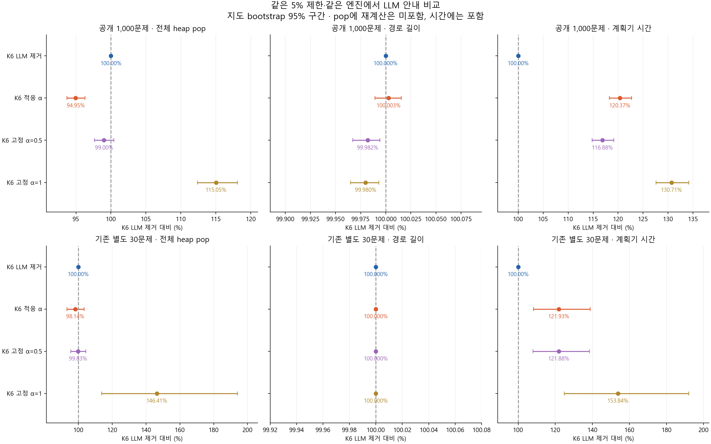
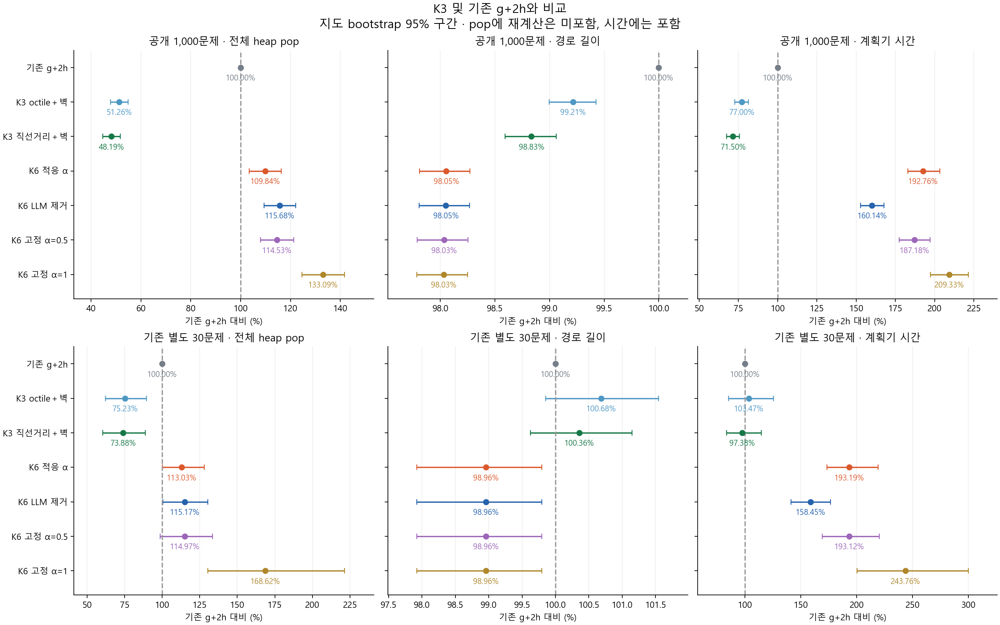
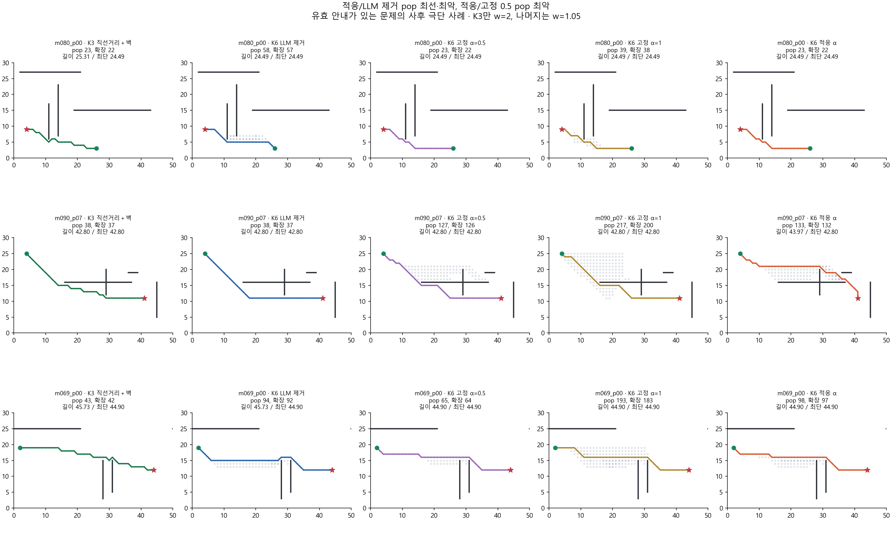

# K6 5% 제한: LLM 제거·고정 가중치 대조 결과

2026-10-25 · 규민 · gm · 기존 K6의 후속 실험

**적응형 K6의 LLM 안내는 같은 엔진의 안내 제거 조건보다 pop을 5.05% 줄였지만 실제 이웃 확장은 2.97%, 계획기 시간은 20.37% 늘었다. 경로 길이는 사실상 같았다.** 따라서 pop 절감을 전체 계산 효율 개선으로 해석하면 안 된다. 고정 α에서는 아주 작은 길이 개선이 관측됐으나 시간 비용이 늘었고 별도 지도에서는 길이 이득이 없었다.

현재 선택 의견은 **효율 중심이면 K3 직선거리＋벽 하한, 5% 경로 제한이 필요하면 이번 LLM 없는 g+1.05h0**다. 이전 K6 5%의 후보 가치는 주로 품질을 제한하는 탐색 구조에서 왔고, LLM의 독립적인 실용적 이득은 입증하지 못했다. 모든 지표에서 효과가 0이라고 주장하는 것은 아니다.

[실행법·코드](README.md), [사전 규약](PROTOCOL.md), [전체 수치와 신뢰구간](results/run_20261025/analysis/TABLES.md)를 함께 본다. 표의 상대 수치는 별도 표시가 없으면 문제별 비율의 기하평균이고 시간은 모델 생성 지연을 제외한다.

## 1. 무엇을 그대로 두고 무엇만 바꿨나

이번 질문은 기존 K6 5% 조건의 성능에서 **LLM 안내를 넣은 효과**와 **그 영향력 α를 적응시키는 효과**를 구분하는 것이다. 기존 `experiments/K6/search.py`의 graph_search, Controller, prepare_targets를 수정 없이 가져와 얇은 실행 함수에서 설정만 바꿨다.

```text
H = 1.05·h0 + α·0.05·(min(d(node,target), h0)−h0)
f = g+H
h0 = K3 octile＋벽 하한
```

| 조건 | LLM | α | 공통 비용 제한 |
| --- | --- | --- | --- |
| 기존 K6 적응형 | 같은 저장 경유점 | 0.5로 시작, 8회 관측마다 진전 시 증가·정체 시 감소 | 1.05C* |
| LLM 제거 | 응답 파싱·경유점 기능 제거 | 0, 같은 엔진에서 g+1.05h0 | 1.05C* |
| 고정 0.5 | 같은 저장 경유점·같은 필터 | 중간 경유점 동안 0.5 | 1.05C* |
| 고정 1 | 같은 저장 경유점·같은 필터 | 중간 경유점 동안 1 | 1.05C* |

네 조건 모두 같은 지도, 이동 비용, 하한, 재개방, tie-break, 종료, 경로 검증을 사용한다. 중간 경유점이 없거나 마지막 goal 단계이면 고정 조건도 α=0이다. 고정 조건도 target이 바뀌면 OPEN을 재정렬한다. no-guide는 기본 제어 bookkeeping은 유지하지만 파싱·거리 안내·target 전환·재정렬이 없다.

기존 g+2h와 K3 octile/직선거리＋벽 하한도 함께 재측정했다. K3는 가중치 2와 기존 CLOSED 규칙을 유지하므로 **K6/K3 비교는 성능 절충을 보는 비교이고 LLM의 효과를 분리하는 대조는 아니다.**

## 2. 진행 과정과 검증

1. 기존 K6의 유망했던 5% 조건과 미확인 대조를 확인하고 7조건을 고정했다. 결과를 보고 주 방법을 고정 α로 바꾸지 않았다.
2. 새 설정을 heap 없는 전체 OPEN 스캔 참조 및 독립 정수 기하·Dijkstra와 대조했다. 480조건을 통과했다.
3. 첫 파일럿의 첫 g+2h 시행에서 내부 시간 `seconds`까지 비시간 동등성 항목으로 비교한 실행기 오류로 중단됐다. [초기 실패 기록](development/failed_20261025_timing_parity/manifest.json)을 보존하고 `seconds`와 `total_seconds`를 제외했다. 알고리즘·데이터·α는 바꾸지 않았고, 기존 측정 폴더를 덮어쓰지 않고 전체를 다시 실행했다. 이 1회는 최종 집계에서 제외했다.
4. 공개 부분집합 파일럿 30문제, 공개 1,000문제, 기존 별도 30문제를 실행했다. 각 문제에서 7조건을 5회씩 순서를 섞어 측정했다. 파일럿은 독립 문제 수에 더하지 않는다.
5. 원시 기록을 저장한 뒤 표·진단·사례를 생성하고, 해시·반복·중앙값·비율을 별도 코드로 다시 확인했다.

| 항목 | 결과 |
| --- | --- |
| 데이터 | 공개 100지도×10쌍, 기존 별도 seed=20261013의 10지도×3쌍 |
| 모델 응답 | GPT-4o mini 2024-07-18 standard/Few-shot의 동일 실제 응답 1,030개 |
| 시간 반복 | 모든 조건 결정적, 각 5회 중앙값. 모델을 5번 생성한 것이 아님 |
| 실행 수 | 공개 35,000＋별도 1,050＋중복 파일럿 1,050 = **37,100회** |
| 독립 경로 검증 | 37,100회 통과 |
| 5% 상한 검사 | K6 네 조건 21,200회 통과, 위반 0 |
| 과거 결과 동등성 | 기준 3조건＋적응 K6의 비시간 지표 21,200회 일치 |
| no-guide 별도 엔진 대조 | K4 clean weighted 엔진을 w=1.05로 실행. 1,060개 참조 실행에 대해 5,300회 경로·pop·storage·goal g 일치 |
| 참조 검증 | 480조건, 선택 6,487회, 충돌 37,104회, 하한 79,014회 검사 |
| 저장 감사 | 입력 22개·고정 데이터 3개·분석 입력 13개 해시, 시간 중앙값 7,420개, 상대 비율 735개 재집계 통과 |
| 신규 API | **0회** |

순서 및 bootstrap seed=20261029, 지도 단위 bootstrap 2,000회다. 여러 조건을 비교하지만 다중 비교 보정은 하지 않았다. 이전에도 사용한 지도와 응답이므로 독립적인 새 holdout 검증이라고 표현하지 않는다. 이 별도 30문제는 K3의 추가 120문제와 다르다.

## 3. 같은 5% 제한에서 LLM은 도움이 됐나

다음 표의 기준은 **LLM 제거 조건=100**이다. 모든 K6 조건은 같은 비용 제한과 엔진이다.

| 공개 1,000문제 | pop | 실제 이웃 확장 | 경로 길이 | 계획기 시간 | 최단경로 수 |
| --- | ---: | ---: | ---: | ---: | ---: |
| LLM 제거 | 100.00% | 100.00% | 100.0000% | 100.00% | 984/1,000 |
| **적응 α** | **94.95%** | **102.97%** | **100.0029%** | **120.37%** | **981/1,000** |
| 고정 α=0.5 | 99.00% | 103.42% | 99.9819% | 116.88% | 993/1,000 |
| 고정 α=1 | 115.05% | 119.76% | 99.9799% | 130.71% | 995/1,000 |

적응형의 pop 비율 95% 구간은 **93.69–96.30%**, 이웃 확장은 **101.92–104.03%**, 시간은 **118.24–122.68%**다. 길이 구간은 **99.9891–100.0155%**이고 개선/동일/악화 문제는 4/989/7이었다. 경로 길이 이득이 있다고 결론 내릴 근거가 없다.

고정 α=0.5는 no-guide보다 길이가 짧은 문제 10개, 동일 989개, 긴 문제 1개였다. 고정 α=1은 12개 개선·987개 동일·1개 악화였다. 따라서 **일부 경로 품질 개선은 실제로 존재한다.** 다만 전체 상대 길이 감소는 약 0.018–0.020%로 작고 시간은 16.88–30.71% 증가했다. 고정 0.5의 pop 구간은 97.63–100.42%라 전체 pop 절감도 뚜렷하지 않다.

또한 α가 커지면 H가 1.05h0에서 h0에 가까워지므로 더 보수적으로 탐색하는 효과가 들어 있다. 이 작은 품질 이득을 전부 GPT의 의미 이해나 우회 판단 덕분이라고 말할 수는 없다. 비LLM 안내를 같은 방식으로 넣는 추가 대조까지 수행한 것은 아니다.



그림의 길이 축은 작은 차이를 보여주기 위해 확대되어 있다. 0.02% 안팎의 길이 차이를 큰 성능 차이처럼 읽지 않는다.

## 4. pop 감소가 실제 탐색 절감은 아니었던 이유

공개 문제당 산술평균을 분해하면 다음과 같다. 이 절의 산술평균 비율은 앞의 문제별 비율 기하평균과 다르다.

| 조건 | 전체 pop | 실제 이웃 확장 | stale pop | OPEN 재계산 항목 | heap 재구성 | 안내 거리 계산 |
| --- | ---: | ---: | ---: | ---: | ---: | ---: |
| LLM 제거 | 203.848 | 144.993 | 57.855 | 0 | 0 | 0 |
| 적응 α | 184.043 | 146.231 | 36.812 | 229.183 | 5.950 | 295.181 |
| 고정 0.5 | 192.339 | 148.033 | 43.306 | 52.200 | 1.526 | 274.504 |
| 고정 1 | 205.377 | 158.966 | 45.411 | 67.104 | 1.938 | 299.212 |

모든 시행에서 `전체 pop = 이웃 확장 + stale pop + 목표 pop 1`이다. 적응/no-guide의 평균 pop 차이 **−19.805**는 이웃 확장 **+1.238**과 stale pop **−21.043**으로 분해된다. 따라서 이 집계에서 pop 감소는 실제 이웃 확장이 줄어서 생긴 것이 아니다.

적응형은 α/target 변경 때 OPEN을 다시 만들며 낡은 heap 항목도 정리한다. 재구성 전에 버린 전체 항목은 평균 264.106개, 새로 구성한 활성 항목은 229.183개로, 그때 제거한 낡은 항목이 34.923개다. 이후 heap에서 pop하지 않아도 된다는 점과 부합한다. 하지만 재계산·거리 측정·heapify에 비용이 들고 이는 pop 숫자에 들어 있지 않다. 실제 시간은 이를 포함한다.

`pop+rekey_scans`를 단순히 더한 값은 적응 413.226, no-guide 203.848이다. 두 연산의 CPU 비용은 다르므로 이것을 정확한 연산량의 두 배라고 해석하지 않는다. 핵심은 **pop 한 지표로 총비용 절감을 주장할 수 없다는 것**이다.

## 5. 적응 조절은 고정 가중치보다 좋은가

공개 데이터의 적응/고정 0.5 비교는 pop **4.10% 감소**, 이웃 확장 **0.44% 감소**, 시간 **2.98% 증가**, 길이 **0.021% 증가**였다. 실제 확장 비율 구간은 98.79–100.31%이고, 길이는 0개 개선·988개 동일·12개 악화였다. 적응 제어를 더해서 고정 0.5보다 실용적인 순이득을 얻었다고 보기 어렵다.

고정 1과 비교하면 적응형은 pop **17.47%**, 확장 **14.02%**, 시간 **7.92%**를 줄였다. 강한 안내의 낭비를 완화하는 효과는 있었다. 그러나 처음부터 안내를 없앤 조건보다 시간·확장이 유리해지지는 않았다. '항상 강하게 믿는 것보다 덜 손해'와 '안내 자체가 유리함'을 구분해야 한다.

공개 적응형의 전체 확장 중 α=0은 71.37%, 확장 가중 평균 α는 0.126이었다. 546개 문제에서 정체 때문에 적어도 한 번 안내를 껐다. α=0에는 마지막 goal 단계 및 중간점 없는 응답도 포함되므로 전체를 잘못된 안내의 비율로 해석하지 않는다.

공개 응답 중 중간 경유점이 남은 것은 841개다. 파싱 실패 116개 및 유효 중간점 없는 추가 43개는 네 조건의 경로·pop·길이가 같았다. **유효 안내 841개만 사후 분리해도 적응/no-guide 시간은 24.31%, 확장은 3.54% 늘었다.** 파싱 실패만 제거하면 유리해진다는 증거는 없다. 부분집합 분석은 전체 결과를 대체하지 않는다.

## 6. K3 직선거리＋벽 하한과의 비교

아래는 기존 g+2h=100이다. 네 K6 행은 w=1.05, K3는 w=2다. 모든 시간은 이번 같은 실행의 결과다.

| 공개 1,000문제 | pop | 경로 길이 | 계획기 시간 | 최단+5% 초과 |
| --- | ---: | ---: | ---: | ---: |
| g+2h | 100.00% | 100.00% | 100.00% | 153/1,000 |
| K3 octile＋벽 | 51.26% | 99.21% | 77.00% | 96/1,000 |
| **K3 직선거리＋벽** | **48.19%** | **98.83%** | **71.50%** | **44/1,000** |
| K6 적응 α | 109.84% | 98.05% | 192.76% | 0/1,000 |
| K6 LLM 제거 | 115.68% | 98.05% | 160.14% | 0/1,000 |
| K6 고정 0.5 | 114.53% | 98.03% | 187.18% | 0/1,000 |
| K6 고정 1 | 133.09% | 98.03% | 209.33% | 0/1,000 |

K3 직선거리＋벽 대비 적응 K6는 **길이 0.789% 감소를 얻는 대신 pop 2.279배·시간 2.696배**였다. no-guide도 길이를 **0.792% 줄였고**, pop 2.400배·시간 2.240배였다. K6의 K3 대비 길이 이득은 LLM을 빼도 유지된다.

K3 직선거리＋벽은 모든 문제에서 5% 제한을 제공하는 조건이 아니다. 공개 최악 길이는 최단의 121.65%, K6 no-guide는 102.933%, 적응/고정 조건은 102.874%였다. 따라서 K3가 모든 품질 요구에서도 무조건 더 좋다고 말하지 않는다. 과제에서 5% 제한을 필수로 지정한 것은 아니며 요구 품질에 따라 비용 절충을 선택한다.

절대 산술평균:

| 공개 조건 | pop | 길이 | 계획기 ms |
| --- | ---: | ---: | ---: |
| g+2h | 201.353 | 35.07668 | 2.8402 |
| K3 직선거리＋벽 | 94.697 | 34.66854 | 1.8303 |
| K6 적응 α | 184.043 | 34.35242 | 4.5578 |
| K6 LLM 제거 | 203.848 | 34.35081 | 4.1142 |
| K6 고정 0.5 | 192.339 | 34.34446 | 4.5557 |
| K6 고정 1 | 205.377 | 34.34353 | 4.8270 |

위 평균값끼리 나눈 비율과 대표 기하평균 비율은 다르다. 이전 실험과 시스템 부하·측정 시점·반복 수가 다르므로 과거 절대 ms와 직접 비교하지 않는다.



## 7. 기존 별도 30문제에서도 유지되나

LLM 제거=100인 동일 품질 제한 비교:

| 조건 | pop | 실제 이웃 확장 | 길이 | 계획기 시간 |
| --- | ---: | ---: | ---: | ---: |
| LLM 제거 | 100.00% | 100.00% | 100.00% | 100.00% |
| 적응 α | 98.14% | 102.30% | 100.00% | 121.93% |
| 고정 0.5 | 99.83% | 101.70% | 100.00% | 121.88% |
| 고정 1 | 146.41% | 147.88% | 100.00% | 153.84% |

30문제 모두 네 조건의 **경로 길이가 동일**했다. 경로 좌표까지 모두 같다는 뜻은 아니다. 네 조건 모두 29/30개가 최단이었고 최악 초과는 0.854%였다. 적응형 pop 구간은 93.27–103.47%로 절감이 명확하지 않았고 시간 구간은 108.36–138.92%였다.

K3 직선거리＋벽 대비 적응형은 pop 1.530배·시간 1.984배, no-guide는 pop 1.559배·시간 1.627배였다. 길이는 둘 다 K3보다 1.396% 짧았다. 별도 지도에서도 품질 이득은 LLM 없이 유지됐다. 다만 지도 10개뿐이고 이미 사용한 자료라 미지 환경 일반화를 보장하지 않는다.

## 8. 도움이 된 경우와 나빠진 경우

유효 안내가 있는 문제 중 적응/no-guide pop 최선·최악, 적응/고정0.5 pop 최악을 사후에 선택했다. 유리한 사례만 고르지 않았으며 평균을 대표하는 예시도 아니다.

| 사례 | K3 직선거리 pop | no-guide pop | 고정0.5 pop | 고정1 pop | 적응 pop | no-guide → 적응 길이 |
| --- | ---: | ---: | ---: | ---: | ---: | ---: |
| m080_p00, pop 개선 | 23 | 58 | 23 | 39 | 23 | 24.485 → 24.485 |
| m090_p07, pop 악화 | 38 | 38 | 127 | 217 | 133 | 42.799 → 43.971 |
| m069_p00, 고정0.5 대비 악화 | 43 | 94 | 65 | 193 | 98 | 45.728 → 44.899 |

- **m080_p00:** 안내가 실제 이웃 확장을 57→22로 줄이는 사례도 있다. 다만 적응형은 OPEN 재계산 310항목, 고정 0.5는 252항목이 추가됐다. 단일 좋은 사례의 pop만으로 전체 시간 우위를 주장하지 않는다.
- **m090_p07:** no-guide와 K3는 38 pop으로 최단경로를 찾았지만 적응형은 133 pop, 재계산 135항목, 재확장 20회였고 경로도 길어졌다. 5% 제한은 지켰지만 안내가 성능을 악화시킨 사례다.
- **m069_p00:** LLM을 쓰는 세 조건은 no-guide보다 짧은 최단경로를 찾았다. 그러나 같은 길이를 얻는 데 고정 0.5는 65 pop·재계산 0, 적응형은 98 pop·재계산 252항목이었다. 안내의 일부 품질 이득과 적응 조절의 비용을 구분할 수 있다.



## 9. 결론과 다음 선정에 반영할 내용

**LLM이 실제로 도움이 되는가?** 일부 문제의 탐색 순서와 고정 α의 작은 경로 품질에는 도움이 되는 경우가 있었다. 하지만 이번 전체 평가에서 LLM 안내는 no-guide보다 시간을 늘렸고, 적응형은 길이 이득 없이 실제 확장도 늘렸다. '효과가 전혀 없다'보다 **'관측한 작은 이득이 추가 비용을 정당화하지 못했다'**가 정확하다.

**적응 조절이 필요한가?** 강한 고정 α=1의 손해를 줄이는 데는 효과가 있었지만 고정 0.5보다 시간·길이가 유리하지 않았다. 이 제어기를 최종 개선의 핵심 성과로 제시할 근거는 부족하다.

**최종 후보는?** 효율 중심의 1순위는 K3 직선거리＋벽 하한을 유지한다. 개별 경로 5% 제한이 필요하다면 이번 **LLM 없는 g+1.05h0**가 더 합리적인 비용 기준점이다. 이전의 “K6 5%는 LLM 유지가 필요한 경우의 후보”라는 추천은 LLM 제거 대조가 없을 때의 잠정 의견이었다. 이번 결과로 그 추천의 근거가 약해졌다. LLM을 남겨야 하는 과제 해석 때문에 호출만 유지하고 효과를 과장하지 않는다.

이번 실험은 원 논문 전체의 추가 재현이 아니라 개선 후보의 구성요소 검증이다. 최종 과제에서는 원본 A*·LLM-A*와의 비교, 제출 입출력, 숨겨진 지도 실행, 코드와 설명 일치도 필요하다. LLM 없는 제안의 최종 허용 여부나 성능 점수를 이 실험이 보장하지 않는다.

## 10. 한계·재현 자료

모델 하나·프롬프트 하나의 고정 응답과 이미 본 작은 선분 장애물 지도에서 얻은 결과다. 다른 LLM·프롬프트·환경의 효과를 부정하지 않는다. no-guide 대조는 안내 입력·필터·target 전환·점수·관리 비용을 함께 제거하므로 모델 좌표 내용의 순수 효과를 완전히 분리하지는 않는다. 비교가 사후 질문에서 출발했다는 사실과 다중 비교 미보정도 명시한다.

시간에는 파싱·필터·하한 준비·탐색·제어·재정렬·경로 검증이 포함된다. 모델 생성·파일 IO·독립 정답 산출은 제외했다. 재사용 응답의 과거 평균 API 지연은 공개 5.436초, 별도 5.772초였고 총 토큰은 1,219,246이다. 이번 추가 지출은 없지만 새로운 문제에서 LLM 방식의 온라인 비용은 0이 아니다.

- [실행·환경·입력 해시](results/run_20261025/manifest.json), [알고리즘 검증](results/run_20261025/verification.json), [최종 감사](results/run_20261025/final_audit.json), [결과 파일 해시](results/run_20261025/artifacts_sha256.json)
- [공개 원시 반복](results/run_20261025/public/evaluations.jsonl.gz), [문제별 지표](results/run_20261025/public/per_case.jsonl.gz), [CSV](results/run_20261025/public/per_case.csv)
- [별도 지도 원시 반복](results/run_20261025/transfer/evaluations.jsonl.gz), [전체 표](results/run_20261025/analysis/TABLES.md), [안내 진단·사례](results/run_20261025/analysis/diagnostics.json), [사례 추적](results/run_20261025/analysis/trace_examples.json)
- [기존 K6 수식·문헌·구현 설명](../K6/README.md), [K3 결과](../K3/REPORT.md)

Codex가 설정 구현, 검증·실험 실행, 집계·그림·이 문서의 초안을 지원했다. 사용자의 이해와 최종 문장 검토는 별도다. 기존 결과와 최종 제출용 Proposed/PDF/ZIP은 이 실험으로 자동 교체하지 않았다.
