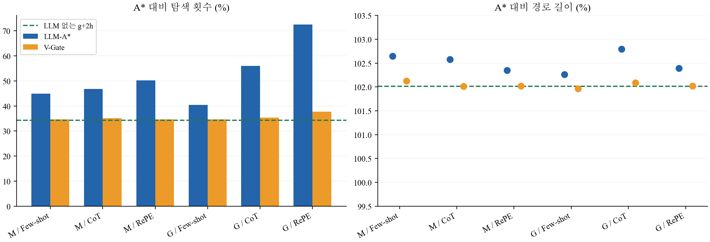
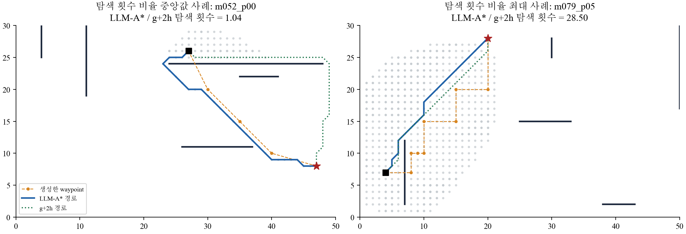

# 2026-10-13 재현 결과와 해석

공개 1,000문제 × 모델 2개 × 프롬프트 3종의 **6,000개 실제 응답**을 수집했다. API 오류는 0건이다. Table 1의 14개 조건을 각 1,000문제로 평가했고, 제안 방법과 ablation 18,000건, 새 맵 30문제 비교를 추가했다. 원문 응답을 공유하므로 평가 건수만큼 LLM을 다시 호출한 것은 아니다.

## 먼저 볼 결과

| 방법 | A* 대비 연산량 | 저장량 | 경로 길이 | 유효 경로 |
| --- | ---: | ---: | ---: | ---: |
| A* | 100% | 100% | 100% | 100% |
| GPT-4o mini Few-shot LLM-A* | 44.85% | 64.43% | 102.65% | 100.00% |
| V-Gate 개선안, 같은 응답 | 34.63% | 56.31% | 102.13% | 100.00% |
| LLM 없는 g+2h 대조군 | 34.32% | 56.23% | 102.02% | 100% |

비율은 문제별 방법/A*의 기하평균이다. 예를 들어 연산량 44.85%는 A*보다 55.15% 적다는 뜻이다. [전체 14행](../results/main/table1.md), [원문 Table 1 인용값](../report/paper_table1.json)을 구분해 확인한다.

## 이번 결과가 말해 주는 것

1. LLM이 직접 내놓은 선분 경로는 충돌이 많다. LLM-only 성공률은 여섯 조건에서 5.6~12.1%다. 탐색을 결합하면 이 데이터에서 모두 100% 경로를 얻었다.
2. A*보다 탐색이 줄었다고 해서 그 감소가 모두 LLM 덕분인 것은 아니다. LLM 없이 목표 거리의 가중치만 두 배로 한 대조군이 여섯 LLM-A* 조건보다 평균 연산량이 적었다. 이것이 우리 보고서의 핵심 대조 분석이다.
3. V-Gate는 생성 경로의 시작·끝, 경계, 충돌과 정수 좌표를 검사한다. 통과하면 원 안내를 쓰고, 실패하면 g+2h로 전환한다. 주 조건에서 56/1,000개 안내만 채택했다. 원 LLM-A* 대비 연산량 비율은 77.22%, 맵 단위 bootstrap 95% 구간은 73.98~80.43%다.
4. 개선안도 LLM 없는 대조군보다 좋다고 주장할 수 없다. 안내를 대부분 버리는 것이 좋아진 이유라면 LLM 호출의 필요성 자체가 약해진다. 개선안은 이미 응답을 받은 뒤 검증하므로 API 비용도 그대로 발생한다.

## 원본 구현에서 확인한 함정

- waypoint를 반드시 통과하지 않는다. 목표는 그대로이고 g+h(goal)+h(target)로 탐색 순서만 바뀐다.
- 목록이 없으면 start/goal로 fallback되어 g+2h가 된다. 이번에 382개 응답이 해당했다.
- 마지막 `[[...]]`를 무조건 읽는 parser는 장애물 triple까지 waypoint로 해석한다. 실제 32개 응답에서 2차원 schema 위반을 확인했다. 원본 재현에서는 앞 두 숫자를 쓰는 동작을 보존하고, LLM-only와 V-Gate에서는 거부한다.
- 1,000토큰 제한으로 229개 응답이 잘렸다. 이 응답도 숨기거나 다시 생성하지 않았다.
- operation은 중복 pop 포함, storage는 inf 비용 항목 포함이다. 실제 시간·메모리와 동일한 값이 아니다.

## 검증과 추가 실험

원본 대비 90개 고정 응답 검사에 더해 실제 응답 62개를 원본 코드로 재생해 비교했다. A* 전체 1,000개 경로 길이를 독립 Dijkstra로 확인했고 저장된 모든 성공 경로를 재검사했다. [검증 기록](../results/verification/final_integrity.json).

새 맵 10개·30문제에서는 LLM-A*와 V-Gate 모두 30/30 성공했다. 연산량 비율은 각각 42.12%, 33.39%였고, g+2h는 30.51%였다. 이 작은 smoke 실험으로 광범위한 일반화를 보장하지 않는다.

본 실험 6,000회의 표준 요금 추산은 약 **US$3.104**다. 실제 청구액은 아니며 모델 접근 확인, 자연어 입력 검사, 새 맵 30회는 이 숫자에서 제외한다. 토큰과 요청 지연은 [비용 기록](../results/main/costs.json)에 있다. 요금 출처: [GPT-4o mini](https://developers.openai.com/api/docs/models/gpt-4o-mini), [GPT-3.5 Turbo](https://developers.openai.com/api/docs/models/gpt-3.5-turbo).

## 재현 범위와 남은 제출 준비

GPT-4o mini가 논문의 Llama3를 대체했다. GPT-3.5도 정확한 원 snapshot/API와 같다고 주장하지 않는다. 원 코드의 newline stop을 제거했고 DWA 감쇠 규칙 및 실패 경로 길이의 분모는 명시한 가정이다. 논문의 10단계 확장성 실험은 수행하지 않았다. 과제 안내서의 Table 1 재현과 제안 비교에 집중했다.

코드·실험·결과 분석·ACL 보고서 초안을 마련했다. 팀 최종 버전 선정, 저자/팀명 반영, 사용자의 설명·문장 검토, 개인별 기여 보고서, 실제 제출과 이후 동료평가/답변은 별도다. 다른 팀원 기여를 추측해 작성하지 않았다. AI 지원을 숨기거나 탐지 회피를 위한 문장 변경을 하지 않는다.

