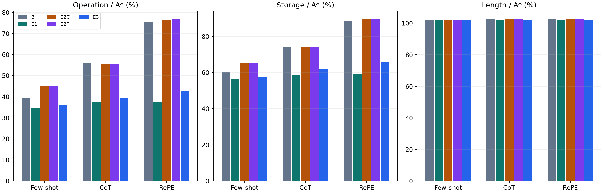
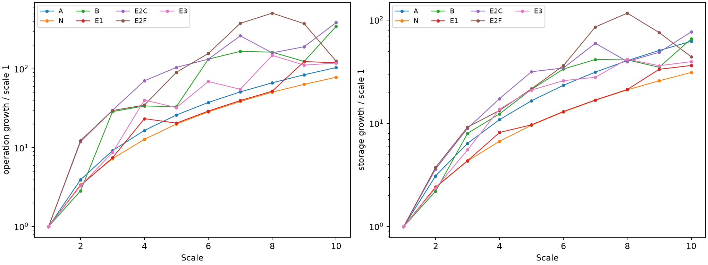

> **현재 평가에서 사용 금지 — 이전 결과 폐기**
>
> 2026-10-28 정정: 이 문서의 이전 SM 실험 수치와 선정 결론은 현재 평가 근거로 폐기되었습니다. 현재 유효한 S1~S6 결과는 GM 기준·Python 3.11 재실험입니다. 과거 기록은 추적을 위해서만 보존합니다.
> [현재 공식 결과](../../gm_retest_20261028/results/s1_s6_gm_20261028/report.md)

---

# LLM-A\* 개선 실험 최종 보고서

실험 완료일: 2026-10-14 · 상태: 전체 실행 및 서버·로컬 검증 완료

> **결과 판단:** 기본 LLM-A* 대비 관찰된 개선 효과가 뚜렷한 후보는 **1번(경유점 정제)**과 **3번(조건부 호출)**입니다. 1번은 탐색 연산량 감소, 3번은 연산량과 API 호출 수 감소가 핵심입니다. 2번은 출력 유효율이 소폭 높아졌지만, 동일 호출 횟수의 대조군 대비 일관된 탐색 개선을 보이지 않았습니다.
>
> 이 보고서의 “개선 효과”는 이번 데이터에서 관찰한 차이를 뜻합니다. **통계적 유의성 검정이나 신뢰구간 산출을 수행하지 않았으므로, 통계적으로 유의하다고 결론 내릴 수는 없습니다.** 또한 세 개선안 모두 GPT 없는 g+2h 대조군보다 본실험의 집계 연산량이 적지는 않았습니다.

경유점 정제(E1)와 조건부 호출(E3)은 기본 LLM-A\*의 탐색 연산량을 줄였습니다. 오류 피드백(E2)은 같은 호출 횟수의 재검토보다 일관된 탐색 개선을 보이지 않았습니다.

세 방법 모두 GPT 없는 g+2h 대조군(N)을 일관되게 능가한다는 증거는 없습니다. 따라서 “GPT 안내 자체의 우월성”보다 “잘못된 안내의 영향 감소”와 “API 호출 절감”으로 해석하는 것이 적절합니다.

**28,270행** 전체 평가 기록 검증

**1,000 × 3** 각 개선안의 본실험 문제 × 프롬프트

**8,814건** 공유·캐시를 반영한 실제 응답 수집

## 1. 실험 범위와 변인 통제

1,000은 학습 step 수가 아니라 고유 경로 탐색 문제 수입니다. 각 개선안은 동일한 1,000문제에 Few-shot·CoT·RePE를 적용해 3,000개의 최종 탐색 평가를 수행했습니다. 대조군과 GPT-only 평가까지 합친 본실험은 27,000행이며, 개발 270행과 확장성 1,000행을 포함하면 28,270행입니다.

기존 GPT 재현의 모델 **gpt-3.5-turbo-0125**, temperature=0, max_tokens=1000, 지도·시작점·목표점, 세 프롬프트, 경계·충돌 판정, 탐색 규칙과 네 평가 지표를 유지했습니다. 최초 GPT 응답을 새로 수집해 조건 간 공유하고, 세 개선안을 결합하지 않았습니다. E2C와 E2F는 수정이 필요한 같은 문제에서 각각 한 번만 추가 호출하고 두 번째 답을 그대로 채택했습니다.

| 방법 | 유일한 변경 또는 대조 역할 |
| --- | --- |
| B | 기본 LLM-A\*: 최초 GPT 경로를 원래 방식으로 사용 |
| E1 | 반복 구간 제거 → 충돌 없는 직선 단축 → 검증 실패 시 내부 경유점 불채택 |
| E2F | 최초 경로가 무효일 때 기존 검증기의 첫 오류를 제공하여 한 번 수정 |
| E2C | E2F와 호출 횟수가 같은 비구체적 재검토 대조군 |
| E3 | g+2h 탐색으로 시작하고 고정된 정체 조건에서 GPT를 한 번 호출 |
| N | GPT 경유점 없는 g+2h 대조군: GPT 안내의 추가 기여 확인 |

연산량은 중복을 포함한 heap-pop 수, 저장량은 len(g), 길이는 최종 경로 길이입니다. 아래 감소율은 같은 문제의 두 조건 비율을 기하평균한 뒤 100%에서 뺀 값입니다. 본실험의 모든 하이브리드 조건은 1,000/1,000문제에서 유효한 경로를 얻었습니다.

## 2. 핵심 결과

| 비교 (양수 = 감소, 음수 = 증가) | Few-shot | CoT | RePE |
| --- | --- | --- | --- |
| E1 / B 연산량 감소 | +12.50% | +33.27% | +49.91% |
| E2F / E2C 연산량 감소 | +0.36% | -0.48% | -0.78% |
| E3 / B 연산량 감소 | +9.01% | +30.03% | +43.50% |
| E3 / B API 호출 감소 | 50.20% | 50.20% | 50.20% |

### E1 — 경유점 정제

기본 LLM-A\* 대비 연산량이 감소했지만 N보다 연산량이 적지는 않았습니다. 검증 실패로 내부 경유점을 불채택한 경우는 Few-shot 924건, CoT 780건, RePE 701건입니다. 개선의 상당 부분은 유용한 GPT 안내 생성보다 부정확한 안내의 제거와 관련된 것으로 해석할 수 있습니다.

### E2 — 오류 피드백

GPT 출력 자체의 유효율은 소폭 개선됐으나, 같은 호출 횟수의 E2C와 비교한 최종 탐색 연산량은 Few-shot에서만 소폭 감소하고 CoT·RePE에서는 증가했습니다. 오류 정보 제공의 일관된 탐색 개선 효과는 확인되지 않았습니다.

| GPT 출력 유효율 | Few-shot | CoT | RePE |
| --- | --- | --- | --- |
| 최초 출력 | 6.3% | 9.4% | 11.9% |
| 일반 재검토 | 9.7% | 10.4% | 12.4% |
| 오류 피드백 | 9.9% | 11.9% | 13.7% |

### E3 — 조건부 호출

각 프롬프트에서 1,000문제 중 498문제에서만 API를 호출했습니다. 기본 LLM-A\*보다 연산량과 호출 수가 감소했으나, GPT 없는 N보다 연산량은 더 많았습니다. 추가 연구 후보로는 호출 비용 절감이 가장 명확합니다. 실제 응답 시간 우위는 이 실험으로 주장하지 않습니다.

## 3. 본실험 네 지표

연산량·저장량·길이는 같은 문제의 A\* 대비 비율(기하평균, %)이며 낮을수록 작습니다. 유효율은 높을수록 좋습니다. N은 프롬프트에 무관한 공통 대조군입니다.

| 방법 | 프롬프트 | 연산량 % | 저장량 % | 길이 % | 유효율 % | 문제 수 | 논리적 API 호출 |
| --- | --- | --- | --- | --- | --- | --- | --- |
| A\* | 공통 | 100.00 | 100.00 | 100.00 | 100.00 | 1000 | 0 |
| N: GPT 없는 g+2h | 공통 | 34.32 | 56.23 | 102.02 | 100.00 | 1000 | 0 |
| B: 기본 LLM-A\* | Few-shot | 39.45 | 60.54 | 102.22 | 100.00 | 1000 | 1000 |
| B: 기본 LLM-A\* | CoT | 56.28 | 74.22 | 102.79 | 100.00 | 1000 | 1000 |
| B: 기본 LLM-A\* | RePE | 75.31 | 88.54 | 102.44 | 100.00 | 1000 | 1000 |
| E1: 경유점 정제 | Few-shot | 34.52 | 56.36 | 101.96 | 100.00 | 1000 | 1000 |
| E1: 경유점 정제 | CoT | 37.56 | 58.83 | 102.15 | 100.00 | 1000 | 1000 |
| E1: 경유점 정제 | RePE | 37.72 | 59.24 | 101.96 | 100.00 | 1000 | 1000 |
| E2C: 일반 재검토 | Few-shot | 45.16 | 65.31 | 102.36 | 100.00 | 1000 | 1937 |
| E2C: 일반 재검토 | CoT | 55.56 | 73.88 | 102.76 | 100.00 | 1000 | 1906 |
| E2C: 일반 재검토 | RePE | 76.37 | 89.38 | 102.43 | 100.00 | 1000 | 1881 |
| E2F: 오류 피드백 | Few-shot | 45.00 | 65.33 | 102.35 | 100.00 | 1000 | 1937 |
| E2F: 오류 피드백 | CoT | 55.82 | 74.09 | 102.63 | 100.00 | 1000 | 1906 |
| E2F: 오류 피드백 | RePE | 76.97 | 89.72 | 102.39 | 100.00 | 1000 | 1881 |
| E3: 조건부 호출 | Few-shot | 35.89 | 57.80 | 102.01 | 100.00 | 1000 | 498 |
| E3: 조건부 호출 | CoT | 39.38 | 62.16 | 102.21 | 100.00 | 1000 | 498 |
| E3: 조건부 호출 | RePE | 42.56 | 65.70 | 102.05 | 100.00 | 1000 | 498 |

논리적 호출 수는 각 알고리즘을 따로 운영할 때의 사용량입니다. 실제 응답 수집은 조건 간 공유와 캐시를 사용하므로 이 표의 호출 수 합계와 다릅니다.

## 4. 확장성 평가

기존 GPT 재현의 고정 시드 240702511로 선택한 10문제를 1~10배로 확대해 Few-shot으로 평가했습니다. 모든 조건에서 100문제를 완료했습니다. 아래 그래프는 각 문제의 1배 대비 증가율을 배율별 산술평균한 값이며 세로축은 로그 눈금입니다. 원본 논문의 Llama 확장성 실험과 동일한 실험은 아닙니다.

| 방법 | 연산량 / A\* % | 저장량 / A\* % | 길이 / A\* % | 유효율 % | 문제 수 |
| --- | --- | --- | --- | --- | --- |
| A\* | 100.00 | 100.00 | 100.00 | 100.00 | 100 |
| N: GPT 없는 g+2h | 23.05 | 30.19 | 104.77 | 100.00 | 100 |
| B: 기본 LLM-A\* | 38.81 | 45.70 | 103.01 | 100.00 | 100 |
| E1: 경유점 정제 | 24.34 | 31.44 | 103.43 | 100.00 | 100 |
| E2C: 일반 재검토 | 54.76 | 58.84 | 102.37 | 100.00 | 100 |
| E2F: 오류 피드백 | 55.40 | 60.46 | 102.07 | 100.00 | 100 |
| E3: 조건부 호출 | 31.49 | 40.69 | 103.50 | 100.00 | 100 |

확장성 평가에서 기본 LLM-A\* 대비 연산량 감소율은 E1 37.28%, E3 18.87%입니다. E3는 100문제 중 75문제에서 호출해 호출 수를 25% 줄였습니다. 확장성 평가에서도 E1·E3의 연산량은 N보다 많았고, E2F는 E2C보다 연산량이 소폭 증가했습니다.

## 5. 실행 이력과 통제상의 한계

- 사용자 요청으로 실행 호스트를 Windows PC에서 Linux GPU 서버로 옮겼습니다. 모든 대조군을 서버에서 다시 실행했고, 기존 A\*·Dynamic Weighted A\*·g+2h의 3,000개 지표 기록과 일치함을 확인했습니다. 운영체제까지 완전히 동일한 환경은 아닙니다.
- GPT 추론은 OpenAI API에서 수행했고, 원래 Python 탐색은 CPU에서 수행했습니다. GPU 커널이나 병렬 탐색 알고리즘을 도입하지 않았습니다.
- 2026-10-14 02:08 KST에 API 크레딧 소진으로 E2 확장성 평가가 중단됐습니다. 중단 뒤 E3는 이미 수집한 응답과 실제 호출 시점 기록을 이용한 재생 평가로 먼저 완료했습니다. 이는 사전 계획의 실행 순서에 대한 예외이며, 별도 감사 기록에 보존했습니다. 재생 결과는 실제 수집 당시의 경로·지표·호출 조건과 대조했습니다.
- 충전 확인 후 2026-10-14 09:50 KST에 동일한 고정 코드·프로토콜로 재개했습니다. 완료된 응답을 교체하지 않고 남은 E2 확장성 21문제만 채운 뒤 전체 검증을 수행했습니다. 중단 전후 API 서비스 상태와 시간 차이까지 통제할 수는 없습니다.
- 프롬프트 예시와 겹치는 5문제를 모든 조건에서 공통 제외한 995문제 결과를 별도 제공했습니다. 이 제외 분석에서도 위 연산량 비교의 방향은 유지됐습니다. 이미 관찰한 데이터에서 제안한 개선안이며, 독립 미관측 데이터 검증이나 반복 실험에 기반한 통계적 유의성 검정은 수행하지 않았습니다.
- 본실험 응답 중 길이 제한 종료 21건과 content_filter 종료 3건도 좋은 출력으로 교체하지 않고 평가에 포함했습니다. 모든 응답의 모델 반환명은 고정 모델과 일치했지만, 서비스가 system_fingerprint를 제공하지 않아 내부 버전 동일성까지 확인할 수는 없습니다.
- 캐시와 응답 공유 때문에 실제 지연시간·실제 청구 금액 우위를 주장하지 않습니다. 추가 검증, 경유점 정제, OPEN 재계산 비용은 원본 heap-pop 지표에 포함되지 않습니다.

## 6. 원자료와 검증 기록

- [전체 자동 생성 보고서](../../results/improvements/report/report.html)
- [본실험 전체 지표 CSV](../../results/improvements/report/main_table.csv)
- [문제별 대응 비교 집계 CSV](../../results/improvements/report/paired_comparisons.csv)
- [확장성 지표 CSV](../../results/improvements/report/scaling_table.csv)
- [예시 중복 공통 제외 결과 CSV](../../results/improvements/report/main_without_demo_overlap.csv)
- [서버 전체 검증](../../results/improvements/verification.json)
- [로컬 파일 해시 및 결과 재검증](../../results/improvements/local_import_verification.json)
- [E3 실행 순서 예외 감사 기록](../../results/improvements/execution_deviation.json)
- [서버 원자료·보고서 ZIP](../../improvement-results-verified.zip)

서버 원자료 ZIP SHA-256: `081b8c1faba8f87aa458d23db63935f13406c523d8a02e25caf382914750b836`

고정 프로토콜 서명: `a9fe04a39cc82e046089b45b42cdcc6d16ca819293f864a0445f5f58fbc62f53`

검증 파일 수: 12,166개. 최종 응답 수: 8,814건.

이 문서는 검증된 결과를 해석한 최종 안내 보고서입니다. 고정된 실험 코드와 서버 자동 생성 보고서는 수정하지 않았습니다.
