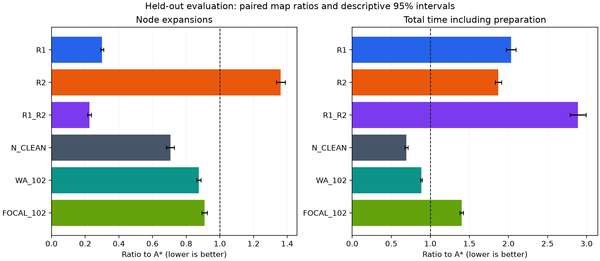

# 세 가지 추가 개선 실험 완료 보고서

주 실험 서버 완료: **2026-10-14 14:46:59 KST** · 보조 비교 완료: **2026-10-14 14:50:30 KST**  
실행: `next-search-20261014-v2` · 프로토콜: `next-search-20261014-v1`  
결과 회수 후 서버·로컬 검증 완료. 이 보고서는 계획 문서나 중간 보고서가 아닌 실제 실행 결과다.

## 1. 결론과 채택 판정

기본 크기의 단일 질의 기준으로 세 후보는 모두 사전 채택 기준을 통과하지 못했다. R1은 탐색 정점 확장을 줄였지만 기본 크기의 준비 포함 시간은 줄이지 못했고, R2는 재풀이와 전체 경로 검증 비용을 감당하지 못했다. R3의 Llama 순위는 규칙 순위보다 검증 확장 수와 추론 포함 시간이 모두 증가했다.

다만 **8배 확대 지도에서 R1의 시간 비율은 0.698 [0.554, 0.898]**로, 준비 비용을 포함한 대응 기하평균이 30.2% 감소했다. 이는 후속 검증 가치가 있는 조건부 관측이다. 40지도·80질의의 탐색적 95% 구간이며, 문제별 시간 비율 P95가 8.965배여서 일부 질의의 큰 퇴행도 남는다. 일반적인 채택 성공으로 확대 해석하지 않는다.

| 후보 | 경로 품질 | 확장 수 비율 | 전체 시간 비율 | N_CLEAN 대비 시간 | 판정 |
|---|---|---|---|---|---|
| R1 | 최단 길이 100.0% | 0.301 | 2.033 | 2.928 | 기본 크기 미달; 8배 조건 후속 검증 |
| R2 | 최단 길이 100.0% | 1.361 | 1.871 | 2.695 | 단일 질의 채택 기준 미달 |
| R1_R2 | 최단 길이 100.0% | 0.225 | 2.890 | 4.163 | 단일 질의 채택 기준 미달 |
| R3 LLM | 검증에서 w=1.02 상한 검사 | 1.054 / RULE | 18.455 / RULE | 직접 비교 대상 아님 | 최종 LLM 생성 중단 |

R1·R2·결합형의 비율은 새 최종 지도에서 A_OCT 대비다. R3 행은 **검증 120문제에서 RULE 대비**이며 최종 평가 결과가 아니다. 상세한 조건별 성능은 아래 확대·반복 질의 표로 구분한다. 검증 기준을 통과하지 못한 R1·R2·결합형의 최종 결과는 진단 목적이며 확증 성공으로 승격하지 않는다.

실용적으로는 정확한 최단 길이가 필수인 단일 질의에 A_OCT를 유지하는 판단이 적절하다. WA_101은 이번 최종 2,000문제에서 최단 길이가 모두 일치하면서 시간 비율이 0.891였지만, 일반적인 보장은 최적 비용의 1.01배까지이므로 정확 탐색과 동일하게 취급하지 않는다. 목표 고정·Q=10에서는 역방향 Dijkstra의 누적 시간 비율이 0.698로 유리했다. 이는 세 신규 후보의 개선 성공과 구분해야 한다.

## 2. 완료 범위와 실행 조건

- 개발 60지도·600문제, 검증 60지도·600문제, 신규 최종 200지도·2,000문제. 세 분할의 지도 기하 중복은 없다.
- 최종 주 평가 11방법 × 2,000문제 = 22,000행. R3 최종 대조군은 80지도·400문제 × 12조건 = 4,800행이다.
- 확대: 40개 원형 지도 × 2질의 × 1·2·4·8배 = 320조건, 5방법. 재사용: 20지도 × 목표 변경/고정 × Q=1·5·10 × 7방법 = 840묶음이다.
- 개발·검증을 포함한 알고리즘-문제 조건은 **43,520행**, 각 성공 조건은 시간 측정 5회. 반복 측정과 같은 지도의 질의는 독립 지도 수로 세지 않는다.
- 탐색은 CPU에서 순차 실행, 수학 라이브러리 스레드 수 1. GPU `NVIDIA RTX A5000`의 GPU 0은 Llama 추론에 사용했다. 두 GPU로 탐색을 병렬 실행한 실험이 아니다.
- Python `3.12.3`, NumPy `1.26.4`, SciPy `1.15.2`, Shapely `2.2.0`, PyTorch `2.7.0a0+7c8ec84dab.nv25.03`, CUDA `12.8`.
- 모델 `meta-llama/Meta-Llama-3-8B-Instruct`, BF16, greedy, 배치 1, revision `8afb486c1db24fe5011ec46dfbe5b5dccdb575c2`. 유료 API 호출 **0건**.
- 지도 생성 시드: 개발 26101410, 검증 26101411, 최종 26101412, 고정 목표 보조 26101413. 모델 시드 26101430, 무작위 순위 시드 26101431·26101432·26101433. 주 시간 순서 시드 26101420, 보조 A* 비교 순서 시드 26101440.

원래 정수 8방향 격자, 직선 이동 비용 1과 대각선 이동 비용 √2, 선분 충돌 규칙을 유지했다. R1 경로도 단위 이동으로 복원하며 any-angle 지름길로 길이를 줄이지 않았다. R3 안내는 FOCAL의 보조 순위에만 사용하고 admissible octile anchor와 전체 그래프를 유지한다.

## 3. 최종 단일 질의 결과

비율은 대응 문제의 로그 비율을 지도 안에서 평균하고 지도 간 평균한 기하평균이다. **1 미만이면 감소, 1 초과이면 증가**다. 시간에는 지도 준비·안내·필수 검증·재풀이·복원이 포함된다. 표의 신뢰구간은 유형별 지도 bootstrap 10,000회로 계산한 탐색적 95% 구간이다.

| 방법 | 성공/전체 | 최단 길이 일치 | 확장 수/A* | 전체 시간/A* (95% 구간) | P95 초과 길이 | 최대 L/L* |
|---|---|---|---|---|---|---|
| A_OCT | 2000/2000 | 100.0% | 1.000 | 1.000 [1.000, 1.000] | 0.000% | 1.000000 |
| R1 | 2000/2000 | 100.0% | 0.301 | 2.033 [1.971, 2.097] | 0.000% | 1.000000 |
| R2 | 2000/2000 | 100.0% | 1.361 | 1.871 [1.830, 1.912] | 0.000% | 1.000000 |
| R1_R2 | 2000/2000 | 100.0% | 0.225 | 2.890 [2.790, 2.993] | 0.000% | 1.000000 |
| N_LEGACY | 2000/2000 | 55.9% | 0.768 | 6.425 [6.226, 6.621] | 11.110% | 1.471983 |
| N_CLEAN | 2000/2000 | 65.7% | 0.706 | 0.694 [0.673, 0.715] | 9.384% | 1.471983 |
| WA_101 | 2000/2000 | 100.0% | 0.881 | 0.891 [0.880, 0.902] | 0.000% | 1.000000 |
| WA_102 | 2000/2000 | 99.5% | 0.875 | 0.885 [0.873, 0.896] | 0.000% | 1.014622 |
| WA_200 | 2000/2000 | 68.7% | 0.690 | 0.732 [0.710, 0.754] | 13.094% | 1.449052 |
| FOCAL_101 | 2000/2000 | 98.5% | 0.886 | 1.335 [1.315, 1.355] | 0.000% | 1.009809 |
| FOCAL_102 | 2000/2000 | 95.3% | 0.909 | 1.400 [1.378, 1.423] | 0.000% | 1.019901 |

`N_LEGACY`의 확장 수 열은 원래 구현의 중복 포함 heap pop 횟수다. 새 탐색기의 확장 수나 FOCAL의 여러 큐 pop과 같은 연산으로 비교하면 안 된다. `N_CLEAN`은 원래 N의 가중 Euclidean 안내를 새 탐색기에 적용한 대조군이다. WA는 Weighted A*, FOCAL은 경로 길이 상한을 유지하는 보조 순위 탐색이다.

### 사전 지정 비교의 보수적 구간

| 비교 | 시간 비율과 98.75% 구간 |
|---|---|
| R1/A_OCT | 2.033 [1.955, 2.116] |
| R2/A_OCT | 1.871 [1.819, 1.924] |
| R1_R2/R1 | 1.422 [1.379, 1.465] |

최대 네 비교를 고려한 98.75% 시간 구간이다. R3 LLM/RULE의 최종 비교는 진행 기준 미달로 존재하지 않는다. 위 세 구간도 탈락 후보의 진단 결과이며, 사전 게이트를 통과했다는 의미는 아니다.

### 개발 자료의 Euclidean/octile A* 보조 비교

계획에 있던 휴리스틱 단독 비교가 주 실행 묶음에서 빠져, 주 실험 종료 후 개발 60지도·600문제에 한해 별도 측정했다. 가중치 1과 동일 탐색기를 사용하고 두 방법을 같은 무작위 블록에서 5회씩 측정했다. 최종 자료를 사용하거나 설정을 다시 선택하지 않았다.

Euclidean A* / octile A*의 전체 시간은 **1.280 [1.222, 1.341]**, 확장 수는 **1.584 [1.503, 1.672]**다. 구간은 지도 bootstrap의 탐색적 95% 구간이며, 두 방법 모두 600문제의 최단 길이가 독립 정답과 일치했다. 별도 1,200행은 위 주 실행의 행 수에 포함하지 않는다. [보조 비교 원자료](../next_octile_supplement/summary.json)와 [로컬 검증](../next_octile_supplement/local_verification.json)에 보존했다.

### 지도 유형별 전체 시간

| 지도 유형 | R1 시간/A* | R2 시간/A* | 결합형 시간/A* |
|---|---|---|---|
| corridors_dead_ends | 1.446 | 2.494 | 2.678 |
| dense_segments | 2.495 | 2.167 | 3.575 |
| multiple_detours | 2.211 | 1.475 | 2.814 |
| original_style_segments | 2.141 | 1.536 | 2.589 |

유형마다 최종 50지도·500문제다. 원래 형태 지도는 51×31, 나머지는 101×61 크기의 합성 지도다. 원래 형태에서는 시작-목표 직선이 장애물에 막히는 질의만 생성했고, 나머지는 같은 연결 성분의 도달 가능한 질의를 뽑았다. 유형별 난이도 분포 차이를 함께 고려해야 한다.

## 4. R1: 정확한 직사각형 압축

개발에서 full/sparse를 비교해 **sparse**를 선택했다. 검증에서 A* 대비 확장 수 0.296배, 시간 1.926배였다. 최종에서는 확장 수가 **69.9% 감소**했지만, 준비 포함 시간은 **2.033배**다.

| 개발 후보 | 문제 수 | 확장 수/A* | 전체 시간/A* |
|---|---|---|---|
| R1:full | 600 | 0.275 | 4.582 |
| R1:sparse | 600 | 0.301 | 1.995 |

내부 정점을 생략해도 경계 정점의 macro edge 후보 생성, fan 순회, 정렬, 큐 작업과 경로 복원이 남는다. 따라서 압축 그래프의 확장 한 번은 원래 격자 정점의 확장 한 번과 같은 계산량이 아니다. 실제 계측을 함께 보아야 한다.

보존 논증은 빈 직사각형 내부의 두 점 사이에서 octile 길이의 단위 경로를 만들 수 있다는 데 기초한다. 완전 경계형에서는 원래 경로의 영역 진입·이탈 구간을 같은 값 이하의 macro edge로 바꾸고, 반대로 각 macro edge를 같은 길이로 복원한다. 희소형에서는 같은 변의 이동을 경계 간선으로, 마주 보는 변의 이동을 fan과 남은 경계 이동으로, 이웃한 변의 이동을 대각 연결과 경계 이동으로 나타낸다. 내부 시작·목표는 경계 및 같은 영역의 삽입점에 연결한다. 길이 0 벽처럼 이 인증을 쓰지 않는 경우는 원래 격자로 fallback한다. 수치 구현의 정확성은 아래 독립 정답·복원 검사를 추가로 거쳤다.

## 5. R2와 결합형: 장애물 단계적 반영

first/batch/rule/random, Llama가 제안한 제한된 4특징 선형 점수, 조건부 LPA 재사용을 개발에서 비교했다. 선택한 초기화는 **program**, 선형 가중치는 `[0.5, 0.3, 0.1, 0.1]`다. 임의 생성 Python을 실행한 방식이 아니라 지정된 특징의 유한 가중치만 허용했다.

특징 순서는 시작-목표 직선과 벽의 교차 여부, 지도 대각선으로 정규화한 벽 길이, 벽 끝점을 거치는 최소 우회 거리의 정규화 값, 외곽 경계 부착 여부다. 점수가 큰 벽을 먼저 반영하며 초기 벽 수는 직선과 교차하는 벽 수로 맞춘다.

| 개발 후보 | 문제 수 | 확장 수/A* | 전체 시간/A* |
|---|---|---|---|
| R2:batch | 600 | 1.550 | 2.066 |
| R2:first | 600 | 1.556 | 2.001 |
| R2:incremental | 600 | 1.921 | 9.604 |
| R2:program | 600 | 1.346 | 1.726 |
| R2:random | 600 | 1.550 | 2.131 |
| R2:rule | 600 | 1.346 | 1.773 |

개발 기본 변형과 선택된 프로그램·LPA는 별도 실행 블록이므로 위 표는 개발 선택 과정을 설명하는 기술 통계다. 독립적인 최종 유의성 비교로 사용하지 않는다. 반복 풀이가 필요한 개발 질의 비율 34.5%가 10%를 넘었기 때문에 LPA 비교도 실행했다.

추가 대조에서 선택된 AI 점수와 RULE의 **개발 600문제 경로·확장 수·회차 기록이 전부 동일**했다. 따라서 표의 작은 시간 차이는 새로운 탐색 행동의 이득을 입증하지 않는다. 이번 R2에서 AI가 규칙보다 독립적으로 유용한 선택 전략을 만들었다는 근거는 없다. 12개 제안 중 8개가 유효했고 서로 다른 가중치는 2개였다.

완화된 지도에서 찾은 경로를 모든 벽에 대해 검사하고 충돌 벽을 추가한다. 세 번의 실패 후 전체 벽을 반영한 정확 탐색으로 전환한다. 선택된 경로가 원래 문제에서 유효한지 확인하는 비용도 온라인 시간에 포함했다.

벽을 일부 제거한 문제의 최적 비용은 원래 문제의 하한이다. 그 완화 최적 경로가 모든 원래 벽에 대해 유효하면 원래 문제의 상한도 같은 값이 되므로 최단 경로임을 인증할 수 있다. 벽의 우선순위는 이 인증을 대체하지 않으며 계산량에만 영향을 준다.

| 방법 | 평균 풀이 회차 | 2회 이상 풀이 | 전체 벽 fallback |
|---|---|---|---|
| R2 | 1.401 | 34.7% | 1.3% |
| R1_R2 | 1.397 | 34.2% | 1.4% |

R1+R2의 시간은 R1 대비 **1.422배**다. 단독 후보 대비 추가 이득 여부를 별도로 판단해야 하며, 단순히 A*보다 적게 확장했다는 이유로 결합의 가치를 주장하지 않는다.

### 비용 분해와 연산 기록

| 방법 | 준비 ms | 탐색 ms | 필수 검증 ms | 복원 ms | 전체 ms |
|---|---|---|---|---|---|
| A_OCT | 0.055 | 2.662 | 0.000 | 0.034 | 2.782 |
| R1 | 1.749 | 3.162 | 0.000 | 0.037 | 4.674 |
| R2 | 0.102 | 3.198 | 0.647 | 0.041 | 4.117 |
| R1_R2 | 1.676 | 3.099 | 0.646 | 0.038 | 5.777 |

각 항목은 문제별 5회 측정의 중앙값을 다시 전체 문제에서 중앙값 낸 값이다. 서로 다른 항목의 중앙값을 더해도 전체 중앙값과 일치하지 않으며, 비율 표의 기하평균과도 다른 요약이다.

| 방법 | 총 확장 수 | 총 heap pop | 총 relax 시도 | 총 macro edge 검사 | 총 경로-벽 교차 검사 |
|---|---|---|---|---|---|
| A_OCT | 1,726,599 | 2,754,881 | 12,786,567 | 0 | 0 |
| R1 | 543,245 | 856,139 | 8,594,971 | 8,594,971 | 0 |
| R2 | 3,595,327 | 5,742,023 | 27,240,396 | 0 | 3,156,051 |
| R1_R2 | 718,575 | 1,103,437 | 16,137,511 | 16,137,511 | 3,045,888 |

이 표는 최종 2,000문제의 실제 카운터 합계다. 각 열은 서로 다른 작업이므로 가중치 없이 합쳐 단일 FLOP 수로 해석하지 않는다. 전체 시간 비율이 실용 성능의 주 판단 근거다.

대응 비율의 기하평균과 총 연산량의 비율도 다르다. 결합형은 기하평균 확장 비율이 R1보다 작지만 합산 확장 수는 718,575로 R1의 543,245보다 많다. 쉬운 질의에서의 개선과 어려운 질의에서의 재탐색 비용이 다르게 가중되기 때문이다. 따라서 결합형이 R1보다 전체 연산을 절약했다고 결론 내리지 않는다.

## 6. R3: 출입구 경로 후보와 LLM 순위

개발 후보 수 2/3 중 **k=2**를 고정했다. 직사각형 경계의 출입구 그래프에서 제한된 대체 경로를 만들고 같은 후보의 규칙·무작위·LLM 순위를 비교했다. 엄밀한 homotopy class의 완전 열거는 아니다.

| 분할 | 문제 수 | LLM/RULE 확장 수 | LLM/RULE 추론 포함 시간 |
|---|---:|---:|---:|
| 개발 | 120 | 1.062 | 20.460 |
| 검증 | 120 | 1.054 | 18.455 |

확장 수 10% 감소 기준을 넘지 못해 **최종 LLM 생성은 사전 규칙대로 생략**했다. 응답이 유효하지 않으면 RULE로 fallback하되 이미 지출한 추론 시간은 포함했다. 후보가 둘 미만이면 LLM을 호출하지 않았다. 이 결과만으로 다른 모델·프롬프트·후보 생성기의 가능성까지 부정할 수는 없다.

실제 R3 순위 응답은 개발 82개와 검증 80개가 모두 유효했다. 이번 성능 미달을 JSON 파싱 실패 때문이라고 설명할 수는 없다.

다음은 최종 400문제에서 LLM 없이 수행한 안내 대조군 결과다.

| w | 직접 대조군 | RULE 확장 수 비율 | RULE 시간 비율 | RANDOM 3시드 시간 범위 | RULE 최대 L/L* |
|---|---|---|---|---|---|
| 1.0 | A_OCT | 1.000 | 4.698 | 4.706–4.785 | 1.000000 |
| 1.01 | FOCAL_101 | 1.152 | 3.595 | 3.599–3.681 | 1.009809 |
| 1.02 | FOCAL_102 | 1.201 | 3.591 | 3.594–3.700 | 1.019658 |

무작위 3시드는 동일 문제의 순위 변동이며 독립 지도 3배로 계산하지 않았다. 표에는 각 시드의 시간 비율 범위를 표시했다. w=1의 대조군은 A_OCT, 나머지는 같은 w의 기본 FOCAL이다. LLM과 기본 FOCAL의 최종 성능 비교로 읽으면 안 된다.

## 7. 확대 지도와 반복 질의

### 공간 배율

| 확대 배율 | 문제 조건 수/방법 | N_CLEAN 시간/A* | R1 시간/A* | R2 시간/A* | 결합 시간/A* | R1 확장 수/A* |
|---|---|---|---|---|---|---|
| 1 | 80 | 0.757 | 2.097 | 1.855 | 2.997 | 0.325 |
| 2 | 80 | 0.829 | 1.684 | 1.798 | 2.483 | 0.172 |
| 4 | 80 | 0.819 | 1.190 | 1.651 | 1.748 | 0.074 |
| 8 | 80 | 0.673 | 0.698 | 1.504 | 0.986 | 0.028 |

각 배율은 동일 40개 원형 지도의 80질의 조건이다. 배율 1·2·4·8을 독립 지도 표본으로 합치지 않았다. 확대 배율은 좌표 배율이며 면적 증가율과 다르다.

8배에서 R1의 시간 비율과 탐색적 95% 구간은 **0.698 [0.554, 0.898]**, 결합형은 **0.986 [0.772, 1.283]**다. 결합형 구간은 1을 포함한다. R1의 확장 비율은 0.028로 크게 낮아졌지만, 유형별 시간 이득은 균일하지 않다.

| 8배 지도 유형 | R1 시간/A* | 문제별 시간 비율 P95 |
|---|---|---|
| corridors_dead_ends | 0.481 | 0.566 |
| dense_segments | 1.012 | 14.871 |
| multiple_detours | 0.510 | 7.291 |
| original_style_segments | 0.955 | 4.458 |

특히 8배 복도 지도에서는 시간 비율 0.481로 유리했고, 조밀한 선분 지도에서는 1.012로 평균 이득이 없었다. 각 유형은 10지도·20질의뿐이다. 이 표를 보고 만든 적용 규칙은 사후 선택이므로 신규 지도에서 다시 검증해야 한다. 확대 및 유형별 여러 비교에 대한 확증용 다중검정 성공을 주장하지 않는다.

8배에서 R1의 시간은 N_CLEAN 대비 약 1.037배로 근접했지만 더 빠르다는 결과는 아니다. R1은 최단 길이를 유지했고 N_CLEAN의 최대 L/L*는 1.204685였다. 따라서 이 조건의 장점은 근사 탐색과 비슷한 시간에 정확 경로를 구할 가능성이지, N_CLEAN의 시간까지 동시에 이겼다는 뜻은 아니다.

### 전처리 재사용

아래는 동일 workload·동일 Q의 A_OCT 누적 시간 대비 비율이다. 지도/목표별 준비 시간을 포함해 실제 서로 다른 질의를 순서대로 풀었다. 숫자만 같은 질의를 반복해 답 캐시를 재생한 실험이 아니다.

| workload | Q | R1 | R2 | 결합 | FOCAL 1.02 | FMM | 역방향 Dijkstra |
|---|---|---|---|---|---|---|---|
| 목표 변경 | 1 | 2.084 | 1.831 | 2.989 | 1.451 | 18.828 | 7.480 |
| 목표 변경 | 5 | 1.247 | 1.807 | 2.356 | 1.531 | 11.817 | 4.736 |
| 목표 변경 | 10 | 1.223 | 1.810 | 2.279 | 1.651 | 10.746 | 4.276 |
| 목표 고정 | 1 | 2.727 | 2.100 | 3.927 | 1.101 | 34.703 | 15.503 |
| 목표 고정 | 5 | 1.390 | 2.111 | 2.985 | 1.362 | 5.044 | 1.414 |
| 목표 고정 | 10 | 1.310 | 2.080 | 2.958 | 1.414 | 3.341 | 0.698 |

R1은 지도 압축을 재사용한다. 현재 R2·결합형은 질의마다 완화 지도와 활성 벽을 다시 구성하므로 질의 간 활성 벽 캐시를 구현한 결과는 아니다. FMM은 목표가 바뀌면 거리장을 다시 계산하며, 고정 목표에서는 재사용한다. 역방향 Dijkstra도 동일한 전처리 허용 아래의 정확 대조군이다. FMM/FOCAL은 w=1.02, 나머지는 최단 길이를 검사했다.

Q=1·5·10은 측정한 점이며 그 사이의 연속 손익분기점을 확정하지 않는다. 목표 고정과 변경의 유리한 조건을 섞어 일반적인 우위를 주장하지 않는다.

R1의 시간 비율은 목표 변경에서 Q=1의 2.084에서 Q=10의 1.223으로 줄었지만 여전히 A*보다 느렸다. 목표 고정 Q=10도 1.310으로, 측정한 Q 범위에서 R1의 전체 손익분기는 관측하지 못했다. 역방향 Dijkstra는 목표 고정에서 Q=5의 1.414가 Q=10의 0.698로 바뀌었다. 다섯 개 이후 열 개 이하의 이 **측정된 질의 prefix**에서 누적 비용이 역전됐다는 관측이며, 모든 지도에서 같은 손익분기점이 있다는 뜻은 아니다.

## 8. 퇴행 사례와 정확성 검증

아래는 각 후보의 최종 단일 질의 **시간 비율이 가장 큰 사례**다. 결과를 본 뒤 진단용으로 고른 것이며 평균 성능의 대표 표본이나 새로운 채택 조건이 아니다. 해당 ID로 원자료의 경로·벽·회차를 추적할 수 있다.

| 방법 | 진단 사례 ID | 유형 | 시간/A* | 확장 수 (후보/A*) |
|---|---|---|---|---|
| R1 | final-corridors_dead_ends-044-q03 | corridors_dead_ends | 24.407 | 2/9 |
| R2 | final-dense_segments-003-q01 | dense_segments | 16.717 | 1460/103 |
| R1_R2 | final-corridors_dead_ends-018-q05 | corridors_dead_ends | 26.856 | 2/8 |

- 서버 사전검사: 2,000개 작은 무작위 질의, 도달 불가능 사례 100개, LPA 회귀 600개 등을 포함한 **7820 solver 검사**. 상세 횟수는 원본 JSON을 기준으로 한다.
- 독립 선분 교차 그래프 + SciPy Dijkstra로 정답을 만들고 지도별 간선 표본을 원래 스칼라 충돌 판정과 대조했다. 정답은 안내나 후보 선택에 입력하지 않았다.
- 서버 저장 결과: 성공 43,520행, 실행 실패 0행, 경로/길이 상한 위반 0건.
- 로컬: ZIP CRC·전체 파일 SHA-256·소스 일치·고정 프로토콜 서명·평가 수·지도 분할 비중복을 검사했다. 43,520행의 기록을 확인하고 서로 다른 경로 12,327개를 원래 충돌 판정으로 재검사했다.
- 반복 질의 840묶음의 5회 시간 기록과 중앙값은 로컬에서 다시 검증했다. 반복 질의 경로 자체는 각 서버 반복에서 검사했으며 경로를 파일에 보관하지 않아 로컬 경로 재검사의 대상은 아니다.

## 9. 모델 실행 예산

| 용도 | 생성 수 | 유효 출력 | 추론 초 | 입력 토큰 | 출력 토큰 |
|---|---|---|---|---|---|
| r2_programs | 12 | 8 | 116.810 | 1320 | 3834 |
| r3_development | 82 | 82 | 89.008 | 27268 | 2696 |
| r3_validation | 80 | 80 | 86.630 | 27061 | 2617 |

실제 생성 총 **174회**, 유효 출력 **170개**, 입력 **55,649토큰**, 출력 **9,147토큰**, 추론 시간 합 **292.45초**다. 단계별 모델 로딩 합 40.97초와 warmup 합 6.17초는 온라인 문제 시간에서 분리했다. R2 점수 생성은 오프라인 비용이며 R2 개별 질의마다 LLM을 호출하지 않는다.

한 응답은 한 번 생성하고 실제 소요 시간을 저장했다. 탐색 시간 5회 반복을 위해 모델을 5번 호출하지 않았으며, 캐시 읽기 시간을 온라인 추론 시간으로 대체하지 않았다.

## 10. 실행 이력과 해석의 한계

1. 최초 실행은 LPA의 동일 f 값 부동소수점 종료 문제를 발견해 최종 자료 생성 전에 중단했다. goal-f plateau 전체를 처리하도록 수정하고 600개 중간 크기 지도 회귀검사를 추가했다. v2는 이전 결과를 재사용하지 않고 새 폴더에서 실행했다.
2. 실행 중 VPN 연결이 두 차례 끊겼지만 서버의 detached PID 418348은 계속 계산했다. 13:23 KST와 14:42 KST경 연결을 복구했으며 주 실행을 중복 시작하지 않았다. 두 번째 장애 중 보조 파일 업로드가 지연됐고, 복구 후 서버 파일 SHA-256을 확인한 뒤 주 실행 종료를 기다려 보조 측정을 수행했다. 연결 장애 기록은 별도 보존했다.
3. 최종 공통 비교군+R1의 9방법과 R2+결합형의 2방법은 **별도 순차 블록**이다. 각 블록 안에서 순서를 섞었지만 11방법을 한 블록에 섞은 설계는 아니다. 공유 서버의 장기 부하 차이가 시간 비교에 영향을 줄 수 있고, 신뢰구간은 이를 제거하지 않는다.
4. RSS는 5ms 간격의 프로세스 표본 최대값이며 알고리즘별 순수 할당량이나 순간 최대 메모리가 아니다. 단일 질의 60초 제한과 8GiB 표본 위반 검사를 적용했다.
5. Euclidean A* 보조 대조는 주 실행 종료 후 개발 자료만 사용해 보완했으며 설정 선택에 쓰지 않았다. R1_ADAPTIVE와 별도 w=1.1 과거 연결 평가는 실행하지 않았다. R1_ADAPTIVE는 조건부 확장이고 이번에는 full/sparse만 비교했다. 기본 세 후보·최종·확대·재사용 평가의 완료와 조건부/과거 연결 항목의 미실행을 구분한다.
6. 최종 지도는 설정/소스/통계 코드를 고정한 뒤 생성했다. 검정력 검토에서 최종 지도 200개를 정했으며 결과를 본 뒤 표본을 추가하지 않았다. 이 보고서의 비용 분해·유형별·최악 사례 해석은 사후 진단이며 새 확증 검정이 아니다.
7. 합성 축정렬 선분 지도와 현재 Python 구현에 대한 결과다. 표준 Moving AI 지도, 실제 로봇 지도, 다른 언어 구현이나 더 강한 LLM에 대한 일반화는 별도 검증이 필요하다. 연구용 정답 생성/감사 전체 벽시계 비용을 완전한 분리 계측으로 집계하지 않았으므로 전체 연구 계산비를 온라인 시간에서 역산하지 않는다.

## 11. 다음 연구에 반영할 점

- **R1:** 후속 실험의 우선 후보는 **큰 지도, 특히 긴 복도 조건**이다. 8배 확대에서 관측한 시간 이득과 짧은 질의의 큰 퇴행을 함께 검증한다. 경계 fan·간선 생성·전처리 비용을 줄이는 구현을 검토하되, Q≤10 재사용만으로 기본 크기에서 이긴다는 가설은 이번 결과가 지지하지 않았다. 최종 결과를 보고 만든 적용 조건은 신규 분할에서 검증한다.
- **R2:** 전체 경로×전체 벽 검사의 비용과 반복 풀이 수를 줄이는 것이 우선이다. 공간 인덱스에 의한 정확한 교차 후보 축소와 질의 간 안전한 제약 캐시를 별도 후보로 설계할 수 있으나, 이번 실험에서 그 성능을 입증한 것은 아니다.
- **R3:** 같은 LLM 호출 수를 늘리는 후속 실험은 근거가 약하다. 먼저 후보 경로가 규칙보다 나은 선택 여지를 제공하는지 확인하고, 가능성이 관측될 때 저비용 선택기로 옮길지 판단한다. LLM의 온라인 채택은 실제 추론 포함 시간이 개선될 때만 검토한다.

새 개선 효과를 가정해 이번 실패를 덮지 않는다. 후속 후보는 새로운 구현·개발·검증 자료와 별도 고정 프로토콜로 평가해야 한다.

## 12. 재현 자료

- [사전 계획](../next_experiments_plan/plan.md), [실행 고정 프로토콜](../next_search_v1/protocol_frozen.json), [선택 설정](../next_search_v1/selection.json)
- [서버 검증](../next_search_v1/verification.json), [로컬 검증](../next_search_v1/local_verification.json), [사전검사](../next_search_v1/server_preflight.json)
- [주 통계](../next_search_v1/summary.json), [후속 기술 통계](../next_search_v1/local_analysis.json), [모델 예산](../next_search_v1/actual_budget.json)
- [알고리즘별 원자료](../next_search_v1/per_case.jsonl), [5회 시간 원자료](../next_search_v1/timings.jsonl), [환경](../next_search_v1/environment.json)
- [서버 자동 보고서](../next_search_v1/report.md), [실행 기록](../next_search_deployment.json), [연결 장애 이력](../next_search_connection_issue.json)
- [검증한 결과 ZIP](../../next-search-results-verified.zip)
- [Euclidean/octile 보조 결과 ZIP](../../octile-supplement-results-verified.zip)
- [서버 완료 증거 화면](../next_search_server_proof/complete.png)

결과 ZIP SHA-256:

```text
b0e25a4d2d4bca262ea1cf1021d54dc3539d22857c7dde5e8badd3b3af1040ab
```

서버 실행 폴더: `/home/work/fanimal_hidream/next-search-20261014-v2`  
서버 실행 명령: `/home/work/fanimal_hidream/llama-reproduction/.venv-llama/bin/python reproduction/next_run.py all`

로컬 검증·기술 통계·보고서 재생성:

```powershell
.venv\Scripts\python.exe reproduction/import_next_results.py next-search-results-verified.zip --sha256 b0e25a4d2d4bca262ea1cf1021d54dc3539d22857c7dde5e8badd3b3af1040ab
.venv\Scripts\python.exe reproduction/import_octile_supplement.py octile-supplement-results-verified.zip --sha256 8cea926845d63f29f15c7a7f81706553d20b6959b2a864f810b463950890c84a
.venv\Scripts\python.exe reproduction/analyze_three_experiments.py
.venv\Scripts\python.exe reproduction/write_three_experiment_report.py
```


