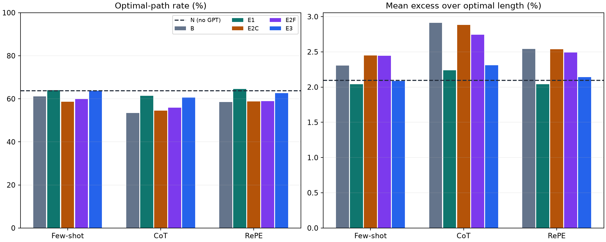
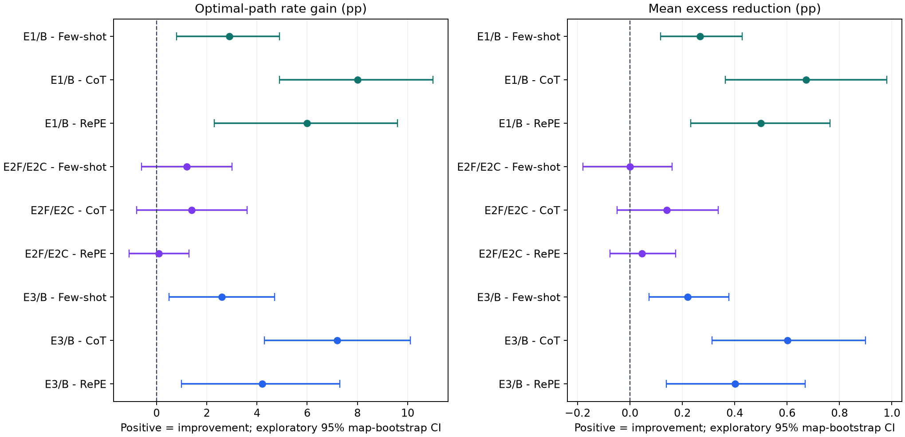

> **현재 평가에서 사용 금지 — 이전 결과 폐기**
>
> 2026-10-28 정정: 이 문서의 이전 SM 실험 수치와 선정 결론은 현재 평가 근거로 폐기되었습니다. 현재 유효한 S1~S6 결과는 GM 기준·Python 3.11 재실험입니다. 과거 기록은 추적을 위해서만 보존합니다.
> [현재 공식 결과](../../gm_retest_20261028/results/s1_s6_gm_20261028/report.md)

---

# 최단 경로 정확도 및 초과 길이 보조 분석 보고서

분석일: 2026-10-14 | 기존 GPT 개선 실험의 저장 경로 재분석 | 추가 API 호출 0건

본실험에서는 1번 경유점 정제와 3번 조건부 호출이 기본 LLM-A*보다 최단 경로를 정확히 찾은 비율과 평균 초과 길이를 함께 개선했습니다. 1번의 개선 폭이 더 컸습니다. 다만 지도 확대 평가에서는 이 효과가 유지되지 않아, 모든 환경에서 정확도가 좋아진다고 일반화할 수 없습니다.

| 개선안 | 본실험의 핵심 결과 | 판단 |
| --- | --- | --- |
| 1번 E1 | 최단 경로 일치율 +2.9~8.0%p; 평균 초과율 0.268~0.672%p 감소 | 본실험 정확도 개선 근거가 가장 뚜렷함 |
| 2번 E2F | 동일 호출 대조군 대비 일치율 +0.1~1.4%p; 탐색적 구간은 0 포함 | 본실험의 오류 피드백 고유 효과는 불확실 |
| 3번 E3 | 최단 경로 일치율 +2.6~7.2%p; 평균 초과율 0.219~0.600%p 감소 | 본실험에서 정확도와 호출 효율 동시 개선 |

이 분석은 결과를 확인한 뒤 추가한 사후 보조 분석입니다. 아래 95% 구간은 다중비교를 보정하지 않은 탐색적 구간이며, 사전 등록된 확증 검정이나 새로운 데이터에서의 재현 결과가 아닙니다.

## 1. 분석 대상과 최단 경로 정의

본실험은 100개 지도 × 지도당 10문제 = 1,000문제입니다. 각 개선안은 동일 문제에서 Few-shot·CoT·RePE를 평가했습니다. 확장성 평가는 10개 시작·목표 문제를 1~10배 확대한 100개 조건입니다. 이 10문제는 서로 다른 9개 지도에 속하므로, 100개의 독립 지도로 해석하면 안 됩니다. 개발용 10문제는 본 분석에서 제외했습니다.

최단 경로는 기존 탐색과 동일한 8방향 격자 그래프의 최단 경로입니다. 가로·세로 한 칸 비용은 1, 대각선 한 칸 비용은 √2이며, 기존 경계와 선분 충돌 규칙을 유지했습니다. 연속 공간에서 자유롭게 선분을 연결하는 경로의 최적값을 뜻하지 않습니다.

휴리스틱·GPT 경유점 로직이 없는 별도 Dijkstra 구현으로 본실험 1,000문제와 확장성 100조건의 최적 길이를 계산했습니다. 1,100개 모두 저장된 A* 길이와 일치했습니다. 최단 경로의 좌표열이 달라도 길이가 같으면 성공으로 인정합니다. 부동소수점 오차 허용치는 절대 10⁻⁸, 상대 10⁻¹⁰입니다.

대상 방법은 A*, 동적 가중 A*(D), GPT 없는 g+2h(N), 기본 LLM-A*(B), E1, E2C, E2F, E3입니다. GPT 원출력은 긴 직선 구간이나 비정수 좌표를 포함할 수 있어 격자 최적값과 공정하게 비교할 수 없으므로 제외했습니다. 기존 보고서의 GPT 출력 유효율 평가는 그대로 유지합니다.

| 지표 | 계산 및 분모 |
| --- | --- |
| 최단 경로 일치율 | 유효하고 최적 길이와 같은 경로 수 / 전체 평가 문제 수 × 100 |
| 절대 초과 길이 | 반환 길이 L − 최적 길이 L*; 단위는 격자 좌표 길이이며 미터가 아님 |
| 상대 초과율(%) | 100 × (L − L*) / L* |
| 평균 초과 길이·초과율 | 유효 경로의 문제별 값을 산술평균; 0도 포함 |
| P95 초과율 | 문제별 초과율의 95백분위수; 하위 95%가 이 값 이하 |
| 개선 폭 | 일치율은 실험군−대조군(%p), 초과율 감소는 대조군−실험군(%p) |

모든 대상 최종 경로가 유효해 본실험의 각 조건 분모는 1,000, 확장성은 100입니다. 유효율 100%는 최단 경로 일치율 100%와 다릅니다. 평균 초과율은 기존 보고서의 길이 비율 기하평균과 집계 방식이 다르므로 숫자를 직접 혼용하지 않습니다. 예를 들어 초과율 2.91%→2.24%는 0.67%p 감소입니다.

## 2. 본실험: 최단 경로를 정확히 찾은 비율

| 방법 | Few-shot | CoT | RePE |
| --- | --- | --- | --- |
| B: 기본 LLM-A* | 611/1000 (61.1%) | 534/1000 (53.4%) | 585/1000 (58.5%) |
| E1: 경유점 정제 | 640/1000 (64.0%) | 614/1000 (61.4%) | 645/1000 (64.5%) |
| E2C: 일반 재검토 | 587/1000 (58.7%) | 545/1000 (54.5%) | 588/1000 (58.8%) |
| E2F: 오류 피드백 | 599/1000 (59.9%) | 559/1000 (55.9%) | 589/1000 (58.9%) |
| E3: 조건부 호출 | 637/1000 (63.7%) | 606/1000 (60.6%) | 627/1000 (62.7%) |

공통 대조군의 일치율은 A* 100.0%, D 93.6%, N 63.7%입니다. D는 기존 재현의 동적 가중치 구현이며 본 분석에서 변경하지 않았습니다. 정확도만 보면 이들 고전 탐색 대조군도 반드시 함께 고려해야 합니다.

## 3. 본실험: 최단 경로 대비 초과 길이

| 방법 | 프롬프트 | 평균 절대 초과 길이 | 평균 초과율 | 중앙값 초과율 | P95 초과율 |
| --- | --- | --- | --- | --- | --- |
| A* | 공통 | 0.0000 | 0.0000% | 0.00% | 0.00% |
| D: 동적 가중 A* (재현 구현) | 공통 | 0.0638 | 0.2472% | 0.00% | 2.15% |
| N: GPT 없는 g+2h | 공통 | 0.7363 | 2.0965% | 0.00% | 9.86% |
| B: 기본 LLM-A* | Few-shot | 0.7894 | 2.3070% | 0.00% | 10.89% |
| B: 기본 LLM-A* | CoT | 1.0160 | 2.9102% | 0.00% | 12.47% |
| B: 기본 LLM-A* | RePE | 0.9080 | 2.5401% | 0.00% | 11.14% |
| E1: 경유점 정제 | Few-shot | 0.7178 | 2.0387% | 0.00% | 9.46% |
| E1: 경유점 정제 | CoT | 0.7793 | 2.2380% | 0.00% | 10.26% |
| E1: 경유점 정제 | RePE | 0.7169 | 2.0404% | 0.00% | 9.48% |
| E2C: 일반 재검토 | Few-shot | 0.8241 | 2.4469% | 0.00% | 11.17% |
| E2C: 일반 재검토 | CoT | 0.9989 | 2.8823% | 0.00% | 12.24% |
| E2C: 일반 재검토 | RePE | 0.9072 | 2.5356% | 0.00% | 11.81% |
| E2F: 오류 피드백 | Few-shot | 0.8285 | 2.4464% | 0.00% | 11.86% |
| E2F: 오류 피드백 | CoT | 0.9698 | 2.7421% | 0.00% | 12.84% |
| E2F: 오류 피드백 | RePE | 0.8921 | 2.4897% | 0.00% | 11.07% |
| E3: 조건부 호출 | Few-shot | 0.7285 | 2.0876% | 0.00% | 10.16% |
| E3: 조건부 호출 | CoT | 0.8141 | 2.3098% | 0.00% | 10.33% |
| E3: 조건부 호출 | RePE | 0.7535 | 2.1393% | 0.00% | 9.98% |

모든 본실험 조건은 절반 이상에서 최단 경로를 찾아 중앙값 초과율이 0%입니다. 따라서 평균과 P95도 함께 봐야 합니다. 일부 조건의 평균 개선이 긴 우회 경로까지 일관되게 줄였다는 뜻은 아닙니다.

## 4. 대응 비교와 탐색적 신뢰구간

동일 문제의 실험군·대조군을 짝지어 비교했습니다. 지도 안의 10문제를 독립으로 가정하지 않고, 100개 지도를 복원추출하는 군집 부트스트랩을 10,000회 수행했습니다(고정 시드 240702512). 표는 백분위 95% 구간이며, 모든 개선 폭은 양수일 때 개선입니다. 지도 구성에 따른 변동을 표현하며 반복 API 호출의 변동까지 추정하지는 않습니다.

| 실험군 / 대조군 | 프롬프트 | 일치율 차이 %p [95% 구간] | 평균 초과율 감소 %p [95% 구간] | 최적 획득 / 상실 문제 수 |
| --- | --- | --- | --- | --- |
| E1 / B | Few-shot | +2.9 [+0.8, +4.9] | +0.2682 [+0.1173, +0.4289] | 61 / 32 |
| E1 / B | CoT | +8.0 [+4.9, +11.0] | +0.6722 [+0.3641, +0.9800] | 157 / 77 |
| E1 / B | RePE | +6.0 [+2.3, +9.6] | +0.4997 [+0.2313, +0.7639] | 168 / 108 |
| E2F / E2C | Few-shot | +1.2 [-0.6, +3.0] | +0.0004 [-0.1801, +0.1611] | 56 / 44 |
| E2F / E2C | CoT | +1.4 [-0.8, +3.6] | +0.1402 [-0.0485, +0.3376] | 53 / 39 |
| E2F / E2C | RePE | +0.1 [-1.1, +1.3] | +0.0459 [-0.0765, +0.1751] | 17 / 16 |
| E3 / B | Few-shot | +2.6 [+0.5, +4.7] | +0.2194 [+0.0720, +0.3776] | 61 / 35 |
| E3 / B | CoT | +7.2 [+4.3, +10.1] | +0.6004 [+0.3137, +0.8990] | 144 / 72 |
| E3 / B | RePE | +4.2 [+1.0, +7.3] | +0.4008 [+0.1381, +0.6690] | 134 / 92 |

E1/B와 E3/B는 세 프롬프트 모두 두 지표의 탐색적 구간이 0보다 큽니다. 이번 데이터에서는 본실험 정확도 개선을 지지하는 결과입니다. E2F/E2C는 두 지표 모두 세 프롬프트에서 구간이 0을 포함하므로, 오류 정보 제공 자체의 효과가 명확하다고 판단하지 않습니다.

비교는 여러 방법·프롬프트·지표에 걸쳐 수행됐고 다중비교 보정을 하지 않았습니다. 따라서 구간의 0 포함 여부를 확정적인 유의성 판정으로 사용하지 않으며, 후속 독립 실험에서 재확인이 필요합니다.

## 5. GPT 없는 대조군과 비교하면 어떤가?

| 개선안 / N | 프롬프트 | 일치율 차이 %p [95% 구간] | 평균 초과율 감소 %p |
| --- | --- | --- | --- |
| E1 | Few-shot | +0.3 [-0.7, +1.3] | +0.0577 |
| E1 | CoT | -2.3 [-3.8, -0.8] | -0.1415 |
| E1 | RePE | +0.8 [-1.1, +2.7] | +0.0561 |
| E3 | Few-shot | +0.0 [-1.0, +1.0] | +0.0089 |
| E3 | CoT | -3.1 [-5.0, -1.2] | -0.2134 |
| E3 | RePE | -1.0 [-3.5, +1.4] | -0.0428 |

E1과 E3가 기본 LLM-A*를 개선했다는 사실과 GPT 없는 탐색보다 우수하다는 주장은 구분해야 합니다. N 대비 우위를 일관되게 보이지 않았으며, CoT에서는 일치율이 오히려 낮았습니다. E1의 결과는 부정확한 경유점의 영향을 줄인 효과와 부합하지만, 그 기여를 분리하는 추가 실험 없이 단일 원인으로 확정하지 않습니다.

## 6. 지도 확대 평가: 개선이 그대로 유지되는가?

| 방법 | 최단 경로 일치율 | 평균 절대 초과 길이 | 평균 초과율 | P95 초과율 |
| --- | --- | --- | --- | --- |
| A* | 100/100 (100.0%) | 0.0000 | 0.0000% | 0.00% |
| N: GPT 없는 g+2h | 37/100 (37.0%) | 9.1674 | 5.0155% | 25.78% |
| B: 기본 LLM-A* | 41/100 (41.0%) | 6.3094 | 3.1233% | 8.92% |
| E1: 경유점 정제 | 40/100 (40.0%) | 7.0175 | 3.5639% | 8.88% |
| E2C: 일반 재검토 | 38/100 (38.0%) | 5.0234 | 2.4172% | 8.87% |
| E2F: 오류 피드백 | 40/100 (40.0%) | 3.8957 | 2.0950% | 7.46% |
| E3: 조건부 호출 | 41/100 (41.0%) | 6.2619 | 3.6679% | 25.41% |

E1은 기본 대비 최단 경로 일치율이 41%→40%로 낮아졌고 평균 초과율은 3.1233%→3.5639%로 증가했습니다. E3는 일치율이 41%로 같고 평균 초과율은 3.6679%로 증가했습니다. 본실험의 정확도 개선이 확대 조건에서도 유지된다는 증거는 없습니다.

E2F는 E2C 대비 일치율이 38%→40%, 평균 초과율이 2.4172%→2.0950%로 개선됐습니다. 이 부분은 추가 검증할 가치가 있습니다. 다만 10문제를 반복 확대한 작은 표본이며 같은 문제의 배율 조건들은 독립이 아닙니다. 확장성 집계에는 독립 100표본을 가정한 유의성 검정을 적용하지 않았습니다.

E3의 평균 절대 초과 길이는 기본보다 조금 작지만 평균 상대 초과율은 더 큽니다. 절대 길이와 문제별 최단 길이로 정규화한 상대 비율은 가중 방식이 달라 반대 방향일 수 있습니다. 배율별 세부 결과는 별도 CSV로 제공합니다.

## 7. 예시 중복 제외 분석과 해석 범위

| 비교 | Few-shot 일치율 차이 | CoT 일치율 차이 | RePE 일치율 차이 |
| --- | --- | --- | --- |
| E1/B | +2.91%p | +8.04%p | +5.93%p |
| E2F/E2C | +1.21%p | +1.41%p | +0.10%p |
| E3/B | +2.71%p | +7.24%p | +4.12%p |

프롬프트 예시와 중복되는 5문제를 모든 조건에서 공통 제외한 995문제에서도 결론의 방향은 유지됐습니다. E1/B·E3/B의 두 지표 구간은 0보다 크고 E2F/E2C 구간은 0을 포함했습니다. 이는 예시 중복에 대한 민감도 확인이며, 새로운 미관측 데이터 검증은 아닙니다.

원래 실험의 모델·프롬프트·경로·탐색 구현은 그대로 사용했습니다. 원래 실험에서 있었던 Windows→Linux 호스트 변경, 크레딧 중단, E3 캐시 재생의 실행 순서 예외도 이 자료에 그대로 적용됩니다. 원래 실험의 한계가 이번 보조 분석으로 해소되는 것은 아닙니다.

과제의 정확도 관련 핵심 결과는 “E1과 E3가 기존 LLM-A* 대비 본실험의 최단 경로 일치율과 평균 초과 길이를 개선했다”로 제시할 수 있습니다. 동시에 “GPT 없는 대조군을 일관되게 능가하지 못했고, 지도 확대 조건에서는 정확도 개선이 유지되지 않았다”는 범위를 함께 제시해야 합니다. E2F의 확대 조건 초과 길이 개선은 후속 연구 후보입니다.

## 8. 검증 및 재현 자료

| 항목 | 검증 결과 |
| --- | --- |
| 최단 길이 독립 검증 | 1,100문제/조건, 저장 A*와 불일치 0건 |
| 최종 격자 경로 검증 | 본실험 18,000행 + 확장성 700행 = 18,700행 |
| 충돌 규칙 대조 | 1,577,336개 간선 대조 통과; 본실험 크기는 전체, 큰 지도는 결정적 표본 대조 |
| 부동소수점 최대 기준 차이 | 1.93e-12 |
| 원자료 무결성 | ZIP SHA-256, 분석 대상 rows.json 해시, 고정 코드·데이터 해시 확인 |
| 새 API 호출 | 0건; 저장 경로의 보조 지표 계산만 수행 |

- [본실험 지표 CSV](../../results/path_accuracy/main_summary.csv)
- [본실험 대응 비교 및 95% 구간 CSV](../../results/path_accuracy/main_paired_comparisons.csv)
- [본실험 문제별 결과 CSV](../../results/path_accuracy/main_per_case.csv)
- [확장성 지표 CSV](../../results/path_accuracy/scaling_summary.csv)
- [배율별 확장성 CSV](../../results/path_accuracy/scaling_by_factor.csv)
- [확장성 문제별 결과 CSV](../../results/path_accuracy/scaling_per_case.csv)
- [예시 중복 제외 지표 CSV](../../results/path_accuracy/main_without_demo_overlap.csv)
- [예시 중복 제외 대응 비교 CSV](../../results/path_accuracy/paired_without_demo_overlap.csv)
- [Dijkstra 최적 길이 참조 CSV](../../results/path_accuracy/optimal_reference.csv)
- [분석 설정·무결성 기록](../../results/path_accuracy/analysis_manifest.json)
- [전체 분석 JSON](../../results/path_accuracy/analysis.json)
- [분석 코드](../../reproduction/analyze_path_accuracy.py)
- [기존 실험 보고서](../../results/improvements_final/report.md)

원자료 ZIP SHA-256: 081b8c1faba8f87aa458d23db63935f13406c523d8a02e25caf382914750b836

원래 실험 프로토콜 서명: a9fe04a39cc82e046089b45b42cdcc6d16ca819293f864a0445f5f58fbc62f53
