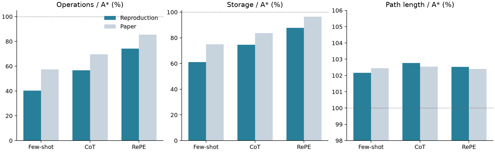
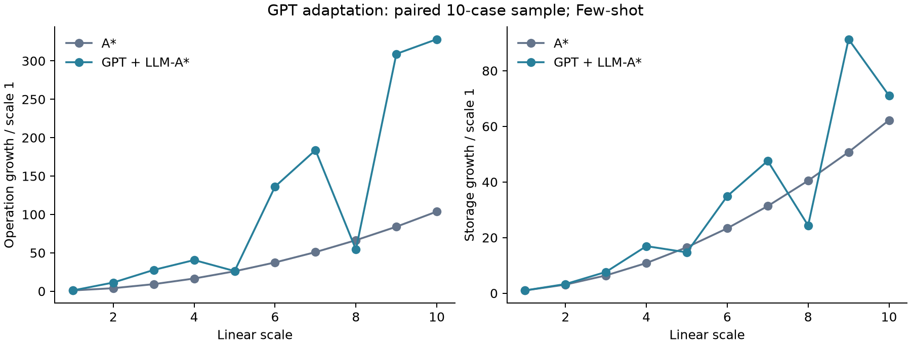
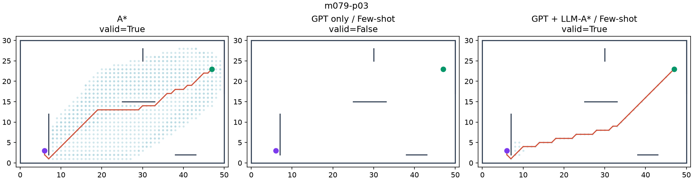
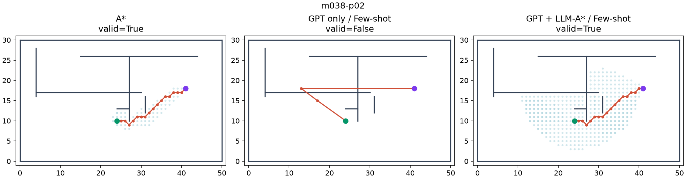
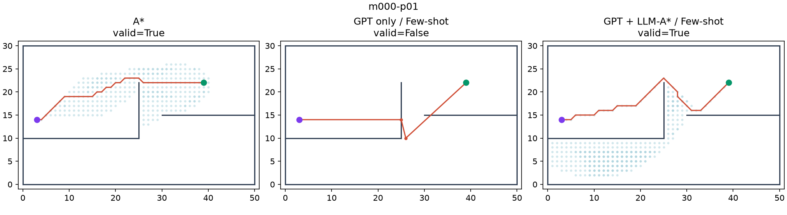

> **현재 평가에서 사용 금지 — 이전 결과 폐기**
>
> 2026-10-28 정정: 이 문서의 이전 SM 실험 수치와 선정 결론은 현재 평가 근거로 폐기되었습니다. 현재 유효한 S1~S6 결과는 GM 기준·Python 3.11 재실험입니다. 과거 기록은 추적을 위해서만 보존합니다.
> [현재 공식 결과](../../gm_retest_20261028/results/s1_s6_gm_20261028/report.md)

---

# LLM-A\*: GPT API 재현 결과

상태: 본 실험 1,000문제·8조건 완료. 이 보고서는 완료된 GPT 기반 8개 조건을 다룹니다.

**3,000** 본 실험 API 응답

**8,000** 평가 결과 행

**$1.9407** 전체 토큰 요금 추정

## 실험 조건

요청 모델 gpt-3.5-turbo-0125, 반환 모델 gpt-3.5-turbo-0125. temperature=0, max\_tokens=1000, 프롬프트당 1회 생성. Few-shot 5-shot, CoT/RePE 3-shot. 동일 응답을 GPT 단독 및 LLM-A\*에 공유했습니다. 학습·파인튜닝은 수행하지 않았습니다.

저자 데이터 100개 지도 × 10개 시작·목표 쌍 = 1,000문제. 범위 \[0,51\]×\[0,31\]은 저자 코드에 따라 경계 좌표 0~50, 0~30으로 해석했습니다. 8방향 이동과 유클리드 비용, 경계 접촉·장애물 선분 교차를 충돌로 처리했습니다.

저장소 고정 커밋: `9414ed894d774f71c36e8c0afd0e20e6033b95b1`. 요청·응답·사용량·요청 ID·프롬프트 해시를 저장했습니다.

## Table 1 비교

각 셀의 큰 숫자는 이번 결과, 작은 숫자는 논문 값입니다. 연산·저장·길이는 문제별 A\* 대비 비율의 기하평균입니다. 길이의 주 통계는 유효 경로만 포함합니다. CSV에는 파싱 가능한 모든 경로의 길이 통계와 각 분모도 함께 제공합니다. 논문의 실패 경로 길이 집계 규칙은 명확하지 않아 직접 수치 비교에 한계가 있습니다.

| 조건 | Operation % ↓ | Storage % ↓ | Length % ↓ | Valid % ↑ | 유효 경로 |
| --- | ---: | ---: | ---: | ---: | ---: |
| A\* | 100.00<br><small>논문 100.00</small> | 100.00<br><small>논문 100.00</small> | 100.00<br><small>논문 100.00</small> | 100.00<br><small>논문 100.00</small> | 1000/1000 |
| Dynamic weighted A\* (reconstructed) | 60.90<br><small>논문 60.91</small> | 78.52<br><small>논문 78.53</small> | 100.24<br><small>논문 100.24</small> | 100.00<br><small>논문 100.00</small> | 1000/1000 |
| GPT only<br><small>Few-shot</small> | —<br><small>논문 —</small> | —<br><small>논문 —</small> | 106.97<br><small>논문 119.38</small> | 6.90<br><small>논문 12.80</small> | 69/1000 |
| GPT only<br><small>CoT</small> | —<br><small>논문 —</small> | —<br><small>논문 —</small> | 131.10<br><small>논문 151.73</small> | 11.00<br><small>논문 15.20</small> | 110/1000 |
| GPT only<br><small>RePE</small> | —<br><small>논문 —</small> | —<br><small>논문 —</small> | 168.00<br><small>논문 183.87</small> | 11.40<br><small>논문 7.80</small> | 114/1000 |
| GPT + LLM-A\*<br><small>Few-shot</small> | 40.29<br><small>논문 57.39</small> | 61.20<br><small>논문 74.96</small> | 102.17<br><small>논문 102.44</small> | 100.00<br><small>논문 100.00</small> | 1000/1000 |
| GPT + LLM-A\*<br><small>CoT</small> | 56.62<br><small>논문 69.50</small> | 74.64<br><small>논문 83.65</small> | 102.77<br><small>논문 102.54</small> | 100.00<br><small>논문 100.00</small> | 1000/1000 |
| GPT + LLM-A\*<br><small>RePE</small> | 74.10<br><small>논문 85.47</small> | 87.78<br><small>논문 96.53</small> | 102.53<br><small>논문 102.41</small> | 100.00<br><small>논문 100.00</small> | 1000/1000 |

Few-shot 결합은 A\* 대비 연산량 40.29%, 저장량 61.20%, 경로 길이 102.17%, 유효 경로 100.00%였습니다. 탐색량 감소와 경로 길이의 소폭 증가라는 경향은 관찰됐지만, 모델·생성 설정 차이가 있어 논문 수치의 완전한 일치로 해석하지 않습니다.



## 논문·공개 코드와 달라진 점

- 논문은 GPT-3.5-Turbo로 기재했지만 공개 코드의 경유점 생성은 Turbo-Instruct입니다. 이번에는 논문에 명시된 모델 계열의 고정 스냅샷과 Chat Completions를 사용했습니다. 당시 저자가 호출한 정확한 스냅샷은 확인되지 않았습니다.

- 원문 프롬프트를 단일 user 메시지로 전달했습니다. 공개 코드의 stop=\[줄바꿈\] 설정은 개발 문제에서 CoT/RePE 최종 경로 출력을 차단하여 제외했습니다. 비교 응답 3건을 별도로 보존했습니다.

- 공개 구현은 호출자 입력 범위를 변경하므로 독립적인 데이터 구조로 실행했습니다. 탐색 우선순위, 중복 힙 pop, 목표 전환, 경유점 필터, operation 및 storage 집계는 보존했습니다.

- 공개 Dynamic Weighted A\* 구현을 찾지 못했습니다. w=max(1,2×0.99^k), k=pop 횟수, 매 확장 후 OPEN 우선순위 재계산으로 구성한 비교군입니다. 논문과 완전히 같은 구현이라고 주장하지 않습니다.

- 파싱 실패는 별도 기록하며, 빈 경유점은 저자 방식대로 시작·목표만 넣어 탐색합니다. 이 경우 우선순위가 g+2h가 되어 일반 A\*와 다릅니다. 실패 응답을 성공할 때까지 재생성하지 않았습니다.

- 연산량은 중복을 포함한 heap pop 횟수, 저장량은 g 딕셔너리 항목 수입니다. 실제 지연 시간·RAM 측정치가 아니며 실행 시간에는 충돌 캐시 영향이 있어 속도 우위를 주장하지 않습니다.

## 경유점 실패와 추가 진단

Few-shot: 경로 목록 추출 실패 187/1000건; CoT: 경로 목록 추출 실패 1/1000건; RePE: 경로 목록 추출 실패 6/1000건. GPT가 실제로 가능한 문제에 “No path found”라고 답한 경우도 포함합니다. 본 실험에서 출력 상한으로 종료된 응답은 6건이며, 그대로 보존하고 다시 생성하지 않았습니다.

시작·목표만 남은 경유점 목록의 수: {"Few-shot": 508, "CoT": 95, "RePE": 39}. 파싱 실패 외에 필터링이나 GPT가 시작·목표만 생성한 경우도 포함합니다. GPT의 경유점 없이 g+2h만 사용한 추가 비교군은 연산량 34.32%, 저장량 56.23%, 경로 길이 102.02%, 유효 경로 100.00%였습니다. 이 비교군은 논문 Table 1에 없는 진단용 실험이며 추가 API 호출 없이 실행했습니다. 따라서 A\* 대비 효율 향상을 전부 GPT의 경유점 품질에 귀속하지 않습니다.

## 프롬프트 예시 중복 제외 분석

저자 데이터에 예시와 정확히 겹치는 문제 5개가 있습니다: m000-p00, m002-p00, m003-p00, m004-p00, m005-p00. 원본 1,000개를 유지한 주 실험 외에 세 프롬프트에서 이 문제들의 합집합을 공통으로 제외했습니다.

| 조건 | Operation % ↓ | Storage % ↓ | Length % ↓ | Valid % ↑ | 유효 경로 |
| --- | ---: | ---: | ---: | ---: | ---: |
| A\* | 100.00<br><small>논문 100.00</small> | 100.00<br><small>논문 100.00</small> | 100.00<br><small>논문 100.00</small> | 100.00<br><small>논문 100.00</small> | 995/995 |
| Dynamic weighted A\* (reconstructed) | 60.84<br><small>논문 60.91</small> | 78.48<br><small>논문 78.53</small> | 100.24<br><small>논문 100.24</small> | 100.00<br><small>논문 100.00</small> | 995/995 |
| GPT only<br><small>Few-shot</small> | —<br><small>논문 —</small> | —<br><small>논문 —</small> | 107.65<br><small>논문 119.38</small> | 6.53<br><small>논문 12.80</small> | 65/995 |
| GPT only<br><small>CoT</small> | —<br><small>논문 —</small> | —<br><small>논문 —</small> | 131.89<br><small>논문 151.73</small> | 10.85<br><small>논문 15.20</small> | 108/995 |
| GPT only<br><small>RePE</small> | —<br><small>논문 —</small> | —<br><small>논문 —</small> | 170.63<br><small>논문 183.87</small> | 11.16<br><small>논문 7.80</small> | 111/995 |
| GPT + LLM-A\*<br><small>Few-shot</small> | 40.29<br><small>논문 57.39</small> | 61.20<br><small>논문 74.96</small> | 102.17<br><small>논문 102.44</small> | 100.00<br><small>논문 100.00</small> | 995/995 |
| GPT + LLM-A\*<br><small>CoT</small> | 56.60<br><small>논문 69.50</small> | 74.66<br><small>논문 83.65</small> | 102.78<br><small>논문 102.54</small> | 100.00<br><small>논문 100.00</small> | 995/995 |
| GPT + LLM-A\*<br><small>RePE</small> | 74.30<br><small>논문 85.47</small> | 87.94<br><small>논문 96.53</small> | 102.54<br><small>논문 102.41</small> | 100.00<br><small>논문 100.00</small> | 995/995 |

## 예비 실험

본 평가와 분리한 합성 문제 10개로 검증했습니다. 예비 실험 결과로 평가 데이터의 프롬프트 내용을 튜닝하지 않았습니다.

| 조건 | Operation % ↓ | Storage % ↓ | Length % ↓ | Valid % ↑ | 유효 경로 |
| --- | ---: | ---: | ---: | ---: | ---: |
| A\* | 100.00<br><small>논문 100.00</small> | 100.00<br><small>논문 100.00</small> | 100.00<br><small>논문 100.00</small> | 100.00<br><small>논문 100.00</small> | 10/10 |
| Dynamic weighted A\* (reconstructed) | 16.86<br><small>논문 60.91</small> | 49.08<br><small>논문 78.53</small> | 100.00<br><small>논문 100.24</small> | 100.00<br><small>논문 100.00</small> | 10/10 |
| GPT only<br><small>Few-shot</small> | —<br><small>논문 —</small> | —<br><small>논문 —</small> | 104.66<br><small>논문 119.38</small> | 30.00<br><small>논문 12.80</small> | 3/10 |
| GPT only<br><small>CoT</small> | —<br><small>논문 —</small> | —<br><small>논문 —</small> | 92.72<br><small>논문 151.73</small> | 20.00<br><small>논문 15.20</small> | 2/10 |
| GPT only<br><small>RePE</small> | —<br><small>논문 —</small> | —<br><small>논문 —</small> | 94.25<br><small>논문 183.87</small> | 20.00<br><small>논문 7.80</small> | 2/10 |
| GPT + LLM-A\*<br><small>Few-shot</small> | 15.33<br><small>논문 57.39</small> | 46.95<br><small>논문 74.96</small> | 101.43<br><small>논문 102.44</small> | 100.00<br><small>논문 100.00</small> | 10/10 |
| GPT + LLM-A\*<br><small>CoT</small> | 10.98<br><small>논문 69.50</small> | 41.15<br><small>논문 83.65</small> | 100.35<br><small>논문 102.54</small> | 100.00<br><small>논문 100.00</small> | 10/10 |
| GPT + LLM-A\*<br><small>RePE</small> | 10.67<br><small>논문 85.47</small> | 40.80<br><small>논문 96.53</small> | 100.21<br><small>논문 102.41</small> | 100.00<br><small>논문 100.00</small> | 10/10 |

## 확장성

논문 Figure 3의 Llama 실험을 GPT로 변경한 보조 실험입니다. 고정 시드 240702511로 원본 문제 10개를 선택하고 같은 문제를 1~10배 좌표 확대했습니다. 각 문제의 규모 1 대비 증가율을 계산해 산술평균했습니다. 원문의 정확한 샘플·확대 절차는 제공되지 않아 프로토콜을 명시한 재구성입니다.

규모 10에서 규모 1 대비 연산량 증가율은 A\* 103.74배, GPT LLM-A\* 328.21배였습니다. 이번 GPT 조건에서는 논문의 거의 선형적인 확장성 경향을 재현하지 못했습니다. 각 알고리즘 자신의 규모 1을 분모로 한 수치이므로 두 증가율의 비율을 같은 규모에서의 절대 연산량 비율로 해석하면 안 됩니다.



## 경로 사례

Few-shot 기준 연산량 비율의 최솟값·최댓값 사례 및 GPT 단독 실패 사례를 자동 선택했습니다. 파란 점은 탐색 상태, 빨간 선은 경로, 초록 점은 출발점, 보라 점은 목표점입니다. 대표성 있는 무작위 표본으로 해석하지 않습니다.







## 사용량과 재실행

```json
{
  "pilot": {
    "requests": 30,
    "prompt_tokens": 22830,
    "completion_tokens": 3530,
    "finish_reasons": {
      "stop": 30
    },
    "returned_models": [
      "gpt-3.5-turbo-0125"
    ],
    "estimated_usd": 0.01671
  },
  "main": {
    "requests": 3000,
    "prompt_tokens": 2367240,
    "completion_tokens": 471410,
    "finish_reasons": {
      "stop": 2993,
      "length": 6,
      "content_filter": 1
    },
    "returned_models": [
      "gpt-3.5-turbo-0125"
    ],
    "estimated_usd": 1.8907349999999998
  },
  "scaling": {
    "requests": 100,
    "prompt_tokens": 59060,
    "completion_tokens": 1630,
    "finish_reasons": {
      "stop": 100
    },
    "returned_models": [
      "gpt-3.5-turbo-0125"
    ],
    "estimated_usd": 0.031975
  }
}
```

추정 비용은 입력 $0.50/백만 토큰, 출력 $1.50/백만 토큰으로 계산했습니다. 예비 실험·본 실험·확장성·줄바꿈 비교를 포함하며 실제 청구 내역은 아닙니다. 키는 산출물에 저장하지 않습니다.

## 검증

저자 A\*·LLM-A\*와 15개 문제씩 연산·저장·경로 길이 일치, 20개 문제의 A\*와 Dijkstra 최단거리 일치, 3,000회 기하 충돌 비교 및 퇴화 선분·파싱·경로 검증 테스트를 수행했습니다. 상세 실행 절차는 프로젝트 README를 참고하십시오.

## 출처

[논문 v2](https://arxiv.org/abs/2407.02511v2) · [고정된 저자 코드](https://github.com/SilinMeng0510/llm-astar/tree/9414ed894d774f71c36e8c0afd0e20e6033b95b1) · [OpenAI 요금](https://developers.openai.com/api/docs/pricing)
