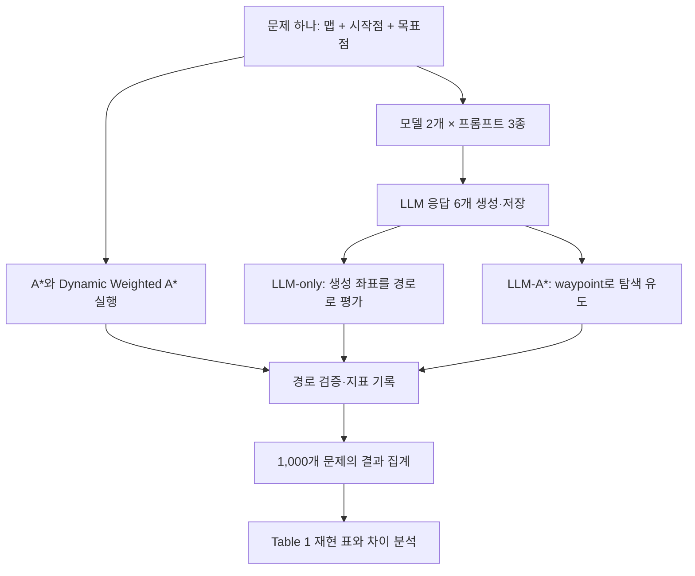

# LLM-A* 논문 재현 과정 설명

정리·갱신일: 2026년 10월 13일. 대화에서 설명한 재현 흐름을 기록한 문서다. 아래 내용은 앞으로 수행할 작업이며 실제 성능 실험을 완료했다는 뜻이 아니다. 세부 실험 규칙과 제출 요건은 [최신 계획서](../LLM-Astar_Project_Plan.md)를 따른다. AI 사용·유사성 검증과 평가 조항은 [과제 지침 대응 문서](과제_지침_대응.md)에서 확인한다.

## 무엇을 재현하는가

같은 길찾기 문제 1,000개를 여러 방법으로 풀고, 경로의 유효성과 탐색 효율을 비교해 논문 Table 1 형태의 결과 표를 만든다. 결과가 논문과 다르면 실제 모델·구현·평가 조건을 근거로 차이를 설명한다.

모델 수는 **2개로 확정**했다. 첫 모델은 **GPT-4o mini**다. 두 번째 모델은 논문의 Llama3 설정과 일치하는 실행 환경을 우선 검토하고, 접근성·예산을 확인해 정확한 이름과 버전을 결정한다. 원 모델을 대체하면 보고서에 이를 명시한다.

최종 조건 수는 다음과 같다.

`공통 기준 알고리즘 2개 + 모델 2개 × 프롬프트 3종 × 사용 방식 2개 = 14개 조건`

여기서 기준 알고리즘은 A*와 Dynamic Weighted A*, 프롬프트는 Few-shot·CoT·RePE, 사용 방식은 LLM-only와 LLM-A*다. 한 모델로 만든 8개 조건은 중간 점검 단계이며 최종 완료 범위는 14개 조건이다.

## 전체 흐름

## 1. 같은 길찾기 문제를 준비한다

원 저장소의 공개 데이터에는 맵 100개가 있고, 맵마다 시작점·목표점 조합이 10개씩 있다. 따라서 총 1,000개 문제다.

각 문제에서 맵 범위, 장애물, 시작점, 목표점을 읽어 모든 방법에 같은 입력을 제공한다. 어떤 방법에만 쉬운 문제를 주거나 실패한 문제를 평가 목록에서 빼지 않는다. 실행 과정에서 원본 입력이 변경되지 않도록 입력 복사와 검증도 준비한다.

이 단계의 결과물은 1,000개 문제를 빠짐없이 읽는 데이터 로더와 문제별 식별자다.

## 2. LLM 없이 탐색과 평가 코드부터 검증한다

A*와 Dynamic Weighted A*를 준비하고, LLM-A*에는 우리가 정한 고정 waypoint를 넣어 동작을 확인한다. 실제 장애물을 피하는지, 목표까지 도달하는지, target이 바뀌면 탐색 순서도 제대로 갱신되는지 살펴본다.

공식 `source_code/`는 비교 기준으로 보존한다. 우리 구현과 다른 동작이 나타나면 첫 차이가 생기는 지점과 이유를 기록한다. 특히 Dynamic Weighted A*는 공식 저장소에 구현이 없으므로 논문이 명확히 제시하지 않은 감쇠 세부 규칙은 구현 가정으로 남긴다.

경로 검증기도 함께 준비한다. 시작·목표 연결, 장애물 충돌, 맵 경계, 허용 이동 규칙을 검사하며 작은 사례는 독립적인 최단 경로 계산과 비교한다. 검증용 정답을 LLM이나 planner의 입력으로 제공하지 않는다.

이 단계에서는 API 비용 없이 탐색·검증·기록·집계의 기본 동작을 확인할 수 있다. 사용자가 한 사례의 g·h·f 계산, target 갱신, 경로 복원을 따라가며 이해할 수 있게 실행 로그를 남긴다.

## 3. 실제 LLM에서 waypoint를 받는다

시작점·목표점·장애물을 텍스트로 표현하고 논문의 프롬프트를 적용한다.

- **Few-shot:** 경로 생성 예시를 보여주고 좌표를 생성하게 한다.
- **CoT:** 추론 설명을 포함한 예시를 제공한다.
- **RePE:** 경로 제안·평가·수정 과정을 프롬프트에 포함한다. 원 코드에서는 별도의 환경 피드백 루프를 반복 실행하는 방식이 아니다.

문제 하나에 모델 2개와 프롬프트 3종을 적용하므로 기본 응답은 6개다. 원문 응답, 요청한 모델과 응답 모델 ID, 생성 설정, 종료 이유, 토큰 사용량과 지연을 저장한다. 좌표 추출 실패도 기록한다.

원 프롬프트의 예시와 내용을 먼저 보존하고, API 호환을 위한 변경은 문서화한다. 자동 재질문이나 좌표 보정으로 성공률을 높이는 변형은 원 재현과 별도로 취급한다.

## 4. 같은 응답을 두 방식으로 사용한다

LLM 응답 하나를 LLM-only와 LLM-A*에 각각 사용한다. 원문 응답은 같지만 각 방식의 파싱·후처리 결과는 구분해 저장한다.

**LLM-only**에서는 생성 좌표들을 연결한 경로 자체를 평가한다. 장애물을 통과하거나 목표까지 연결되지 않는다면 그 실패도 기록한다. A*로 경로를 고친 뒤 LLM-only 결과로 넣지 않는다.

**LLM-A***에서는 응답에서 얻은 waypoint를 안내로 사용해 실제 탐색을 수행한다. 최종 goal은 처음부터 끝까지 같고 waypoint는 탐색 우선순위에 영향을 준다. 최종 경로가 모든 waypoint를 반드시 통과할 필요는 없다.

기본 점수는 `f(n) = g(n) + d(n, goal) + d(n, target)`이다. waypoint까지의 거리는 실제로 이동한 거리 g에 더하는 값이 아니라 후보 노드를 고르는 우선순위에 들어간다. target 변경 때 OPEN의 점수를 다시 계산한다. 세부 전환 조건은 [Waypoint 문답](../review/WAYPOINT_QA.md)을 참고한다.

응답 6개를 두 방식으로 사용하므로 LLM 관련 평가 조건은 12개다. 여기에 A*와 Dynamic Weighted A*의 2개 조건을 더해 총 14개가 된다. 같은 응답을 사용하면 두 방식에 서로 다른 LLM 응답이 들어가서 생기는 차이를 줄일 수 있다.

## 5. 소규모 파일럿을 거쳐 전체 실험으로 확대한다

서로 다른 맵에서 30개 문제를 먼저 고정한다. GPT-4o mini로 점검한 뒤 두 번째 모델에도 같은 문제를 적용한다. 두 모델의 기본 생성 횟수는 `30 × 2 × 3 = 180회`다.

좌표를 제대로 읽는지, 여러 줄 응답이 잘리지 않는지, 실패 기록과 비용 계산이 맞는지 확인한다. 이때 API 접근 여부와 비용 한도를 확정하고 호출·토큰·재시도 상한을 설정한다. 통신 오류의 제한된 재시도와 좋지 않은 경로를 다시 생성하는 실험은 구분한다.

파일럿에서 확인한 문제를 해결한 뒤 모델·프롬프트·파싱·실패 처리·집계 설정을 고정하고 전체 1,000개로 확대한다. 전체 기본 생성은 `1,000 × 2 × 3 = 6,000회`다. 설정이 동일한 파일럿 응답은 이 6,000회에 포함해 재사용할 수 있다. 재시도, 설정 변경, 추가 반복 생성은 별도다. 로컬 모델을 사용하면 해당 생성 횟수와 유료 API 요청 수를 구분한다.

응답을 저장해 두면 API를 다시 호출하지 않고 탐색·평가·표 생성을 재실행할 수 있다. 저장 응답의 재생은 독립적인 LLM 반복 생성 실험과 구분한다.

## 6. 경로를 검증하고 Table 1을 만든다

각 결과의 경로 유효성을 확인하고 논문의 정의에 맞춰 operation·storage·경로 길이·유효 경로 비율을 기록한다. LLM-only에는 탐색이 없다는 차이도 반영하고, 각 방법에서 정의되는 지표를 명확히 구분한다.

원 탐색 코드의 operation은 큐에서 꺼낸 횟수이며 중복 추출이 포함된다. storage는 g 사전의 항목 수이므로 실제 메모리 바이트와 같지 않다. 실제 시간·메모리와 관련된 보조 지표는 원 지표와 별도로 기록한다.

가상의 예로, 한 문제에서 A*의 operation이 1,000이고 LLM-A*가 400이라면 그 문제에서는 A* 대비 40%를 사용한 것이다. 감소량으로는 60%다. 이 예시는 계산을 설명하기 위한 값이며 실제 실험 결과가 아니다.

상대 지표는 같은 문제의 A* 대비 비율을 먼저 구하고, 정의되는 양수 비율을 기하평균으로 집계한다. 유효 경로 비율은 전체 평가 사례를 기준으로 별도로 계산한다. 실패·0거리 등 비율을 정의할 수 없는 경우에는 임의의 0이나 작은 수를 넣지 않고 상태와 적용 사례 수를 표시한다.

최종 표는 14개 행 각각이 같은 1,000개 문제를 평가한 결과다. 실패 유형과 유효 사례 수도 함께 남긴다. 해결되지 않은 API 장애가 있으면 해당 생성 조건은 미완료로 표시한다.

## 7. 숫자가 나온 이유를 분석한다

논문 수치와 우리 수치를 나란히 비교한다. 모델 대체, 구현 가정, waypoint 품질, 파싱·필터 동작 등이 차이에 어떤 영향을 주었는지 실제 코드와 로그로 설명한다.

추가 진단에서는 LLM waypoint를 사용하는 경우와 target을 goal로 고정해 `f=g+2h`로 탐색하는 경우를 비교한다. 이렇게 하면 탐색 감소 중 LLM의 방향 정보가 기여하는 부분을 살펴볼 수 있다. 이 대조군은 원 Table 1의 Dynamic Weighted A*와 별도다.

실패 사례, OPEN 재계산 비용, 실제 탐색 시간, LLM 지연·비용, 프롬프트 예시와 평가 데이터의 중복도 분석한다. 추가 진단 결과는 주 재현 표와 구분한다. 이후 반복해서 확인된 한계를 개선 알고리즘 설계의 근거로 사용한다.

## 재현이 끝났을 때 남는 결과물

- 전체 실행 코드와 모델·프롬프트·실험 설정.
- 원문 LLM 응답과 생성 기록.
- 문제별 실제 경로, 유효성, 지표와 실패 이유.
- 원 논문 수치와 비교한 Table 1 재현 표.
- 대표 성공·실패 경로 그림과 원인 분석.
- 논문·공식 코드·우리 구현의 차이와 가정 목록.
- 설치 의존성, 새 응답 생성 및 저장 응답 재생 방법을 담은 README.

팀원 3명은 각자 전체 재현을 수행한다. 이후 결과와 보고서의 완성도를 비교해 팀 제출의 기반이 될 버전을 선택하고, 선택한 코드·설정·실험 기록·보고서가 일치하도록 정리한다.

바로 다음 작업은 데이터 로더·탐색 코드·경로 검증기를 준비하고 고정 waypoint로 한 문제의 실행을 끝까지 따라가는 것이다. 재현 이후에는 과제의 필수 요구인 자체 개선 알고리즘과 비교 실험을 이어서 수행한다.

## 근거 자료

- [과제 안내서](<../materials/SWE3011_41 Assignment Notice (1).pdf>)
- [논문](../materials/인지개과제_논문.pdf)
- [공식 원본 코드](../source_code/README.md)와 [출처 기록](../UPSTREAM.md)
- [논문 리뷰](../review/PAPER_REVIEW.md), [코드 리뷰](../review/CODE_REVIEW.md)
- [최신 재현·개선 계획서](../LLM-Astar_Project_Plan.md)
